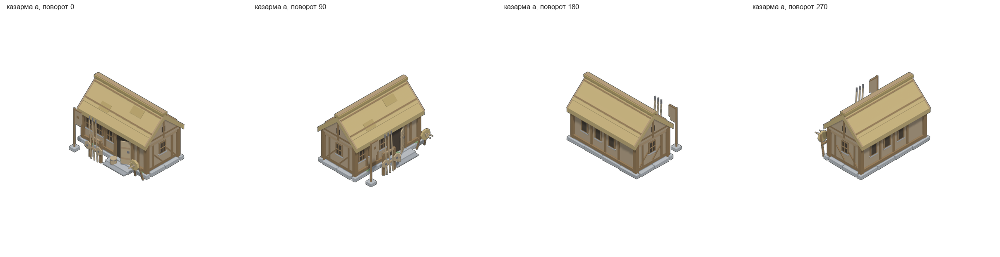
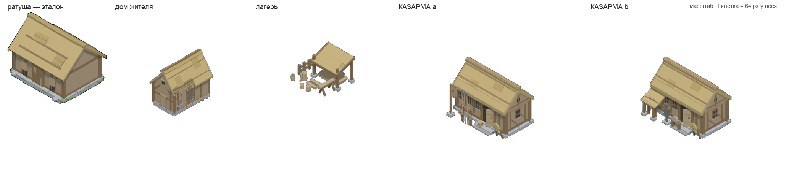
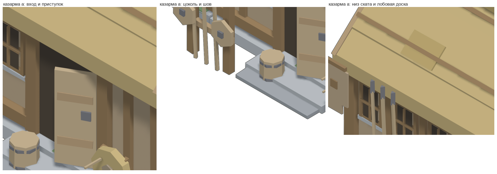

# Казарма (4 x 3) — четвёртая постройка деревни

Длинное служебное здание, где живёт гарнизон, и двор, где он строится.
Пятно **4 x 3 клетки** (X — длина, Y — глубина, перед в `+Y`, как у всех
построек игры). При `FACE_ROT = 90` на карте встаёт 3 x 4 — ровно как ратуша.

Собрана по скиллу `4tox-building-forge` (метод), канон формы — `4tox-house-3d`,
стиль и гейт — `4tox-lowpoly-3d`, приёмка — `3d-model-acceptance`.
Сцена Blender `barracks`, префикс имён `br_`, кадр 96 ppu (истинная изометрия,
азимут 45°, подъём 35.2644°).

**Два варианта, как просил заказчик:**

| Вариант | Двор | Силуэт |
|---|---|---|
| **a** — открытый плац | стойка с тремя копьями и двумя щитами, столб со знаменем, мишень со стрелами, кадка у крыльца | чистый длинный скат |
| **b** — двор с навесом | навес на двух столбах, под ним стойка с мечами; стойка для брони, точильный камень, мишень | низкая пристройка слева спереди |

**В игре с 2026-10-20.** Заказчик сначала просил только модель и атлас, а потом
добавил её в меню построек игры — вариантом **A** (открытый плац), за 28 брёвен.
В движке это тип `barracks` (`mapgen2/js/buildings.js`: `TYPES`), атлас грузят
обе оболочки, а строка меню и покупка живут в `game/js/play.js` (`BUILD_MENU`).
Вариант B в меню не предлагается, но атлас и тип его знают: вариант — поле
постройки, а не отдельный тип. Приёмки — `node mapgen2/tools/place.js` и
`node game/tools/menu.js` (раздел «стройка»).

**С 2026-10-22 в казарме не нанимают, а тренируют.** Свободный житель идёт ко
входу, заступает на территорию казармы, растворяется в дверях, пять секунд
учится и выходит воином — и уходит в военный лагерь. Пока идёт и учится, он
обычный житель; воинский атлас включается в кадр выхода. Поэтому у казармы
больше нет рабочих мест (`Buildings.workSlots = 0`), а есть тренировочные
(`Buildings.trainingSlots = 3`), и нет двора для рабочих. Вход считает
`Buildings.entrance`: дверь в модели стоит не по середине фасада, и при любом
повороте житель идёт именно к ней. Приёмки механики — `node
mapgen2/tools/game.js` (все четыре поворота, пять секунд, растворение, выход
воином) и `node game/tools/menu.js` (панель «Тренировать»).

## Числа (последний прогон)

| | |
|---|---|
| Пятно | **4 x 3** клетки; крупность `mul = siteMul(4) = 0.7667` (как у ратуши) |
| Стены | 3.600 x 1.780; высота стен 1.40 (верх 1.55) |
| Ярусы | цоколь 0.15 · стены 1.40 · конёк 2.46 (низ кровли) · верх 2.82 |
| Уклон ската | **43.0°** (канон 32..55; у ратуши 40.6 — см. «отличия») |
| Свесы | по скату **12 %** ширины стены, по торцу **4 %** длины (канон 11..31 / 4..13) |
| Габарит | 4.011 x 2.936 x 2.822 юнита (в пятне 4 x 3, запас 0.03) |
| Основание (цоколь + приступок + плац) | 4.01 x 2.84 юнита → **3.08 x 2.18 клетки** на карте |
| Зазор до кромок | **0.462** (длинная сторона) и **0.411** (короткая) клетки |
| Середина основания | смещение **0.000..0.025 юнита** = 0.000..0.019 клетки (порог 0.05) |
| Полигонаж | **a — 1434**, **b — 1398** трис (бюджет 300..1500, цель 1100..1450) |
| Деталей | a — 164, b — 162 |
| Материалы | **12** плоских красок ратуши, все 12, ни одного нового |
| Кадр | 512 x 640 при 96 ppu, 2 варианта x 4 поворота; @4x — 2048 x 2560 при 384 ppu |

## Что взято у кого: стилевой контракт

Образец — **ратуша из игры** (`mapgen2/assets/townhall`), единственная постройка,
которую заказчик назвал идеальной. Рядом — дом жителя (`starter_house`, тот,
что стоит в игре) и лагерь лесоруба (`lumbercamp`).

| Что | Ратуша (эталон) | Дом жителя | Лагерь | **Казарма** |
|---|---|---|---|---|
| **Цвет** | 12 плоских красок (`townhall/tools/thpal.py`) | те же 12 (`thpal.json`) | те же 12, разложены по зонам (`village.py`) | те же 12, дословно (`tools/paint.py`), все зоны ратуши |
| **Цоколь** | ряд валунов по периметру, мох, забутовка `stone2` | ряд валунов, **не досложен** (2 вынуты) | 4 камня под столбами навеса | ряд из 14 валунов по периметру, 3 пятна мха, тёмный шов; приступок **перед** цоколем |
| **Каркас** | стойки 0.18, обвязки 0.13..0.15, раскосы | каркас с обмазкой, панель без обмазки | столбы 0.12 + прогоны | стойки 0.17, нижняя обвязка 0.14, верхняя 0.165, стойки 0.10, раскосы 45° на торцах |
| **Кровля** | солома плоскостью, 2 слеги, 2 заплаты, конёк с провисом | солома, пласты | тёс рядами на односкатном навесе | солома плоскостью, нижний пласт с набегом 0.022, 2 слеги на скат, 2 заплаты, **ровный** конёк, лобовые доски |
| **Проёмы** | 0.34 x 0.70, тёмное нутро, доски-ставни | окна со ставнями, дощатая дверь | нет (двор без стен) | 0.26 x 0.46: тёмное нутро, наличник, переплёт 1 x 2, каменная полка; дверь с порталом, полотно приоткрыто на 30° |
| **Двор** | у B: крыльцо, плетень, кадка | штабель брёвен, вязанка соломы | рабочий двор: поленница, колода с топором, козлы, пни | **плац**: стойка с копьями и щитами, знамя, мишень со стрелами, кадка (a); навес, стойка с мечами, стойка для брони, точильный камень, мишень (b) |

Что взято **не было**: колокольня и фонарь ратуши (запрещены условием), три
варианта (у казармы их два), провис конька (по условию конёк ровный),
крыльцо-навес ратуши (у казармы дверь с приступком).

## Чем проверено

| Проверка | Результат | Файл |
|---|---|---|
| Канон пропорций, габарит, бюджет, нормали — вариант a | **ИТОГ: ПРИНЯТО**, замечаний 0 | `acc/canon-a.txt` |
| То же, вариант b | **ИТОГ: ПРИНЯТО**, замечаний 0 | `acc/canon-b.txt` |
| Изнанки (6 видов + сетка 32 ракурса), зазоры, z-fighting | **0 px на всех канонных видах**; z-fighting 0 пар; висящих 0 | `acc/xray-a.txt`, `acc/xray-b.txt`, `acc/xray-views.txt` |
| Стиль-гейт 1x, 2 x 4 кадра | **4 строки из 5 PASS, 0 WARN** на каждом; ТЕНЬ падает правилом 2026-10-17 | `acc/style-gate-1x.txt` |
| Стиль-гейт @4x, 2 x 4 кадра | **4 строки из 5 PASS, 0 WARN** на каждом | `acc/style-gate-4x.txt` |
| Гейт по эталонам (дом, лагерь, ратуша) | у всех трёх падает ровно ТЕНЬ | `acc/style-gate-ref.txt` |
| Приёмка `gate.py` по СЦЕНЕ | **GATE: PASS** — 0 провалов, 1 предупреждение | `acc/gate.txt` |
| Посадка в пятно (свои формулы `place.js`) | **ИТОГ: ПРИНЯТО** (зазор 0.462, середина 0.000) | `acc/place.txt` |
| Приёмка размещения в игре (регрессия трёх построек) | «все проверки размещения пройдены» | `acc/place-js.txt` |
| Атлас | 8 кадров, ppu 96, mul 0.7667, пятно 4 x 3 / 3 x 4 | `acc/pack-atlas.txt` |





## Отличия от ратуши (словами)

1. **Длина вместо высоты.** Стены 3.60 x 1.78 против 3.70 x 2.70: корпус тот же
   по длине, но мельче в глубину, а конёк 2.72 против 2.82 у ратуши (и у той сверху ещё фонарь с колоколом). Казарма
   массивнее дома и ниже, спокойнее ратуши.
2. **Уклон 43° против 40.6°.** Круче, потому что корпус узкий: при том же
   подъёме кровли скат лёг бы плоско. Канон соломы (32..55) держится.
3. **Нет колокольни, звонницы и башни** — условие задачи. Вторая вертикаль
   силуэта — знамя во дворе, а не надстройка.
4. **Конёк ровный** (у ратуши провисает): казарма не «недостроена».
5. **Двор — плац**, а не крыльцо с плетнём: копья, щиты, мишень. По нему и
   читается «казарма», а не «дом побольше».
6. **Проёмы мельче** (0.26 x 0.46 против 0.34 x 0.70) и с переплётом 1 x 2:
   окон больше, каждое уже — так читается казарма, а не жильё.
7. **Контур 1.00 px** при 96 ppu. У ратуши 2.00 px, но её кадры 80 ppu; у дома
   жителя и лагеря (те же 96 ppu, тот же `compose.py`) — тоже 1.00.

## Как пересобрать

```bash
PY3=/Users/hermmoment/.dsh/dsh-runtimes/dsh-primary-runtime/dependencies/python/bin/python3
PY=/Users/hermmoment/.dsh/profiles/desktop/node_modules/dsh-blender/.venv/bin/python

$PY3 tools/canon.py --gen tools/barracks.py --variant a      # ИТОГ: ПРИНЯТО
$PY3 tools/canon.py --gen tools/barracks.py --variant b
$PY3 tools/xray.py probe --gen tools/barracks.py --variant a --full
$PY3 tools/xray.py shot renders/prev_a.png --gen tools/barracks.py --variant a

# сборка в УЖЕ ЗАПУЩЕННОМ Blender (сокет аддона blender-mcp, 127.0.0.1:9876)
$PY tools/mcp.py info
$PY tools/mcp.py run tools/build_live.py                     # 2 x 4 кадра, 1x
$PY tools/mcp.py run tools/build_live.py -- --config live_4x.json   # 2 x 4 кадра, @4x

# спрайты (тени у зданий нет — правило 2026-10-17)
for v in a b; do for r in 0 90 180 270; do
  $PY3 tools/compose.py --raw renders/br_${v}_${r}_raw.png --out out/br_${v}_${r}.png \
      --ppu 96 --anchor-raw 256,320 --no-shadow --json out/br_${v}_${r}.json
done; done
# то же для @4x: --ppu 384 --anchor-raw 1024,1280, файлы out/br_<v>_<r>@4x.png

$PY3 tools/pack_barracks.py                                   # атлас в игру
$PY3 tools/place_barracks.py                                  # посадка: ПРИНЯТО
$PY3 tools/sheets.py                                          # листы осмотра

# приёмка по сцене: сначала собрать сцену ПО ДЕТАЛЯМ, потом гейт
$PY tools/mcp.py run tools/build_live.py -- --config live_gate_build.json
$PY tools/mcp.py run tools/run_gate.py
```

Стиль-гейт (16 кадров, два прогона) — команда в `spec.json`, поле
`_style_gate`; выводы лежат в `acc/`.

## Файлы

| файл | что делает |
|---|---|
| `tools/barracks.py` | **ГЕОМЕТРИЯ**: чистый Python, ярусы и раскладка двора. Главный файл |
| `tools/paint.py` | **ПАЛИТРА**: 12 красок ратуши, зона -> краска; новый цвет сюда не добавить |
| `tools/forge.py` | примитивы, отсев невидимых фасетов, триангуляция, палитра |
| `tools/xray.py` | софт-рендер и детектор дефектов; `cam_basis` поправлен (см. REPORT) |
| `tools/canon.py` | приёмка по канону: ярусы, габарит, уклон, свесы, бюджет, нормали |
| `tools/blender_live.py` | материалы, свет, камера, рендер (внутри Blender); `build_object_zones` — покраска зонами, как у ратуши |
| `tools/build_live.py` | точка входа сборки в живом Blender; режим `gate` — деталь = объект |
| `tools/mcp.py` | клиент сокета аддона blender-mcp (снаружи Blender) |
| `tools/compose.py` | сырой кадр -> спрайт: обрезка, контур, опора (`--anchor-raw`, `--no-shadow`) |
| `tools/pack_barracks.py` | 8 кадров -> `mapgen2/assets/barracks/atlas.{png,json,js}` |
| `tools/place_barracks.py` | приёмка посадки теми же формулами, что `mapgen2/tools/place.js` |
| `tools/run_gate.py` | приёмка `gate.py` ПО СЦЕНЕ (не по GLB) |
| `tools/sheets.py` | листы: 4 поворота, крупные планы, «эталон рядом» |

`live_config.json` — 2 варианта x 4 поворота, 96 ppu; `live_4x.json` — то же при
384 ppu; `live_gate_build.json` — сцена для приёмки (деталь = объект).

## Чего в модели нет

Пушек и огнестрела, башен, второго этажа, «стеклянных» окон, мрамора и
черепицы, новых цветов, симметрии-коробки. Двор — не ярмарка: на плацу четыре
предмета, и каждый стоит на земле.
