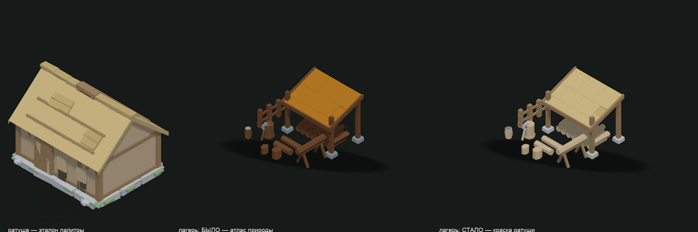

# Лагерь лесоруба — постройка для 4tox/mapgen2

Собран по скиллу `4tox-building-forge`, форма — по `4tox-house-3d`. Сцена
Blender `lumbercamp`, префикс имён `lc_`, кадр 96 ppu (истинная изометрия,
азимут 45°, подъём 35.2644°). **Пятно застройки 3 x 3.**

Задача заказчика: лагерь, откуда житель берёт топор, идёт рубить лес и
складывает дрова обратно.

**Красится краской ратуши.** Заказчик 2026-10-15: «сделай так, чтобы 3D-модель
лагеря лесоруба была в цветовой гамме ратуши, а то он как будто из другого
дерева сделан; в той же палитре пускай будет». Как это сделано и чем доказано —
раздел [«Палитра»](#палитра-лагерь-красится-краской-ратуши) ниже; цвета живут в
`tools/village.py`, палитра для гейта — в `tools/village_palette.json`.

## Что стоит в лагере

| Что | Где | Из чего |
|---|---|---|
| Навес-склад, односкатная кровля 21.1°, тёс рядами | дальняя часть, `-Y` | 4 столба на камнях, 2 прогона, подстилающая плита + 9 досок + 2 лобовые + карнизная |
| **Поленница** — сюда складывают дрова | под навесом | 3 ряда, 18 поленьев, торцы в `+Y` (на камеру) |
| **Колода с топором** — отсюда берут топор | передний двор справа | чурбан 8-гранный Ø0.34 x 0.46, топор прислонён обухом к краю |
| Козлы с бревном (A-опоры, вытянуты вдоль Y) | слева | 4 ноги, жердь, бревно на жерди |
| Пни со спилом (2), брёвна (2), кадка с водой, частокол (4 кола + 2 жерди) | двор | — |

Полигонаж **982 трис** (бюджет класса `building` 300..1500), габарит
2.862 x 2.716 x 1.75, 66 деталей.

Топор — канонной формы (`axe`: рукоять вдоль `+Z`, кромка в `+Y`), укрупнён
против канонного 0.46: при 96 ppu рукоять канонного диаметра — 3 px, и топор
читался светлой щепкой на торце колоды. Кромка у топора **параллельна
рукояти**, поэтому «рукоять вверх и кромка вниз» одной позой недостижимы — на
это ушло три перебора (150°, −35°, +60°), все три прятали рукоять за колоду.
Итог — прислонённый топор, видно и голову, и рукоять.

## Приёмка: чем доказано

| Проверка | Чем | Результат |
|---|---|---|
| Канон пропорций, габарит, бюджет, нормали | `$PY3 tools/canon.py --gen tools/building.py` | **ИТОГ: ПРИНЯТО**, замечаний по нормалям 0 |
| Видимые изнанки (6 видов + 32 ракурса) | `$PY3 tools/xray.py probe --gen tools/building.py --full` | худший кадр 6 px, ни одна деталь не выше порога шума |
| Z-fighting | он же, секция совпадающих плоскостей | **нет пар** |
| Сборка в живом Blender | `$PY tools/mcp.py run tools/build_live.py` | 4 поворота, 982 трис, кадры в `renders/` |
| **Цвет: лагерь в палитре ратуши** | `$PY3 tools/village_check.py` (4 поворота) | **99.53..99.95 %** пикселей в пределах 26 sRGB до цвета из спрайта ратуши, медиана Δ 2.4..7.1 |
| Стиль-гейт 1x (4 поворота) | `audit.py --kind building --palette tools/village_palette.json` | **0 FAIL, 0 WARN** на каждом, ПАЛИТРА 100.0 % |
| Стиль-гейт @4x | он же, `--ppu 384` | **0 FAIL, 0 WARN**, ПАЛИТРА 100.0 % |
| Посадка в пятно 3 x 3 | `$PY3 tools/place_lumbercamp.py` | **ИТОГ: ПРИНЯТО** (см. ниже) |

Посадка по кадрам: зазор до четырёх кромок 0.477..0.529 клетки при пороге
`BASE_MARGIN` = 1/3, середина наземного контура — ровно в середине пятна
(0.000/0.000), силуэт спрайта сходится с проекцией модели в пределах 0.9..2.0 px
(это обводка). Крупность `mul` = **0.7156** = `siteMul(3)` = `fitMul(3) × 0.92`
из `js/buildings.js` — общее правило посадки с поправкой заказчика −8 %,
одинаковой для ратуши, дома жителя и лагеря (2026-10-14: «отступы нижней
площади модели от краёв её площади — такие же, как у ратуши»). Было 0.7778 —
голое правило.

**Что осталось неидеальным.** Основание лагеря — разреженный двор: пятно
контакта с землёй 2.86 x 2.72 клетки в пятне 3 x 3, у ратуши 4.05 x 3.27 в
4 x 3. Поэтому при одном масштабе на обе оси отступ лагеря выходит на 0.03..0.05
клетки больше ратушиного (замер `mapgen2/tools/place.js`: у ратуши
0.400..0.497, у лагеря 0.477..0.529). На зуме игры это 1..3 пикселя. Чинится не
масштабом, а моделью — двор должен занимать пятно плотнее.

## Палитра: лагерь красится краской ратуши

Задача заказчика (2026-10-15): **«сделай так, чтобы 3D-модель лагеря лесоруба
была в цветовой гамме ратуши, а то он как будто из другого дерева сделан; в той
же палитре пускай будет»**.

**Почему было «другое дерево».** Лагерь, как и дом жителя, красился СЕМЕЙСТВАМИ
АТЛАСА ПРИРОДЫ (`mapgen2/assets/sprites/atlas.png`): кровля навеса — `leaf_autumn`,
цвет ОСЕННЕЙ КРОНЫ (#A8701F, насыщенная охра), а столбы, поленница и пни —
`trunk`, цвет КОРЫ (#523521, тёмный шоколад). Ратуша с самого начала красится
своей краской — 12 материалов, снятых с эталона при её сборке
(`townhall/tools/townhall.py::palette()`): приглушённый серо-коричневый каркас,
светлые доски, песочная солома, светлый камень. Отсюда и жалоба.



Слева — ратуша (эталон палитры), в середине — лагерь до правки, справа — после.
Картинка собрана `out/lc_0.png` и атласом ратуши в одном масштабе «одна клетка =
76 px» (`mul` учтён).

**Что сделано.** Детали лагеря разведены не по семействам атласа, а по ЗОНАМ
ПАЛИТРЫ РАТУШИ, и цвет берётся у ратуши ДОСЛОВНО — те же hex, тот же
`roughness 0.75`, тот же `specular 0.12`:

| Зона лагеря | Что это | Краска ратуши |
|---|---|---|
| `timber` | столбы, прогоны, лобовые и карнизная доски, частокол, козлы | `timber` #5E3D1E — силовой каркас |
| `plank` | поленница, колода, топорище, пни, брёвна, клёпки кадки | `plank` #A07C4C — доски, ставни |
| `board`, `board2` | тёс кровли и подстилающая плита под ним | `thatch` #A8823C, `thatch2` #8E6C2C — солома |
| `stone` | опорные камни и голова топора | `stone` #8E9498 — цоколь |
| `iron`, `dark` | обруч кадки, обмотка топора | `iron` #3A3A3E, `dark` #1A140E |

Палитра и раскладка — `tools/village.py`. Две вещи там важны:

1. **Раскладка по материалам — как у ратуши: ОДИН материал на зону, затенение
   естественное.** Прежний тоновый автомат квантовал затенение в три тона
   (`assign_tones`), и этого мало: чтобы цвета сошлись не «примерно», а
   тождественно, нужна и та же схема покраски. Поэтому `blender_live.py`
   получил `build_object_zones` (один материал на зону), а `build_object` с
   тонами оставлен другим проектам.
2. **Цвет кладётся в `Base Color` как ЛИНЕЙНЫЙ hex — и у ратуши, и у лагеря**
   (`thpipe.make_material` и `blender_live.make_material` устроены одинаково).
   Это не ошибка: обе стройки смотрят одной камерой, под одним солнцем
   (`-0.36, 0.30, 0.88`, энергия 2.05) и одним небом (`0.62, 0.66, 0.72`,
   сила 0.42), и одна и та же краска обязана дать один и тот же пиксель.

**Чем доказано.** Тремя разными проверками, а не взглядом на картинку:

| Что проверяется | Чем | Результат |
|---|---|---|
| Цвета лагеря лежат в палитре ратуши | `tools/village_check.py`: палитра берётся ИЗ СПРАЙТА ратуши (её цвета, занимающие ≥0.05 % кадра), зоны лагеря — маской софт-растеризатора | **99.53..99.95 %** пикселей в пределах 26 sRGB, медиана Δ **2.4..7.1**, p90 12.2..14.5 (4 поворота, 1x); @4x — 99.98 % |
| Маска зон не врёт | тот же: силуэт модели против альфа-канала кадра | IoU **0.998..0.999** на каждом повороте |
| Гейт по палитре деревни | `tools/village_probe.py` снимает палитру пробой (краска ратуши на фасетах с известными нормалями), `audit.py --palette tools/village_palette.json` | **0 FAIL, 0 WARN**, ПАЛИТРА **100.0 %** на 1x (4 поворота) и на @4x |

Проба воспроизводит ратушу точно: её же краски дают `thatch` светлый #C5B17F
(у ратуши в кадре #C2AF7D), `timber` в тени #725F45 (ровно цвет её каркаса),
`stone` #B7BCC0 (её цоколь #B5BABF). Замер переноса сцены — `renders/probe_*.png`,
сводка — `tools/village_palette.json`, поле `probe_table`.

**Про гейт стиля и его палитру.** `audit.py` по умолчанию меряет ПАЛИТРУ
атласом природы, и лагерь в нём даёт 31..38 % — ровно как сама ратуша (32.7 %).
Это не поломка, а прямое следствие задачи: постройки деревни красятся НЕ
природной палитрой. Поэтому у гейта появился ключ `--palette`: проект указывает
свою палитру, и проверка снова что-то значит. Для лагеря это
`tools/village_palette.json`. Без ключа поведение гейта не изменилось
(`--self-test` проходит по-прежнему).

**Что осталось неидеальным здесь.** Лагерь вышел светлее и спокойнее прежнего:
в нём нет тёмных проёмов, которые дают контраст ратуше, — вся постройка
деревянная. Кровля навеса красится соломенной краской ратуши (`ROOF_AS_THATCH`
в `tools/village.py`): геометрически это тёс, но по цвету — та же кровля, что у
ратуши, и именно это склеивает две постройки в одну палитру. Если заказчик
захочет дощатую кровлю «по материалу» — переключатель меняет её на `beam` одной
строкой, и палитру надо пересобрать пробой.

## Чем чинили (каталог отказов этого прогона)

| Симптом в отчёте | Причина | Лечение |
|---|---|---|
| Изнанки 427/393 px у камней, 2448 px у прогонов | камень и столб стояли на земле БЕЗ нижней грани, брусок был без торцов — полая труба | добавить `-z` коробу, `caps=(0,1)` бруску |
| Изнанки 1133 px у `plate_0` на косых ракурсах | автоотсев снял верх прогона (счёл закрытым кровлей), а в клине под свесом видно его же изнанку | `nocull=True` на прогон и на жердь козел |
| Тонкая красная линия по кровле | низ досок тёса висел на 0.011 над плитой | утопить низ доски в плиту при любом ряде |
| Z-fighting `roof_base <-> barge` | обе детали кончались одной плоскостью по X | плиту укоротить на 0.010, доски пустить под лобовую доску |
| Z-fighting 0.70 у поленьев | у одинаковых шестигранников боковины параллельны и попадают в одну плоскость | своё сечение каждому полену и свой сдвиг каждому ряду |
| z-fighting колоды и её «башмака» | оба восьмигранника с одной фазой | башмаку своя фаза |
| Вся постройка встала на 0.035 выше земли | ноги козел начинались на `z = 0` при сечении 0.07 — нижний угол уходил под землю, `ground()` поднимал всю модель | ногу начинать на полсечения выше |
| Числа в отчёте разошлись с кодом | поднял столбы, а `wall_h` в SPEC остался прежний | выводить `wall_h`, `z_wall`, `pitch_deg` из геометрии, а не дублировать |

## Оси: рендер построек смотрит «не с той стороны» (находка)

Камера пайплайна (`blender_live.setup`, и он же в старом `thpipe.py`) стоит
со стороны `(-x, +y)`:

```
fwd = (cos EL cos AZ, -cos EL sin AZ, -sin EL)
px = -(x + y) * pxc        py = (-(x - y) - 2z) * pyc
```

Проекция подтверждена не на глаз: силуэт модели, растеризованный этими
формулами, сходится с альфа-каналом рендера по **IoU 0.98** на всех четырёх
поворотах (обратный порядок осей даёт 0.31..0.53).

А карта игры (`js/render.js`) проецирует так:

```
sx = (wx - wy) * z / 2     sy = (wx + wy) * z / 4
```

то есть смотрит со стороны `(+x, +y)` — **ось X зеркальна**. Пайплайн
персонажей (`art/characters/villager/tools/build.py`, `VIEW_FROM = (+cos EL cos AZ, +cos EL
sin AZ, sin EL)`) и ориентация героя (`js/hero.js`: «rot: 0 = +X вправо-вниз по
кадру») согласны с картой, а не с рендером построек.

Практическое следствие: спрайт постройки ложится в клетку зеркально по X
относительно модели (ось Y и «перёд» совпадают, X — нет). У пятна 3 x 3 это
почти незаметно, у ратуши с крыльцом сбоку — заметнее. **Атлас лагеря собран в
той же конвенции, что атласы ратуши и хижины** (`ground` считается как
`X = -(x + z)`, `Y = y - z` — ровно так, как его считает `pack_townhall.py` по
пикселям), иначе постройки в одной игре сдвигались бы в разные стороны.

Это не правилось здесь: смена камеры рендера построек перерисует ВСЕ готовые
спрайты (ратуша, хижина) и потребует заново калибровать солнце и палитру.
Решение за заказчиком.

## Точка опоры: почему `--anchor-raw`

Игра читает `anchorX/anchorY` как «пиксель кадра, куда проецируется ЦЕНТР ПЯТНА
застройки» (`js/buildings.js`, `spriteFrom`). `compose.py` по умолчанию ставит
опору в низ силуэта — у лагеря это передний пень, на 2.2 клетки впереди центра
пятна. Поэтому кадры собираются с явной опорой:

```bash
$PY3 tools/compose.py --raw renders/lc_x_0_raw.png --out out/lc_0.png \
     --ppu 96 --anchor-raw 256,320 \
     --shadow-a 1.40 --shadow-b 0.35 --shadow-alpha 0.44 --no-shadow   # центр кадра 512 x 640
$PY3 tools/compose.py --raw renders/lc4x_x_0_raw.png --out out/lc_0@4x.png \
     --ppu 384 --anchor-raw 1024,1280 \
     --shadow-a 1.40 --shadow-b 0.35 --shadow-alpha 0.44 --no-shadow   # центр кадра 2048 x 2560
```

Камера ортографическая и смотрит в начало координат, поэтому центр пятна
проецируется ровно в центр кадра. Без явной опоры сверка силуэта даёт
расхождение 87..111 px, с ней — 1..2 px.

**`--no-shadow` — не мелочь, а правило заказчика (2026-10-17): «убери тени у
зданий».** В атласе игры у построек контактного пятна нет: кадры собираются без
него, и в команде выше он выключен намеренно. Рамка кадра и точка опоры от
этого не меняются — место под пятно остаётся прозрачным, спрайт стоит на карте
там же, где стоял с тенью, и `atlas.json` (опоры, `ground`, размеры кадров)
пересобирается в те же числа. Числа пятна (`1.40 / 0.35 / 0.44`) в командах
оставлены: они описывают, каким пятно было, и включаются обратно снятием
ключа — инструмент умеет и то и другое.

Числа пятна тени (`1.40 / 0.35 / 0.44`) стоят в КОМАНДЕ, а не в умолчаниях
инструмента: у постройки с разреженным двором силуэт широкий, канонное 1.35
уходило из-под предметов серым озером, а 1.00 не дотягивало до порога гейта
(замер 0.57). Прогон 1.30/1.40/1.45/1.50 по всем четырём поворотам дал минимум
0.69/0.75/0.78/0.81 — взято наименьшее проходящее.  Обновлено 2026-10-14:
`--anchor-raw` и параметры тени перенесены в скилл, и `tools/compose.py` теперь
ПОБАЙТОВО равен `4tox-building-forge/scripts/compose.py`; проверка равенства —
пересборка кадров 0 и `@4x` этой командой даёт те же SHA-256, что лежат в `out/`
(ключ `--no-shadow` добавлен 2026-10-17 сразу в оба файла, равенство цело).

## Инструменты

| файл | что делает |
|---|---|
| `tools/building.py` | **ГЕОМЕТРИЯ**: чистый Python, ярусы и раскладка. Главный файл. |
| `tools/village.py` | **ПАЛИТРА**: зона лагеря -> краска ратуши. Цвет детали меняется только здесь |
| `tools/village_check.py` | приёмка цвета: зоны лагеря против палитры ратуши, взятой из её спрайта |
| `tools/village_probe.py` | проба: краска ратуши на фасетах известных нормалей -> `tools/village_palette.json` |
| `tools/village_palette.json` | палитра деревни для гейта (`audit.py --palette`), снята пробой |
| `tools/forge.py` | примитивы, отсев невидимых фасетов, триангуляция, палитра |
| `tools/xray.py` | софт-рендер и детектор дефектов (изнанки, зазоры, z-fighting) |
| `tools/canon.py` | приёмка по канону: ярусы, габарит, уклон, свесы, бюджет, нормали |
| `tools/blender_live.py` | материалы, свет, камера, рендер, экспорт (внутри Blender); `build_object_zones` — покраска зонами, как у ратуши |
| `tools/build_live.py` | точка входа сборки в живом Blender |
| `tools/mcp.py` | клиент сокета аддона blender-mcp (снаружи Blender) |
| `tools/compose.py` | сырой кадр -> спрайт: обрезка, контур, контактная тень (`--anchor-raw`, `--shadow-a/-b/-alpha`) |
| `tools/pack_lumbercamp.py` | 4 кадра -> `mapgen2/assets/lumbercamp/atlas.png|json|js` |
| `tools/place_lumbercamp.py` | приёмка посадки: зазор до кромок, середина, `mul`, сверка с моделью |
| `live_export.json` | прогон `build_live.py` с `export: true` -> `out/lc_model.glb` + `.obj` и копия сцены `lc_model.blend` |

Выгрузка в GLB (2026-10-14) — раньше её не делали, и лагерь было нечем
посмотреть в 3D. Числа: **982 трис**, 1 объект, габарит 2.86 x 1.75 x 2.72
юнита. Запуск — headless, это выгрузка уже замороженной геометрии, а не сборка
формы:

```bash
/Applications/Blender.app/Contents/MacOS/Blender -b --factory-startup \
    -P tools/build_live.py -- --config live_export.json
```

Ориентация в .glb — как в сцене (лагерь, в отличие от хижины и ратуши, никуда
не разворачивается), поэтому кадр атласа `lc_a_0` и .glb смотрят в одну
сторону.

Правки под эту постройку (обе с объяснением в коде):

* `compose.py` — теперь БЕЗ местных правок: `--anchor-raw` (опора = центр пятна,
  а не низ силуэта) и параметры тени ушли в скилл, файл побайтово равен
  скилловому. Лагерные числа тени стоят в команде см. выше;
* `pack_lumbercamp.py` считает наземный контур **по модели**, а не по пикселям
  (разбор и числа — в шапке файла). Коротко: пиксельные правила годятся на
  повороте 0 и врут на 90 (середина уезжает до 0.12/0.57 клетки), а ошибка,
  зависящая от поворота, заставила бы лагерь «дышать» при повороте на карте.

Правки 2026-10-15 (палитра деревни):

* `building.py` — третьим аргументом `F.part` идёт зона палитры ратуши, а не
  семейство атласа природы; в конце `build()` каждая деталь проверяется на
  известность зоны;
* `blender_live.py` — добавлен `build_object_zones`; `build_object` с тонами по
  нормали не тронут (им пользуются другие проекты);
* `build_live.py` — собирает `build_object_zones`, калибровка атласа больше не
  читается;
* `xray.py` — `flat_rgb` для зон деревни считает затенение по нормали
  (`village.preview_rgb`); это ПРЕДПРОСМОТР без Blender, не приёмка цвета;
* **скилл `4tox-lowpoly-3d`** — `scripts/canon.py` берёт палитру из
  `4TOX_PALETTE`, если он задан (`canon.palette_path`, `canon.reload_palette`), а
  `scripts/audit.py` получил ключ `--palette`. Правка обратно совместимая:
  без переменной и без ключа гейт работает как раньше, `--self-test` проходит.

## Порядок работы

```bash
PY3=/Users/hermmoment/.dsh/dsh-runtimes/dsh-primary-runtime/dependencies/python/bin/python3
PY=/Users/hermmoment/.dsh/profiles/desktop/node_modules/dsh-blender/.venv/bin/python

$PY3 tools/canon.py --gen tools/building.py                 # ИТОГ: ПРИНЯТО
$PY3 tools/xray.py probe --gen tools/building.py --full     # изнанок и z-fighting нет
$PY  tools/mcp.py run tools/build_live.py                   # сборка в УЖЕ ЗАПУЩЕННОМ Blender
$PY  tools/mcp.py shot renders/live_view.png                # вьюпорт (отдельной командой)
$PY3 tools/compose.py --raw renders/lc_x_0_raw.png --out out/lc_0.png --ppu 96 \
     --anchor-raw 256,320 --shadow-a 1.40 --shadow-b 0.35 --shadow-alpha 0.44 --no-shadow
$PY3 tools/village_check.py --rot 0                         # цвет: лагерь против ратуши
# гейт: 4tox-lowpoly-3d/scripts/audit.py --kind building --ppu 96 --anchor <из json> \
#       --tris 982 --palette tools/village_palette.json
#       (гонять на ВСЕХ четырёх поворотах: 0 FAIL, 0 WARN на каждом)
#       СТРОКА «ТЕНЬ» у построек этой игры падает намеренно (правило заказчика
#       2026-10-17: тени у зданий нет) — гейт требует мягкое пятно под
#       силуэтом, а его больше нет. Всё остальное в гейте в силе.
$PY3 tools/pack_lumbercamp.py                               # атлас в игру
$PY3 tools/place_lumbercamp.py                              # посадка
```

Если палитра меняется (правка `tools/village.py`) — палитра для гейта
пересобирается пробой, иначе гейт будет мерить старым набором цветов:

```bash
$PY  tools/mcp.py run tools/village_probe.py                # шаг 1: рендер проб
$PY3 tools/village_probe.py --sample                        # шаг 2: палитра деревни
```

Проверено 2026-10-14 (геометрия): `canon.py` — ИТОГ: ПРИНЯТО (982 трис,
66 деталей, 2.86 x 2.72 x 1.75); `xray.py probe --full` — худший кадр 6 px,
z-fighting нет; `place_lumbercamp.py` — ИТОГ: ПРИНЯТО (зазор 0.477..0.529 при
пороге 1/3, середина 0.000/0.000).

Проверено 2026-10-15 (палитра): `village_check.py` — ИТОГ: ПРИНЯТО на 0/90/180/270
и на @4x (99.53..99.98 % в палитре ратуши, маска зон IoU 0.998..0.999); гейт с
`--palette tools/village_palette.json` — 0 FAIL, 0 WARN на 0/90/180/270 и на
@4x, ПАЛИТРА 100.0 % на каждом; `place_lumbercamp.py` — ИТОГ: ПРИНЯТО.

Сцена Blender — `lumbercamp`, чужая сцена не трогается, чужие объекты не
чистятся, файл заказчика не сохраняется. Проверено: при сборке в файле было
4 сцены (`lumbercamp`, `Scene`, `th_live`, `villager`) — после сборки те же.

## Что дальше (не сделано)

* **Лагерь в игре стоит.** Это уже сделано, а не «дальше»: с 2026-10-14 деревня
  партии — ратуша, дом жителя и лагерь (`mapgen2/js/session.js`, константа
  `VILLAGE`), тип `lumbercamp` живёт в таблице `TYPES` (`mapgen2/js/buildings.js`)
  вместе с пятном 3 x 3 и крупностью 0.7156, и обе оболочки его грузят. С
  2026-10-16 он ещё и рабочее место: `Buildings.workSlots` даёт ему три места,
  наём и цикл работы проверяет `node mapgen2/tools/lumberjack.js`.
* `tools/place.js` (приёмочный тест ратуши в браузере) для лагеря не годится:
  он меряет наземный контур по пикселям с фильтром «столбец с камнем», а у
  лагеря основание разреженное — камень только под четырьмя столбами навеса.
  Проверка посадки сделана `tools/place_lumbercamp.py` теми же формулами
  (`fitMul`, `anchorShift`, `BASE_MARGIN`), а видимую часть основания в игре
  сверяет `mapgen2/tools/place.js` (порог 0.08 клетки).
* Порядок слоёв и порядок отрисовки лагеря в игре проверен только приёмкой
  (`lumberjack-camp.png`, `place-village.png`): отдельного замера глубины
  «лагерь против жителя и деревьев» нет.

## Что дальше (после палитры, 2026-10-15)

* **Дом жителя остался в палитре атласа природы** — он тёпло-оранжевый, и рядом
  с песочной ратушей и песочным лагерем теперь выделяется именно он. Заказчику
  это не показывали: задача была про лагерь. Если деревню сводить в одну гамму —
  это `art/buildings/villager_house`, та же работа (раскладка по зонам
  `townhall.py::palette()`, проба палитры, гейт с `--palette`).
* Ратуша ключом `--palette` тоже меряется, но её спрайты — 80 ppu, а стиль-гейт
  принимает только кратные 96. Чтобы прогнать её тем же гейтом, нужен либо
  пересбор её кадров на 96 ppu (перерисует атлас `assets/townhall/`), либо
  послабление в `audit.load`. Не делалось: цвет ратуши и так эталон.
