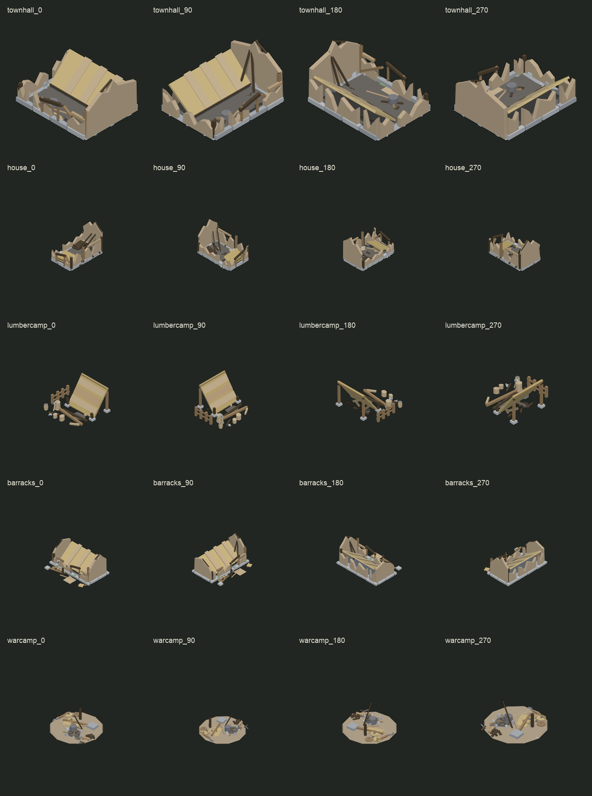
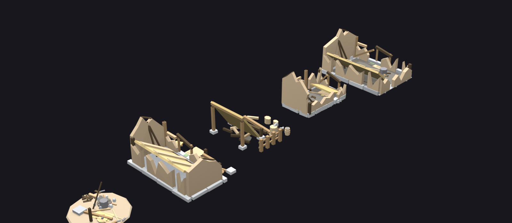

# Руины пяти построек (5 типов x 4 поворота, один атлас)

Разрушенные варианты всех пяти типов построек игры 4tox/mapgen2: **ратуша,
дом жителя (атлас `starter_house`), лагерь лесоруба, казарма, военный лагерь**.
Каждый тип — четыре поворота, все 20 кадров лежат в одном атласе
`mapgen2/assets/ruins/` (`atlas.png`, `atlas.json`, `atlas.js`
с `window.RUINS_ATLAS`).

Требование заказчика (2026-10-23, п.11): крыша упала/просела, часть стропил и
досок лежит на земле; стены частично разрушены (рваная кромка сверху,
проломы), но силуэт узнаваем; обломки только по пятну постройки; цветом
показано запустение и пожар (обугленные участки, пепел, приглушённые краски);
у военного лагеря — упавшее знамя, сгоревшие брёвна, разбросанные щиты и
копья.



Все пять моделей рядом (`ruins_model.blend`, обзорный рендер):

Вьюпорт живой сборки: `renders/live_view.png`.

Сравнение «целое / руина» по каждому типу: `out/compare_<тип>.png`; крупные
планы: `out/closeup_house.png` (из кадра @4x), `out/closeup_warcamp.png`.

## Имена кадров

Решено так: `<тип>_<поворот>`, где тип — **имя типа в игре**, а не имя папки
целого атласа. У дома тип `house`, поэтому кадр `house_0`, а не
`starter_house_0`; атлас-источник при этом `mapgen2/assets/starter_house/`.
Полный список: `townhall_0/90/180/270`, `house_0/90/180/270`,
`lumbercamp_0/90/180/270`, `barracks_0/90/180/270`, `warcamp_0/90/180/270`.
Поле `variant` каждого кадра — тоже имя типа (`townhall`, `house`, ...).

## Числа (последний прогон)

| тип | пятно | модель (X x Y x Z), юниты | трис | деталей | ppu | mul |
|---|---|---|---|---|---|---|
| townhall | 4 x 3 | 3.93 x 3.02 x 2.12 | 941 | 68 | **80** | 0.7667 |
| house | 2 x 3 | 1.97 x 2.99 x 2.07 | 1106 | 88 | 96 | 0.7156 |
| lumbercamp | 3 x 3 | 2.87 x 2.72 x 1.63 | 800 | 56 | 96 | 0.7156 |
| barracks | 4 x 3 | 3.99 x 2.93 x 2.07 | 959 | 74 | 96 | 0.7667 |
| warcamp | 5 x 5 (модель 2 x 2) | 2.51 x 2.51 x 1.08 | 674 | 52 | 96 | 0.7973 |

| тип | кадр 0, px | anchorX/anchorY (0) | ground (0), клетки от опоры |
|---|---|---|---|
| townhall | 431 x 400 | 215, 268 | -1.805 .. 2.245 / -1.321 .. 1.946 |
| house | 733 x 781 | 366, 486 | -0.918 .. 0.993 / -1.484 .. 1.492 |
| lumbercamp | 747 x 636 | 355, 389 | -1.414 .. 1.444 / -1.449 .. 1.266 |
| barracks | 949 x 892 | 465, 550 | -2.014 .. 1.998 / -1.445 .. 1.395 |
| warcamp | 506 x 569 | 250, 351 | -1.254 .. 1.254 / -1.254 .. 1.254 |

Атлас: **3821 x 4661**, ячейка **955 x 932**, 4 столбца (повороты) x 5 строк
(типы в порядке townhall, house, lumbercamp, barracks, warcamp). Кадр рисуется
512 x 640, истинная изометрия (az 45°, el 35.2644°), фон прозрачный, контур
1 px при 96 ppu (2 px при 384), **тени нет** (правило 2026-10-17).

### Почему у ратуши 80 ppu, а у остальных 96

Её ЦЕЛЫЙ атлас снят при 80 ppu (кадр 512 x 640, ortho 8.0). При 96 ppu
диагональ пятна 4 x 3 — 475 px, и в кадр шириной 431 px она не влезает.
`anchorX/anchorY`, `mul` и `ground` обязаны совпасть с целыми — поэтому
ратуша-руина рисуется той же камерой и тем же ppu, что её целый атлас.
У остальных четырёх целых атласов ppu 96, у руин тоже.

Из-за этого в `atlas.json` **общие** `ppu: 96` и `mul: 0.7667` — только
значения по умолчанию. У каждого кадра есть СВОИ `ppu` и `mul`, а блок
`types` держит их по типу; интегратору нужен покадровый `ppu` (или `types`),
иначе ратуша поедет по масштабу.

## Палитра

12 красок ратуши дословно (`art/buildings/townhall/tools/townhall.py`,
`palette()`) плюс **два новых тёмных тона** — и ничего больше:

* `char` — обугленное дерево, почти чёрный с коричневым уходом;
* `ash` — пепел, приглушённый серый.

Новых ярких цветов нет. «Приглушённость» сделана не перекраской целых стен, а
тем, что часть деталей (упавшая кровля, обломки, столбы, угли) красится
`char`/`ash`/`thatch2`, а уцелевшее остаётся своими цветами. Тона для
стиль-гейта считает `tools/palette_json.py` той же формулой, что
`village_probe.py` (`sRGB(base * (SUN_K*c + SKY_K))`), поэтому таблица
`tools/ruin_palette.json` и кадр разойтись не могут.

## Как сделано

Три уровня, как в скилле `4tox-building-forge`:

1. **Геометрия — чистый Python**, без `bpy`: `tools/ruinkit.py` (рваная стена
   цельной призмой, проломы, сломанный столб, упавшая кровля, бревно/доска на
   земле, валун, пепел, угли) + `tools/ruin_<тип>.py`. Числа и краски взяты из
   генераторов ЦЕЛЫХ построек; у дома и казармы вызываются их же
   `build_plinth`, у военного лагеря — `warcamp.build_ground`, поэтому
   наземный контур не «похожий», а тот же.
2. **Сборка и съёмка — только в УЖЕ ЗАПУЩЕННОМ Blender** через сокет
   `127.0.0.1:9876` (`tools/build_live.py` + `tools/mcp.py`); своя сцена
   `ruins`, префикс `rn_`, `read_factory_settings` не зовётся, чужие сцены не
   трогаются, `.blend` — копией. Камера, свет и палитра — канонные.
3. **Пост — `tools/compose_ruins.py`**: кадр кладётся так, чтобы
   `anchorX/anchorY` были РОВНО целыми (кадр строится ОТ целевой опоры, а не
   по силуэту — иначе опора уехала бы на десятки пикселей), контур 1 px,
   тени нет.

Ключевое отличие от штатного `compose.py` скилла: он центрирует силуэт в
своей рамке, и опора становится «половиной ширины силуэта». У руины силуэт
другой, поэтому `compose_ruins.py` берёт цели из `out/targets.json` (их пишет
`tools/targets.py` из целых атласов) и ставит кадр по ним.

## Приёмка

| Проверка | Результат | Файл |
|---|---|---|
| `canon.py` по 5 генераторам | **ИТОГ: ПРИНЯТО** у всех, замечаний по нормалям 0 | `acc/canon-<тип>.txt` |
| `xray.py probe`, 6 канонных видов | изнанок: townhall 0, house 5 px, lumbercamp 8 px, barracks 0, warcamp 9 px; **z-fighting 0 пар** у всех; висящих нет | `acc/xray-<тип>.txt` |
| `gate.py` (3d-model-acceptance) по СЦЕНЕ, деталь = объект | **GATE: PASS** у всех пяти: house 3 WARN, townhall 3, lumbercamp 5, barracks 4, warcamp 3 | `acc/gate-<тип>.txt`, `acc/report-<тип>.json` |
| Стиль-гейт 1x, 20 кадров | на каждом кадре FAIL только строка **ТЕНЬ** (намеренно), других FAIL/WARN нет; ПАЛИТРА 100 %, ДЕТАЛИЗАЦИЯ, КОНТУР, ПОЛИГОНАЖ PASS | `acc/style-gate-1x.txt` |
| Стиль-гейт @4x, дом, 4 поворота | ПАЛИТРА 99.9..100 %, ДЕТАЛИЗАЦИЯ 47..54 %, КОНТУР 1..2 px, ПОЛИГОНАЖ PASS; FAIL только ТЕНЬ | `acc/style-gate-4x.txt` |
| Атлас: 20 кадров, `variant` = тип | 20 из 20, повороты 0/90/180/270 | `acc/check-atlas.txt` |
| **anchor/ground/mul/footprint/ppu против целых** | **0 расхождений** (см. `check_atlas.py`); 2 WARN — у ратуши фактическая середина основания | `acc/check-atlas.txt` |
| Приёмка интегратора `node mapgen2/tools/ruins.js` | **ЗАВАЛЫ ПРИНЯТЫ** (5 типов, 4 поворота, 20 кадров, ppu/mul/ground на месте) | `acc/ruins-js.txt` |

`gate.py` C11-порог `cells.margin` в спеках руин стоит **0**, а не 1/3:
модель меряется в своих юнитах, а зазор до кромки делает игра множителем
`mul` (правило 2026-10-13). С 1/3 гейт требовал бы уже сжатый спрайт и валил
бы любую целую постройку.

`gate.py` предупреждения — класса, а не дефекты:
* C5 «цоколь за стены» — порог `null`, печатаются числа (у ратуши валуны
  выходят за стены по канону; у двора стен нет);
* C7 «полотно двери/окна не нашлось» — в руине полотно сорвано и лежит;
* C9 «вывернутые замкнутые мелочи» — у мелких обломков/углей; проектный
  `canon.py` нормалей замечаний не даёт, в кадре они освещены (как у целого
  военного лагеря, где гейт также даёт этот WARN).

Стиль-гейт: строка **ТЕНЬ падает намеренно** у всех построек игры с
2026-10-17 — контактного пятна под зданием нет. Это не дефект руин.

## Что осталось неидеальным (честно)

1. **Ратуша: основание не по середине пиксельного `ground`.** Её целый
   `ground` посчитан по ПИКСЕЛЯМ кадра и асимметричен (-1.805..2.245 по X
   карты). Наше основание симметрично (3.93 x 3.02), поэтому его середина
   отстоит от скопированной на **0.18..0.23 клетки по X и 0.30 по Y**
   (`check_atlas.py` печатает это по каждому повороту). `anchorX/anchorY`,
   `ground` и `mul` при этом совпадают с целым атласом точно — спрайт ставится
   туда же, куда ставился целый; расходится только ВИДИМОЕ основание руины
   относительно целого. Исправляется либо переносом `ground` целой ратуши на
   замер по модели (правка чужого атласа — запрещена), либо заказом на
   асимметричное основание; в отчёте оставлено числом.
2. **Тень у зданий не рисуется** (правило 2026-10-17) — строка ТЕНЬ
   стиль-гейта FAIL. У природы тень осталась.
3. **Видимая грубость формы.** Лучше всего читаются ратуша, казарма и дом;
   у **дома** крупный плоский пласт упавшей кровли перед фасадом выглядит
   чище, чем хотелось бы, у **лагеря лесоруба** наклонный скат навеса
   доминирует в кадре и закрывает часть двора. Это осознанный компромисс:
   большой фасет нужен и стиль-гейту (доля крупных плоскостей), и читаемости
   «крыша упала»; дробить его на доски — терять и то, и другое.
4. **Военный лагерь мелкий в кадре** — как и целый: модель 2 x 2 на площадке
   5 x 5, остальное место в игре занимают воины. Руина туда не залезает
   (габарит 2.51 юнита = 2.00 клетки при mul 0.7973).
5. **`char` и `ash` — новые цвета** (два, оба тёмные). Это разрешено
   требованием («из существующих материалов + тёмные угольные оттенки»), но
   в палитре деревни их раньше не было; они лежат в `tools/ruin_palette.py`
   и только там.
6. **Угольные кромки стен** (тонкая полоса по верху слома) в первой версии
   были отдельными призмами; они давали пару «совпадающих плоскостей» с верхом
   стены (xray), и от них отказались. Обугленность читается цветом самих
   обломков: угольные балки, столбы, щипцы и участки стен.
7. **Атлас не подключён к игре** — по правилу задачи игровой код не трогался.
   Интегратору: кадры именуются `<тип>_<поворот>`, `variant` = тип, у кадра
   свой `ppu`/`mul`; `anchorX/anchorY`, `ground`, `footprint` — целые.
8. **Не проверено:** как руина выглядит на карте рядом с целыми постройками
   (это делается только в игре/`place.js` после интеграции); поведение при
   `mul`, отличном от записанного; экспорт GLB (руина отдаётся только
   спрайтами, как и требовалось).

## Файлы

| файл | что делает |
|---|---|
| `tools/ruinkit.py` | рваная стена, проломы, сломанный столб, упавшая кровля, обломки, пепел, угли |
| `tools/ruin_townhall.py` | руина ратуши 4 x 3 (упавший колокол, щипец -X) |
| `tools/ruin_house.py` | руина дома 2 x 3 (цоколь целого дома, упавшая кровля) |
| `tools/ruin_lumbercamp.py` | руина лагеря 3 x 3 (упавший навес; двор целого лагеря) |
| `tools/ruin_barracks.py` | руина казармы 4 x 3 (два щипца, упавшее знамя, щиты) |
| `tools/ruin_warcamp.py` | руина военного лагеря (площадка целого, упавшее знамя, костёр) |
| `tools/ruin_palette.py` | 12 красок ратуши + `char`/`ash`; `tools/palette_json.py` — палитра для гейта |
| `tools/build_live.py` | сборка и съёмка в живом Blender, `--gate` — деталь = объект |
| `tools/compose_ruins.py` | кадр -> спрайт с ТОЧНОЙ опорой целого |
| `tools/targets.py` | цели (anchor/ground/mul/footprint/ppu) из целых атласов |
| `tools/pack_ruins.py` | 20 кадров -> `mapgen2/assets/ruins/atlas.{png,json,js}` |
| `tools/check_atlas.py` | сверка атласа с целыми + основание по модели |
| `tools/style_gate.py` | стиль-гейт по всем кадрам, полный вывод в `acc/` |
| `tools/sheets.py` | лист 20 кадров, «целое/руина», крупные планы |
| `tools/make_specs.py`, `tools/run_gate.py` | спеки и прогон `3d-model-acceptance` |
| `tools/mcp.py`, `tools/blender_live.py`, `tools/forge.py`, `tools/xray.py`, `tools/canon.py` | копии инструментов проекта (одна версия со скиллом) |
| `out/`, `renders/`, `acc/` | спрайты, сырые кадры, выводы приёмок (не переписаны руками) |
| `mapgen2/assets/ruins/` | атлас игры |

## Как пересобрать

```bash
PY3=/Users/hermmoment/.dsh/dsh-runtimes/dsh-primary-runtime/dependencies/python/bin/python3
PY=/Users/hermmoment/.dsh/profiles/desktop/node_modules/dsh-blender/.venv/bin/python

$PY3 tools/targets.py                  # цели из целых атласов
$PY3 tools/palette_json.py             # палитра для стиль-гейта

$PY3 tools/canon.py --gen tools/ruin_house.py       # ИТОГ: ПРИНЯТО
$PY3 tools/xray.py probe --gen tools/ruin_house.py  # изнанки/z-fighting

$PY tools/mcp.py run tools/build_live.py -- --types house   # 4 поворота 1x
$PY tools/mcp.py run tools/build_live.py -- --types house --scale 4  # @4x
$PY3 tools/compose_ruins.py --type all
$PY3 tools/compose_ruins.py --type house --scale 4

$PY3 tools/pack_ruins.py
$PY3 tools/check_atlas.py              # anchor/ground/mul — сверка с целыми
$PY3 tools/style_gate.py               # 20 кадров, полный вывод в acc/
$PY3 tools/style_gate.py --scale 4 --type house
$PY3 tools/sheets.py

# приёмка gate.py по сцене: деталь = объект
$PY3 tools/make_specs.py
$PY tools/mcp.py run tools/build_live.py -- --types house --gate
$PY tools/mcp.py run tools/run_gate.py -- --type house
```

Собрано в живом Blender 5.2.0 LTS (сцена `ruins`, префикс `rn_`). Скриншот
вьюпорта — отдельной командой: `$PY tools/mcp.py shot renders/live_view.png`.
