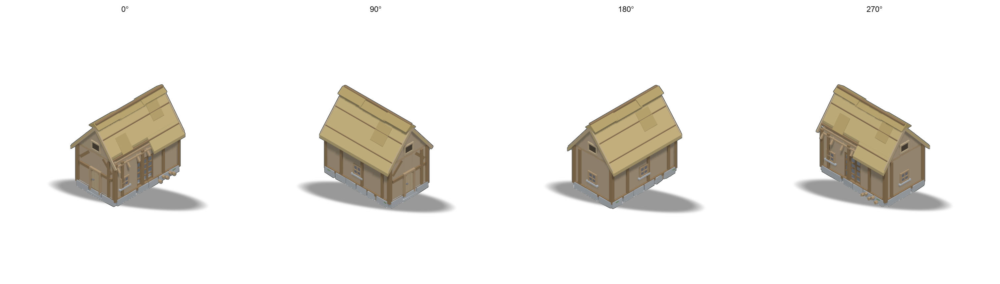
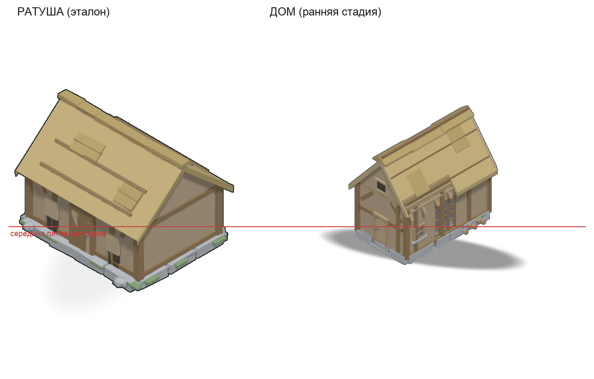

# Стартовый дом жителя (2 x 3) — деревня на ранней стадии

Первая постройка деревни: **каркас с глиняной обмазкой под соломенной
кровлей**, пятно **2 x 3 клетки** (X — короткая сторона, Y — длинная, дверь
смотрит в `+Y`). Дом поставлен и почти покрыт — работа не кончена: у карниза
недомощен скат, одна панель стены без обмазки, цоколь не досложен, во дворе
штабель брёвен и вязанка соломы.

Образец — **ратуша из игры** (`mapgen2/assets/townhall`), единственная
постройка, которую заказчик назвал идеальной. Оттуда взято всё, что определяет
школу, и ничего не додумано: двенадцать плоских красок (`tools/thpal.json` —
те же hex, что в `townhall/tools/thpal.py`), ряд валунов по периметру с мхом,
кровля плоскими плоскостями с прижимными слегами и заплатами, каркас с
раскосами 45°, проёмы как проёмы (тёмное нутро, наличник, полотно, кольцо).
Тонов по нормали нет: у ратуши цвет один на всю плоскость.




## Числа (последний прогон 2026-10-14)

| | |
|---|---|
| Пятно | 2 x 3 клетки; крупность `mul = 0.7156` (`siteMul(3)`) |
| Стены / ярусы | стены 1.66 x 2.80; цоколь 0.15 · стены 1.42 · конёк 2.71 · верх 2.83 |
| Уклоны | передний скат 49.5°, задний 52.5° (канон соломы 45..55) |
| Свесы | по скату 12 % ширины стены, по торцу 4 % (канон 11..31 / 4..13) |
| Габарит | 2.054 x 3.035 x 2.833 юнита (в пятне, канон допускает 0.03) |
| Основание (цоколь + двор) | 1.915 x 2.976 юнита → **1.370 x 2.130 клетки** на карте |
| Зазор до кромок | **0.315** (X) и **0.435** (Y) клетки при канонных 0.307 |
| Середина основания | смещение 0.036 (порог 0.05) |
| Полигонаж | **1432** треугольника, 153 детали (бюджет 300..1500) |
| Материалы | **12** плоских красок ратуши, Δ = 0 |
| Кадр | 512 x 640 при 96 ppu, 4 поворота; @4x — 2048 x 2560 при 384 ppu |

## Чем проверено

| Проверка | Результат |
|---|---|
| Гейт приёмки `3d-model-acceptance`, по СЦЕНЕ | **GATE: PASS** — 0 провалов, 2 предупреждения (`acc/gate-house.txt`) |
| Гейт по эталону (`townhall_c.glb`) | **GATE: PASS** — 0 провалов, 3 предупреждения (`acc/gate-ref.txt`) |
| `canon.py` (канон пропорций и нормали) | **ИТОГ: ПРИНЯТО**, замечаний по нормалям 0 |
| `xray.py probe --full` | изнанки в 4 канонных видах **1/2/1/0 px**; висящих нет; z-fighting 1 пара (доля 0.07 — стык) |
| Стиль-гейт `audit.py` 1x (4 поворота) | **ОК (0 FAIL, 0 WARN)** × 4; палитра 100.0 % |
| Стиль-гейт `@4x` | **ОК (0 FAIL, 0 WARN)**; палитра 100.0 % |
| Посадка `tools/place_check.py` | основание и зазоры — в границах `spec.json` |
| Сверка с эталоном `tools/tone_compare.py` | средний тон 154/138/106 против 159/144/111 |
| Осмотр | 4 поворота, вход, цоколь, низ ската, лист «эталон рядом» |
| Упаковка `tools/pack_atlas.py` | 4 кадра в `mapgen2/assets/starter_house/`, зазор 0.316/0.435 клетки (`acc/pack-atlas.txt`) |
| Приёмка движка `node mapgen2/tools/place.js` | **все проверки пройдены** — пятно 2 x 3 из атласа, крупность 0.7156, отступ по длинной стороне 0.435 в полосе ратуши |
| Приёмки оболочек `node mapgen2/tools/game.js`, `node game/tools/menu.js` | **все проверки пройдены** — деревня из трёх построек, дом 2 x 3 на траве, житель выходит из дома |

Подробности приёмки, список отличий от ратуши, раздел «что не проверено» и
спорные пороги — **[REPORT.md](REPORT.md)**.

## Дом жителя в игре (2026-10-14)

Заказчик: «добавь starter house вместо того дома жителя, который сейчас в игре
— именно в игре замени модельку; сами модели удалять не надо». Сделано так:

* тип постройки `house` в `mapgen2/js/buildings.js` читает **этот** атлас
  (`assets/starter_house/`, `window.STARTER_HOUSE_ATLAS`), пятно 2 x 3 вместо
  прежних 3 x 2 — иначе не менялось ничего: имя типа, роль в деревне
  (`js/session.js`), выход жителя из двери дома и приёмки остались прежними;
* в обеих оболочках тег `<script>` атласа дома заменён на
  `assets/starter_house/atlas.js` (`mapgen2/index.html`, `game/index.html`);
* **прежний дом жителя не удалён**: `art/buildings/villager_house/` и его атлас
  `mapgen2/assets/house/` лежат на диске целиком, страница их просто не грузит.
  Вернуть прежнюю модель — одна строка в `TYPES` (`dir`/`meta`) плюс обратная
  замена тега `<script>`;
* упаковщик — `tools/pack_atlas.py`, он пишет атлас **прямо в игру**
  (`docs/PIPELINE.md`, шаг 5).

### Почему `ground` посчитан по модели, а не по пикселям

Правило упаковщика ратуши меряет наземный контур по пикселям кадра и только
там, где виден камень цоколя. У этого дома так нельзя: цоколь недосложен (два
валуна вынуты из ряда), на земле стоит двор — штабель брёвен и вязанка соломы,
а дальний ряд цоколя и дальняя часть двора закрыты самой постройкой. Замер
четырёх правил по четырём поворотам (`acc/pack-atlas.txt`):

| Кадр | по модели (канон) | по пикселям | max abs Δ |
|---|---|---|---|
| 0 | -0.918 0.993 -1.484 1.492 | -1.001 0.953 -1.362 1.469 | 0.122 |
| 90 | -1.484 1.492 -0.993 0.918 | -1.603 1.462 -0.834 0.892 | 0.159 |
| 180 | -0.993 0.918 -1.492 1.484 | -0.923 0.886 -1.471 1.453 | 0.070 |
| 270 | -1.492 1.484 -0.918 0.993 | -1.466 1.449 -0.899 0.958 | 0.035 |

Середина пиксельного контура гуляет по поворотам на 0.06 клетки — постройка
«дышала» бы при повороте (та же беда, из-за которой по модели считается лагерь
лесоруба). Поэтому в атлас записан контур по модели — габарит точек контакта с
землёй, — и он совпадает с числами проектной приёмки (`acc/place.json`:
основание 1.915 x 2.976, зазор 0.315/0.435). Приёмка движка
(`mapgen2/tools/place.js`) знает про это: у дома она сверяет с пикселями не
контур атласа, а видимую часть основания — она стоит серединой в середине пятна
с точностью 0.05 клетки при пороге 0.08.

**Опора кадра — пиксель спрайта, не плитки атласа.** Упаковщик НЕ прибавляет
`PAD` к `anchorX/anchorY`: игра рисует прямоугольник `(x, y, w, h)`, то есть
ровно спрайт, и читает опору как долю от `w` (`js/buildings.js::spriteFrom`).
Так же считает упаковщик ратуши; у прежнего дома жителя здесь была прибавка
`PAD`, и опора уезжала на 2 px — в этом атласе такой ошибки нет.

## Как пересобрать

```bash
PY=/Users/hermmoment/.dsh/profiles/desktop/node_modules/dsh-blender/.venv/bin/python
PY3=/Users/hermmoment/.dsh/dsh-runtimes/dsh-primary-runtime/dependencies/python/bin/python3

# 1. форма — в УЖЕ ЗАПУЩЕННОМ Blender (правило заказчика: headless для формы нельзя)
$PY3 tools/house.py                       # геометрия без Blender: трис и детали
$PY3 tools/canon.py --gen tools/house.py  # канон: ждём ИТОГ: ПРИНЯТО
$PY3 tools/xray.py probe --gen tools/house.py --full   # изнанки, зазоры, z-fighting

# 2. сборка и кадры в живом Blender (сокет аддона blender-mcp, 127.0.0.1:9876)
$PY tools/blmcp.py info                                  # жив ли сокет
$PY tools/blmcp.py run tools/build_live.py               # 4 поворота 96 ppu
$PY tools/blmcp.py run tools/build_live.py -- --config live_4x.json
$PY tools/blmcp.py run tools/build_live.py -- --config live_closeup.json
$PY tools/blmcp.py run tools/build_live.py -- --config live_export.json
$PY tools/blmcp.py shot renders/live_view.png            # вьюпорт — отдельной командой

# 3. приёмка и спрайты
$PY tools/blmcp.py run tools/run_gate.py                 # gate.py по сцене -> acc/
$PY3 tools/compose_all.py --no-shadow                    # сырые кадры -> out/*.png;
                                                         # без тени — правило
                                                         # заказчика 2026-10-17
$PY3 tools/place_check.py --json acc/place.json          # пятно, зазор, середина
$PY3 tools/sheet.py && $PY3 tools/tone_compare.py        # листы осмотра и сверка тона

# 4. стиль-гейт (палитра деревни, 1x и @4x)
$PY3 ~/.dsh/skills/4tox-lowpoly-3d/scripts/audit.py --mine out/sh_0.png \
    --kind building --ppu 96 --anchor 366,486 --tris 1432 \
    --palette tools/village_palette.json
# строка «ТЕНЬ» тут падает намеренно: тени у зданий этой игры нет, а гейт
# требует мягкое пятно под силуэтом. Всё остальное в гейте в силе.

# 5. упаковка ПРЯМО В ИГРУ и приёмка движка
$PY3 tools/pack_atlas.py | tee acc/pack-atlas.txt   # -> mapgen2/assets/starter_house/
node mapgen2/tools/place.js                         # посадка: пятно, крупность, зазор
node mapgen2/tools/house.js                         # дом 2 x 3 на настоящей карте
node mapgen2/tools/game.js && node game/tools/menu.js   # обе оболочки
```

## Границы

* Модель **не для 3D-печати**: часть граней, скрытых от камеры, не построена —
  меш намеренно не замкнут.
* Интерьера нет (камера наружная), рига и анимации нет (постройка статична).
* **В игре стоит именно эта модель**: с 2026-10-14 тип `house` читает атлас
  `mapgen2/assets/starter_house/` (см. раздел «Дом жителя в игре»). Прежний дом
  жителя не удалён — лежит моделью и атласом, но страница его не грузит.
* Двор на земле (брёвна, солома) **входит в наземный контур** — им дом и
  ставится по середине пятна. Если двор когда-нибудь подвинут, контур надо
  пересчитать: `$PY3 tools/pack_atlas.py`.

## Файлы

```
tools/house.py        ГЕОМЕТРИЯ дома: чистый Python, без bpy (главный файл)
tools/thpal.json      двенадцать красок ратуши (те же hex) + тона для софт-рендера
tools/build_live.py   сборка в ЖИВОМ Blender: детали, плоские краски, кадры
tools/run_gate.py     приёмка gate.py по сцене живого Blender
tools/compose_all.py  сырые кадры -> спрайты (контур, тень, точка опоры; `--no-shadow` — так собран атлас игры)
tools/pack_atlas.py   спрайты -> атлас игры (ground по модели, пиксельная сверка)
tools/place_check.py  посадка основания в пятно: числа по четырём сторонам
tools/tone_compare.py сверка тона и долей красок с ратушей
tools/sheet.py        листы: повороты, крупные планы, «эталон рядом»
tools/{forge,xray,canon,blender_live,compose,mcp}.py  инструменты скилла (копии)
tools/rev2/           ПЕРВАЯ РЕВИЗИЯ дома (забракована): генератор, README, кадры
spec.json             замороженные критерии дома (пороги внутри)
spec-ref-townhall.json  те же критерии для эталона
acc/                  выводы гейтов и замеры последнего прогона
acc/pack-atlas.txt    замер контура (модель и пиксели) и зазоры при упаковке
out/                  спрайты 4 поворотов, @4x, листы, sh_sprites.json, .glb/.obj
renders/              сырые кадры Blender, крупные планы, отчёт сборки
starter_house_model.blend   сцена, сохранённая КОПИЕЙ (файл заказчика не тронут)
```
