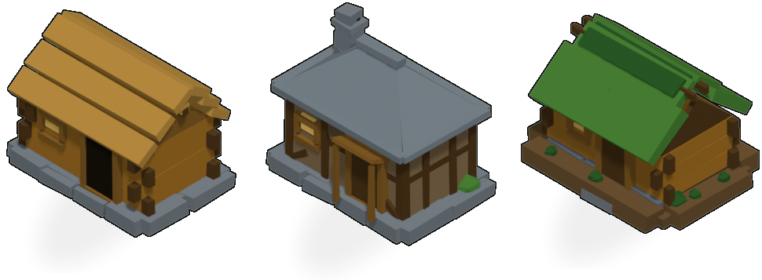
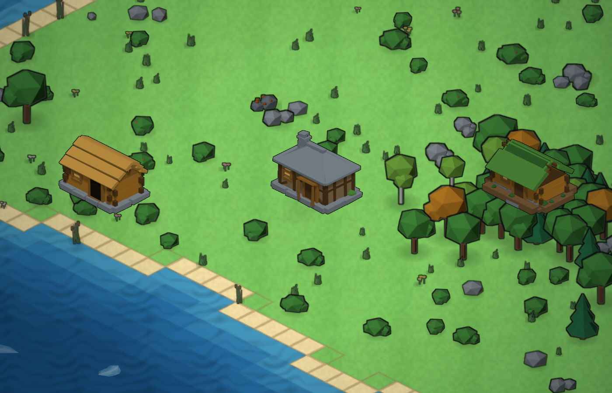

# Прямоугольная хижина 3 x 2 — три варианта

Первая постройка деревни. **Прямоугольная, пятно 3 x 2 клетки** (X — длинная
сторона), при повороте на 90° — 2 x 3. Стиль снят с эталонного атласа
`mapgen2/assets/sprites/atlas.png` (тот же, что у деревьев): плоские фасетки,
плоское затенение, тёмный контур по силуэту, мягкая тень, «лесная» палитра.



## Варианты

| Вариант | Строительная идея | Силуэт |
|---|---|---|
| **A** | сруб из брёвен под двускатной соломой: 4 венца, выпуски брёвен в углах, ступенчатая солома, коньковые жерди | крутая двускатка, ровный конёк, трубы нет |
| **B** | каркас с глиняной обмазкой, вальмовая кровля из каменных плит, наружная труба из валунов, навес над дверью | четырёхскатная кровля + труба у торца |
| **C** | полуземлянка: низкие стены, земляная присыпка, дерновая кровля, дымовое отверстие | приземистый, зелёная кровля, бруствер |

Все три — одноэтажные, без выхода за пятно, с каменным цоколем, дверью в +Y,
окном со ставнем, поленницей и кустом. Полигонаж: **A 844**, **B 878**,
**C 1064** треугольника (C — вместе с травой на бруствере).

## Конвенции (те же, что у ратуши)

| Что | Значение |
|---|---|
| 1 юнит модели | 1 клетка карты; хижина = 3 x 2 юнита |
| Камера | ортографическая, азимут 45°, подъём 35.264° (`atan(1/√2)`) |
| Кадр | 512 x 640, орто-масштаб 8.0 → **80 px на юнит** |
| Свет | солнце сверху-слева-спереди, `(-0.36, 0.30, 0.88)`, энергия 2.05 |
| Контур | тёмный `#0e120e`, расширение 1 px; тень — пятно по пятну застройки |
| Повороты | 4 через 90° |

### Палитра (замер по атласу, подогнана по рендеру)

Бревно `#AB7527`, среднее дерево `#8A6128`, тёмное дерево `#553A1A`,
каменная плита `#7C858B`, тёмная плита `#5C656C`, цоколь `#7C8388`,
обмазка `#8A7150` / `#6E5A3E`, солома `#C09040` / `#A87C34`,
дёрн `#4C8434` / `#2C5C25`, земля `#6E5230`, проём `#1A140E`,
тёплое окно `#F7C765`.

## Файлы

```
townhall/tools/hut_rect.py         геометрия трёх вариантов (bmesh, thpipe)
townhall/tools/build_hut_rect.py   рендер: варианты x повороты -> renders/*_raw.png
townhall/tools/compose_hut_rect.py пост: тень, контур, обрезка -> out/hutrect_*.png
townhall/tools/present_hut_rect.py листы: варианты, повороты, сверка с атласом
townhall/tools/export_hut_rect.py  экспорт трёх .glb
townhall/out/hutrect_<в>_<поворот>.png   12 спрайтов
townhall/out/hutrect_sprites.json        точки опоры (центр пятна 3 x 2)
townhall/out/hutrect_<в>.glb             модели для движка
townhall/out/hutrect_variants.png        три варианта крупно
townhall/out/hutrect_rotations.png       3 x 4 поворотов
townhall/out/hutrect_style.png           сверка с деревьями атласа и ратушей

mapgen2/assets/hut/atlas.png       атлас 4 x 3 кадра для генератора карт
mapgen2/assets/hut/atlas.json      метаданные: ppu, камера, опоры, пятно
mapgen2/assets/hut/atlas.js        то же скриптом (работает по file://)
mapgen2/tools/pack_hut_rect.py     упаковка атласа
mapgen2/tools/hut.js               проба: хижина на настоящей карте
mapgen2/tools/out/hut-map-*.png    скриншоты с карты
```

## Как пересобрать

```bash
BL=/Applications/Blender.app/Contents/MacOS/Blender
PY=/Users/hermmoment/.dsh/dsh-runtimes/dsh-primary-runtime/dependencies/python/bin/python3

cd townhall
$BL -b --factory-startup -noaudio -P tools/build_hut_rect.py -- --samples 48
$PY tools/compose_hut_rect.py
$PY tools/present_hut_rect.py
$BL -b --factory-startup -noaudio -P tools/export_hut_rect.py

cd ../mapgen2
$PY tools/pack_hut_rect.py
node tools/hut.js
```

Быстрая правка формы: `--rotations 0` (один кадр) и `--variants a`.

## Проба на карте

`tools/hut.js` подставляет атлас хижины в **настоящий** генератор карт через
CDP и рисует спрайты тем же масштабом, что `js/buildings.js`:

```
scaleX = z / (2 * cos(az) * ppu)          z — ширина клетки на экране
scaleY = z / (4 * sin(el) * cos(az) * ppu)
```

Ромбы клеток на втором снимке показывают, что спрайт ложится ровно в пятно
3 x 2. Игра при этом не меняется — ни один файл `js/` не тронут.



## Что осталось для игры

`js/buildings.js` жёстко привязан к ратуше: константа `FOOTPRINT = 4x3`,
загрузка `townhall/`, один `set` спрайтов. Чтобы хижина ставилась игроком на
карту, модуль надо обобщить на список типов зданий:

1. `load()` — принимать `dir` и имя глобального мета-объекта (`HUT_ATLAS`)
   и возвращать отдельный `set` (по образцу `build(img, meta)`).
2. `FOOTPRINT` — брать из `meta.variants` / `frames[..].footprint`, а не из
   константы; `footprint(rot)` — из активного типа.
3. `Renderer.setBuildings(list)` и `drawBuilding` — читать `set` из `b.type`
   (сейчас `buildingSprites` — один атлас).
4. Панель размещения в `js/app.js` — селектор типа здания.
5. `index.html` — подключить `assets/hut/atlas.js` рядом с `townhall/atlas.js`.

Атлас уже в том же формате (`ppu`, `az_deg`, `el_deg`, `anchorX/anchorY`,
`footprint`), так что пункты 1–4 — механическая правка, а не переделка.
