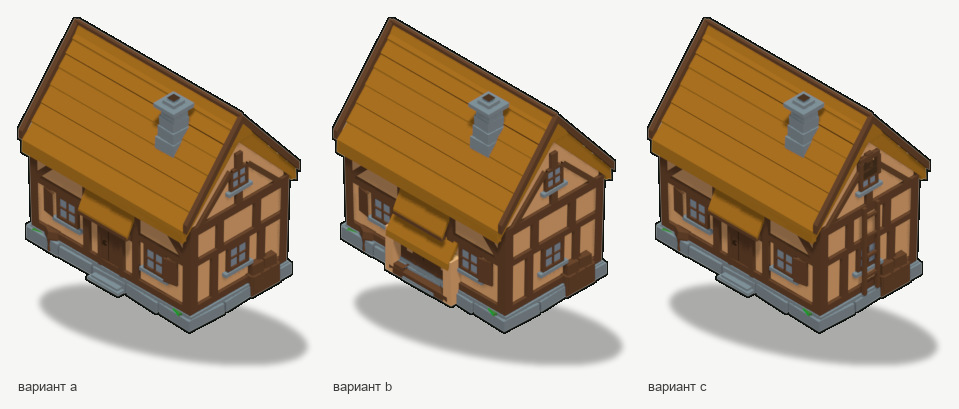
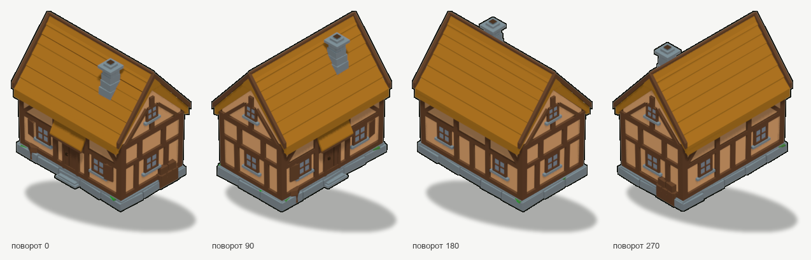
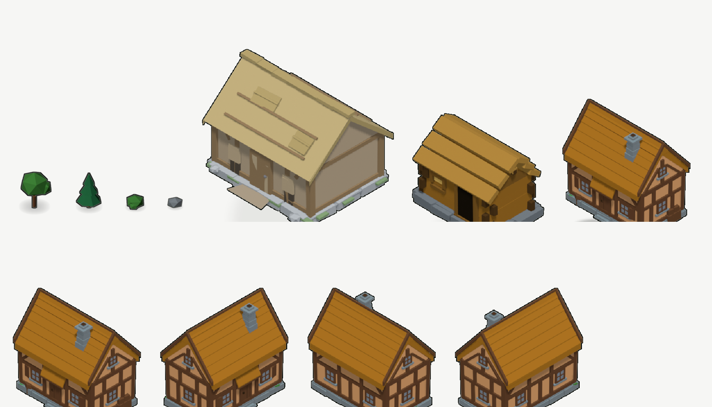
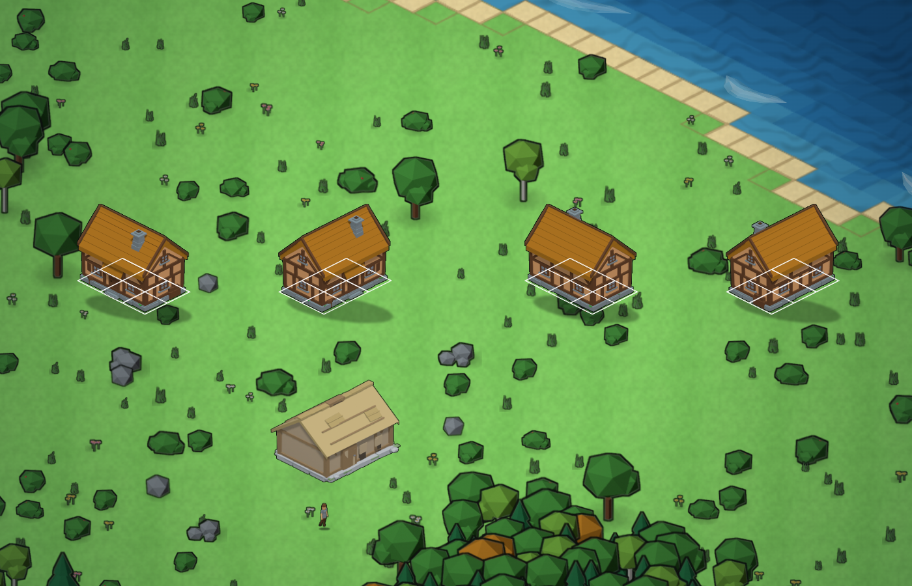
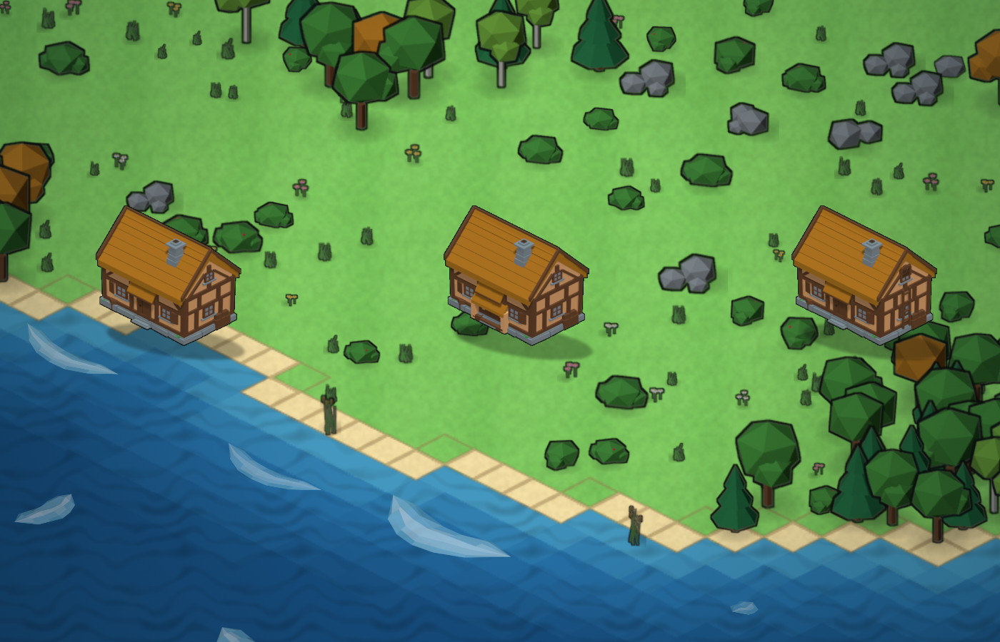

# Дом жителя для mapgen2

Постройка для деревни вокруг ратуши: **каркас с глиняной обмазкой под соломой**,
пятно **3 x 2 клетки** (X — длинная сторона), дверь смотрит в `+Y`.
Эталон — уже собранная ратуша (`art/buildings/townhall/out/th_a_0.png`): та же
строительная школа, но дом меньше, теплее и обжит — ставни, навес над дверью,
труба на скате, поленница, кадка.





## Что сделано

| | |
|---|---|
| Пятно | 3 x 2 клетки; при повороте 90/270 — 2 x 3 |
| Габарит | 2.98 x 2.01 x 2.91 юнита (ровно в пятне: X ±1.490, Y ±1.005) |
| Ярусы | цоколь 0.16 · стены 1.35 · конёк 2.63 · труба 2.91 |
| Уклон ската | 47° (канон: солома 45..55°) |
| Свесы | по скату 11% ширины стены, по торцу 4% |
| Полигонаж | A **1348**, B **1336**, C **1438** треугольника (бюджет `building` 300..1500) |
| Материалы | 21 слот = 7 семейств палитры x 3 тона, тон фасета — по нормали |
| Палитра | **99.2..99.7%** пикселей спрайта в палитре канона (гейт требует 93%) |
| Стиль-гейт | **12 кадров из 12 — ОК (0 FAIL, 0 WARN)**, 60 проверок из 60, и на 1x, и на `@4x` |
| Дыры/изнанки | счётчик `tools/xray.py probe` — максимум **9 px** на кадр (было 5970 px) |

## Варианты

| Вариант | Что это | Чем отличается силуэт |
|---|---|---|
| **A** | дом с соломенным козырьком над дверью, ставнями, трубой, поленницей и кадкой | ровный свес, козырёк по центру фасада |
| **B** | тот же дом с **крыльцом**: две стенки-выступа, настил, односкатный навес, лавка | приземистый выступ впереди, тень под навесом |
| **C** | тот же дом с **чердаком**: слуховое окно в щипце и приставная лестница | окно в щипе и лестница на торце |

Все три — одна изба: одинаковые стены, каркас, цоколь, кровля и труба. Так же
сделана и ратуша (три варианта одного здания).

## Ярусы снизу вверх (канон `4tox-house-3d`)

1. **Каменный цоколь** 0.16: ядро + 20 блоков со швом, каждый повёрнут на ±3°,
   пять пятен мха по углам. Тон блоков чередуется — так читается кладка.
2. **Стены** 1.35: обмазка (семейство `skin`), верх шире низа на 1.4° —
   плоскость не «идеальная линейка».
3. **Каркас**: нижняя и верхняя обвязка, 4 угловые стойки, промежуточные
   стойки, РИГЕЛЬ на одной линии с верхом окна и верхом двери, раскосы ровно
   под 45° в верхних угловых панелях фасада и тыла. Каждый раскос доведён до
   стойки/обвязки с заходом внутрь — висящих в воздухе концов нет (канон §10).
   ТОРЦЫ держат стойки и обвязки без раскосов в панелях: панель 1.38 x 0.39
   слишком широкая и низкая, раскос 45° в ней сходится к середине и обрывается
   в пустоте. Раскосы щипца идут от обвязки В РАМУ окна щипца. Всё выступает
   за плоскость стены на 0.05.
4. **Проёмы**: дверь 0.34 x 0.78 с косяком, тремя досками полотна и ручкой;
   6 окон 0.28 x 0.28 (2 фасад, 2 тыл, 2 торца) + 2 окна щипца 0.23;
   переплёт 2 x 2, стекло тёмное (`iron`), подоконник каменный, ставни на
   фасадных окнах.
5. **Кровля**: пила из **7 пластов соломы на скат** — пласты разной ширины и
   высоты, наклон каждого ±2°, оборванный край по карнизу (3 сегмента);
   соломенный гребень на коньке, прижимная жердь, лобовые доски по кромкам
   торцов. Тело кровли — ЗАМКНУТАЯ призма: разрезные плиты оставляли под
   собой пустоту, и с низкого ракурса в неё было видно изнанку соломы.
6. **Двор**: поленница у торца (торцы поленьев смотрят наружу), кадка «с пузом»
   у крыльца, каменные ступени у двери.

## Метод вынесен в скилл

Приёмы и инструменты этого дома (чистая геометрия, автоотсев фасетов, счётчик
видимых изнанок, приёмка по канону, сборка в живом Blender) собраны в скилл
`4tox-building-forge` — им пользуются для НОВЫХ построек, чтобы не повторять
этот разбор заново:

```
~/.dsh/skills/4tox-building-forge/
  SKILL.md                 метод, режимы A/B, чек-лист
  references/anatomy.md    ярусы, раскладка стен, проёмы, кровля, числа канона
  references/pitfalls.md   каталог отказов «симптом → причина → лечение»
  references/method.md     контракты библиотеки: отсев, триангуляция, бюджет
  references/gates.md      приёмка: что, чем и с какими порогами
  references/case-house.md разбор починки этого дома (числа до/после)
  scripts/                 forge, xray, canon, blender_live, mcp, scaffold
  templates/               рабочий пример (сарай 2x2) + точка входа
```

## Пайплайн

```
art/buildings/villager_house/
  tools/house.py       геометрия: ЧИСТЫЙ Python (verts/faces + семейство палитры),
                       без bpy — поэтому форму можно мерить и повторять;
                       здесь же ear-clipping триангуляция и автоотсев фасетов
  tools/xray.py        СВОЙ софт-рендер и детектор дефектов без Blender:
                       видимые изнанки (дыры), зазоры в стыках, z-fighting;
                       probe / shot --az --el --zoom --center --mode
  tools/closeup_live.py крупные планы ВНУТРИ живого Blender (проверка стыков),
                       камера уводится и возвращается на место
  tools/metrics.py     замер модели без Blender: ярусы, габарит, уклон, свесы,
                       бюджет трис, СХОДИМОСТЬ ОБХОДА и ориентация нормалей
  tools/palette.py     зона дома -> семейство тонов атласа (читает палитру скилла)
  tools/scene.py       своя сцена `villager_house`, свой префикс `vh_`,
                       свой кадр (512x640 = 80 ppu, как у ратуши и хижины)
  tools/build.py       сборка меша, материалы, раскладка ФАСЕТОВ ПО ТОНАМ
                       (по нормали, ПОСЛЕ поворота), рендер кадра, экспорт
  tools/build_live.py  точка входа: исполняется ВНУТРИ живого Blender
  tools/blmcp.py       клиент сокета аддона blender-mcp (127.0.0.1:9876)
  tools/calib_live.py  два прохода калибровки (кадр + карта «фасет -> слот»)
  tools/calib_solve.py решатель калибровки: медиана слота -> поправка цвета
  tools/fit_shadow.py  подбор контактной тени по порогам гейта (не на глаз)
  tools/compose.py     контур, тень, посадка по опоре, обрезка -> out/*.png
  tools/pack_atlas.py  упаковка 12 кадров в атлас игры (assets/house/)
  tools/sheet.py       лист сверки с атласом, ратушей и хижиной
  tools/present.py     итоговые листы вариантов и поворотов
  tools/peek.py        «посмотреть глазами»: обрезка и увеличение кадра
```

### Порядок работы

```bash
PY=/Users/hermmoment/.dsh/profiles/desktop/node_modules/dsh-blender/.venv/bin/python
PY3=/Users/hermmoment/.dsh/dsh-runtimes/dsh-primary-runtime/dependencies/python/bin/python3

cd villager_house
$PY  tools/blmcp.py info                      # жив ли Blender и что в нём открыто
$PY  tools/blmcp.py run tools/build_live.py   # сборка + 12 кадров в живой сессии
$PY3 tools/compose.py                         # контур, тень, обрезка
$PY3 tools/present.py && $PY3 tools/sheet.py  # листы
$PY3 tools/pack_atlas.py                      # атлас в mapgen2/assets/house/

# кадр 4x для метрики детализации (гейт требует и 1x, и @4x)
$PY  tools/blmcp.py run tools/build_live.py -- --config live_4x.json
$PY3 tools/compose.py --tag vh4x --ppu 384 --res 2048,2560 --variants a --rotations 0

# выгрузка для движка + .blend копией (чужой файл не сохраняем)
$PY  tools/blmcp.py run tools/build_live.py -- --config live_export.json
```

### Калибровка палитры

Базовые цвета материалов **темнее** целевых тонов спрайта: поднять тон должна
сцена (солнце 2.05 + небо 0.42), а не материал. Их считает калибровка, а не глаз:

1. `calib_live.py` снимает для каждого из четырёх поворотов два кадра: обычный
   и «карту слотов» — вместо палитры подставлены плоские эмиссии с уникальным
   цветом на каждую пару (семейство, тон);
2. `calib_solve.py` собирает пиксели по маске слота, берёт медиану и домножает
   базовый цвет на отношение «цель/медиана» в ЛИНЕЙНОМ пространстве;
3. две итерации — и медианы слотов ложатся ровно в тона канона (dRGB 0..2).

Так мерятся ровно те пиксели, которые уйдут в спрайт, а не пробная площадка.
Четыре поворота нужны потому, что в одном кадре видно не всё: при повороте 0
стена `-Y` и торец `+X` закрыты, и часть слотов осталась бы без пикселей.

## Грабли, на которые уже наступили (и что теперь в коде)

| Симптом | Причина | Лечение |
|---|---|---|
| На поворотах 90/270 гейт валил ДЕТАЛИЗАЦИЮ: крупных фасетов 2, мусорных 52% | у рендера включён **дизеринг** `dither_intensity = 1.0`: 10 самых частых цветов кадра — один и тот же тон соломы с разбросом ±1, и спрайт рассыпается на 900 «фасетов» по 6 px | `scene.render.dither_intensity = 0.0` в `scene.setup()` |
| Там же, остаточно: 6 крупных фасетов, мусорных 39% (FAIL) | **экранный GI/AO** EEVEE размазывает цвет по большой плоскости: один фасет стены уезжает на 2..3 тона от края к центру | `scene.eevee.use_raytracing = False` — канон и требует плоских фасетов. Замер: было 6 крупных (31%), стало 9 (42%) |
| Тень невидима: гейт писал «под объектом нет мягкого пятна» | низ силуэта дома лежит на **0.94 юнита НИЖЕ опоры пятна** (низкая точка — дальний угол (X+, Y+), а не передний), поэтому пятно вокруг опоры целиком прячется за домом | центр пятна сдвинут на +72 px по экрану; параметры подобраны `fit_shadow.py` по порогам гейта |
| На кадре `@4x` тень уехала под дом, контур стал вчетверо тоньше | полуоси, размытие, сдвиг и толщина контура заданы в пикселях кадра 80 ppu | `compose.py` умножает их на `ppu/80` |
| В `house_a.glb` уехал заводской `Cube` заказчика | `bpy.ops.object.select_all` в контексте таймера аддона молча не срабатывает, а экспортёр glTF без `use_active_scene` тащит в файл ВСЕ сцены файла | выделение через `o.select_set()` в цикле + `use_active_scene=True` |
| Диагональ перечёркивала переплёт окна | раскос шёл «от стойки к углу» и проходил ровно через окно (x 0.45 -> 1.24, z 0.36 -> 1.23 при окне z 0.59..0.87) | раскосы переставлены в ВЕРХНИЕ угловые панели, над ставней |
| Лестница на чердак вылезала за пятно на 0.12 | откинутая лестница физически не влезает в 3 x 2 | лестница приставлена к стене (тетивы вертикально, ступени наружу) |
| `--config live_4x.json` молча игнорировался | `blmcp.run` съедает разделитель `--`, а относительный путь читался от cwd процесса Blender | `_argv()` берёт всё после имени файла, путь конфига считается от корня проекта |
| Раскосы, лобовые доски, жердь конька рисовались ВОЛОСЯНОЙ ЛИНИЕЙ и «наизнанку» | в `bar()` имена `keep` были смещены на две позиции: `'+z'` выбирал `+u`-боковину, а не `+v`; у раскоса выбрасывалась НАРУЖНАЯ грань, у доски — тоже | `bar(p0,p1,sx,sy,see=...)`: брусок знает, С КАКИХ СТОРОН его видно, и сам выбрасывает невидимые боковины; без `see` оставляет все (иначе остаются два торца — полая труба) |
| Окно: верхняя и нижняя планки рамы невидимы, в углах щели | у планок стоял `keep=('+z','-z')` — наружная грань выбрасывалась, а стойки рамы не имели наружной боковины | рама — КОЛЬЦО: стойки на всю высоту, планки МЕЖДУ ними с заходом 5 мм; у планок и стоек свои наружные грани |
| Обвязка и угол стены пробивали скат кровли, по карнизу шли щели | наклон стены применялся к коробке стен, и её верх становился ШИРЕ номинала на 2.4%, а кровля считалась по номиналу | правило 1: верх стены — номинал (наклон уводит низ внутрь), а всё прибитое к стене прижимается тем же законом (`lean()`) |
| Стекло торчало на 1 мм ВПЕРЁД рамы, и автоотсев гасил наружную грань рамы вместе со стеклом | глубины окна задавались «на глаз» от плоскости стены | глубины считает одна формула: рама `WIN_OUT`, стекло `WIN_OUT-0.032`, переплёт `WIN_OUT-0.014` |
| У деталей пропадали целые грани, у блока цоколя оставались все шесть (240 трис) | автоотсев считал фасет закрытым только по лучу наружу; луч, стартующий ВНУТРИ чужого объёма, выходит через дальнюю стенку и «закрытым» не считается | в `autocull` добавлен тест «точка внутри замкнутой чужой детали» (чётность пересечений), владелец фасета из теста исключён |
| Анализатор показывал несуществующие дыры в кровле и в щипце | невыпуклый контур (пила кровли, 30-угольник торца) резался ВЕЕРОМ: треугольники выходили за контур | ear-clipping в `house.py::_triangles`, им же режет автоотсев и `xray.py`; неплоский контур добивается веером |
| «Полый» дом в софт-рендере при живом нормальном рендере Blender | баг самого анализатора: локальные индексы триангуляции подставлялись как индексы детали | `tri.append(tuple(off + f[i] for i in t))` |
| С низкого ракурса видно изнанку соломы, обвязок и подоконников | фасеты, смотрящие вниз, выбрасывались «по канону», но у свеса низ кровли — это НАРУЖНАЯ поверхность | низ кровли, обвязок, ригеля, подоконников и ступеней строится; остальное решает автоотсев |
| Козырёк над дверью смотрел в небо, низ козырька — вывернут | контур козырька самопересекался (5 точек с заворотом) | контур — трапеция; самопересечения ловит `xray.py probe` |
| Навес крыльца давал тонкую красную линию по кромке | два слоя соломы имели общую кромку, и снизу был виден торец нижнего слоя | навес — одна плита |
| На торцах балки «обрубались на половине пути» и читались лишними | в панели торца 1.38 x 0.39 стояли два раскоса 45°, сходящиеся к середине: до центральной стойки им не хватает высоты, оба кончались в пустоте; раскосы щипца не доходили 0.2 до стойки окна | торцы держат стойки и обвязки (как у эталона-ратуши), раскосы щипца доведены В РАМУ окна щипца с заходом 0.035 |
| Поленница, кадка и раскосы козырька вылезали за пятно (X 1.52, Y 1.03) | декор ставился от края стены без учёта пятна | габарит проверяется гейтом: X ±1.490, Y ±1.005 |

## Что отдаётся в игру

| Файл | Что это |
|---|---|
| `out/house_a.glb` | модель для движка (Y вверх), 1 объект, 20 материалов, 1374 трис |
| `out/house_a.obj` | та же модель в Z-вверх (для DCC) |
| `house_a.blend` | сцена Blender **копией** (в файле и сцена заказчика — она не тронута) |
| `out/vh_<вар>_<поворот>.png` | 12 спрайтов 80 ppu с контуром и контактной тенью |
| `out/vh_sprites.json` | опоры, размеры, пятно застройки |
| `../mapgen2/assets/house/{atlas.png,atlas.json,atlas.js}` | атлас 4 x 3 кадра в формате ратуши и хижины |

Масштаб по осям игра считает сама (как в `js/buildings.js`): клетка карты —
ромб 2:1, а камера рендера поднята на 35.2644°, поэтому

```
scaleX = z / (2 * cos(az) * ppu)
scaleY = z / (4 * sin(el) * cos(az) * ppu)
```

`js/` игры не тронут: атлас добавлен рядом с `assets/townhall/` и
`assets/hut/`, подключение — на стороне игры (константа пятна `3 x 2`).

## Проба на настоящей карте

Спрайты подставлены в **настоящий** генератор карт (`node tools/house.js` —
харнесс ратуши и хижины, адаптированный под дом): рисуются тем же масштабом,
что `js/buildings.js`, ромбами подсвечено пятно застройки. Все четыре поворота
ложатся ровно в 3 x 2 клетки, `js/` игры не тронут.




## Границы

* Модель **не для 3D-печати**: часть граней, скрытых от камеры, не построена
  (экономия трис), поэтому меш не замкнут — это норма для спрайтового ассета.
* Интерьера нет: эталоны внутри пустые, камера наружная.
* Рига и анимации нет: постройка статична, поворотов четыре по 90°.
