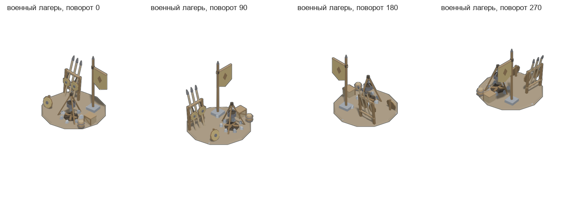
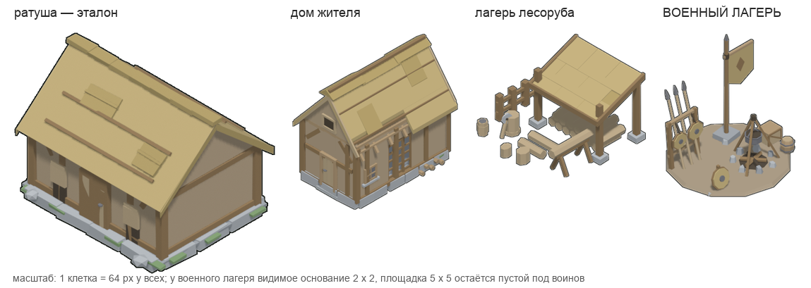
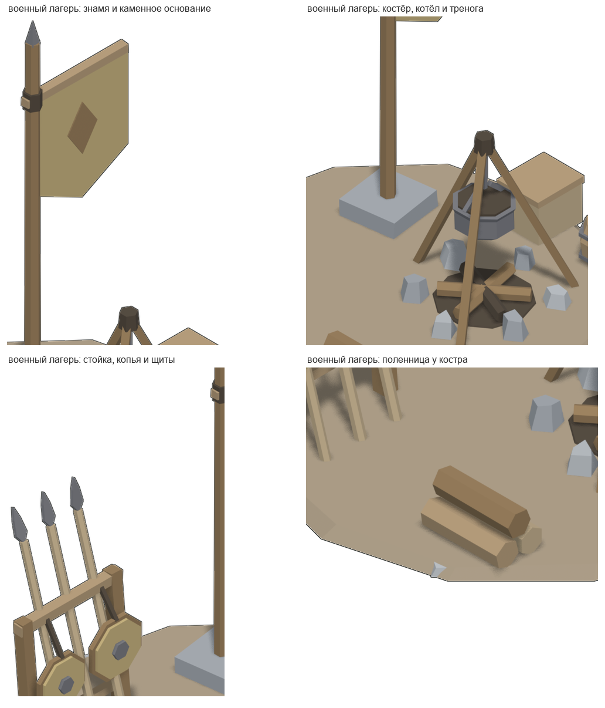

# Военный лагерь (площадка 5 x 5, модель 2 x 2) — точка сбора дружины

**Это не постройка.** У лагеря нет стен, щипца, кровли и цоколя: посреди
площадки **5 x 5** клеток стоит небольшая точка сбора, которая занимает
**2 x 2** клетки по центру. Остальное место площадки в модели намеренно
пустое — туда игра ставит воинов. Самих воинов в модели нет.

**В игре с 2026-10-22.** Тип `warcamp` подключён в `Buildings.TYPES`, атлас
грузят обе оболочки, а площадка стоит в деревне с начала партии. Воины,
обученные в казарме, идут сюда и ходят по кольцу территории, не заступая на
модель 2 x 2: `Buildings.patrolCells` открывает 21 клетку, `modelCells`
держит закрытыми четыре центральные. Правила — в `mapgen2/js/buildings.js`
и `mapgen2/js/session.js`, приёмка — `node mapgen2/tools/game.js`.

В центре — всё, что нужно дружине, чтобы собраться:

- **знамя** на каменном основании (вертикаль силуэта);
- **стойка** с тремя копьями и двумя круглыми щитами;
- **костёр** с котлом на треноге (кухня лагеря);
- **поленница** у костра;
- **ящик припаса** и **кадка**.

Шатров и палаток нет намеренно. Шатёр занял бы всю площадку 2 x 2 и читался
бы ещё одним домом, а заказчик сказал: «это точно не здание». Точка сбора
оставляет место строю и при этом сразу читается как военный лагерь: знамя,
копья, щиты, котёл.

Собрано по скиллу `4tox-building-forge` (метод), канон двора — `yard.md`,
стиль и гейт — `4tox-lowpoly-3d`, приёмка — `3d-model-acceptance`.
Сцена Blender `warcamp`, префикс имён `wc_`, кадр 96 ppu (истинная изометрия,
азимут 45°, подъём 35.2644°), перед — в `+Y`.





## Числа (последний прогон)

| | |
|---|---|
| Площадка в игре | **5 x 5** клеток |
| Сама модель | **2 x 2** клетки по центру; видимое основание **2.00 x 2.00** клетки |
| Крупность `mul` | **0.7973** = `siteMul(5)` (правило зазора × 0.92, `mapgen2/js/buildings.js`) |
| 1 клетка в модели | 1 / `mul` = **1.2542** юнита |
| Габарит модели | **2.5084 x 2.5084 x 2.525** юнита (в пятне 2 x 2, запас 0.03) |
| Зазор до кромок площадки | **1.500** клетки со всех четырёх сторон |
| Середина основания | **0.000 / 0.000** клетки |
| Полигонаж | **978** трис, **57** деталей |
| Материалы | **9** плоских красок ратуши, ни одного нового цвета |
| Кадр | 512 x 640 при 96 ppu, 4 поворота; @4x — 2048 x 2560 при 384 ppu |
| Атлас | `mapgen2/assets/warcamp/atlas.png` — **2089 x 651**, 4 кадра |
| Опора спрайта | центр площадки, `anchorX/anchorY` из `out/wc_<поворот>.json` |

Масштаб устроен так: в игре один юнит модели равен клетке только при
`mul = 1`. С `mul = 0.7973` модель 2 x 2 клетки строится как 2.5084 юнита, а
после поджатия на `mul` даёт ровно 2.00 x 2.00 клетки. Так же устроены ратуша,
дом и лагерь лесоруба (`docs/STRUCTURE.md`, `mapgen2/js/buildings.js`).

## Состав: что и зачем

| Деталь | Роль в кадре | Материалы (зоны ратуши) |
|---|---|---|
| Площадка-«пятак» 2 x 2 | утоптанная земля, наземный контур, 3 камня у кромки | `dirt`, `stone`, `stone2` |
| Знамя | вертикаль силуэта; полотнище с ромбом, видно на всех поворотах | `timber`, `beam`, `thatch`, `iron` |
| Стойка | две стойки, две перекладины, 3 копья, 2 щита на ремнях | `timber`, `beam`, `plank`, `iron`, `thatch` |
| Костёр | камни очага, зола, 3 полена, тренога | `stone`, `stone2`, `dark`, `timber`, `plank` |
| Котёл | висит на цепи, тёмное нутро, дужка | `iron`, `dark` |
| Поленница | 3 бревна разной высоты, торцы к камере | `plank`, `beam`, `timber` |
| Ящик | корпус, утопленная крышка | `plank`, `beam` |
| Кадка | три кольца с пузом, две стяжки, крышка | `beam`, `iron`, `plank` |

Ориентация: перед — в `+Y`. Полотнище знамени стоит вдоль оси X, а не под 45°:
камера изометрическая, её экранное «вправо» — это `(-X, -Y)`, поэтому плоскость
под 45° на повороте 0 видна целиком, а на 90 (игровой `FACE_ROT`) — **ребром**.
Ось X даёт 0.707 ширины и на 0, и на 90. Первый прогон это и показал: на 90
знамя исчезало. Проверено живым рендером, а не рассуждением.

## Стилевой контракт

Образец — **ратуша из игры** и три готовые постройки деревни: дом жителя,
лагерь лесоруба, казарма.

| Что | Как здесь |
|---|---|
| Палитра | 9 из 12 красок ратуши, дословно: `beam`, `dark`, `dirt`, `iron`, `plank`, `stone`, `stone2`, `thatch`, `timber`. `moss`, `thatch2`, `wall` не понадобились; новых цветов нет |
| Материал | один материал на зону, `rough 0.75`, `spec 0.12`; затенение даёт сцена |
| Геометрия | плоские фасеты, `use_smooth = False`, без UV и текстур |
| Полигонаж | 978 трис в бюджете класса `yard` 300..1500 |
| Камера и свет | 96 ppu, азимут 45°, подъём 35.2644°, солнце `(-0.36, 0.30, 0.88)` |
| Контур | 1.00 px при 96 ppu (`compose.py`) |
| Тень | **нет** — правило заказчика 2026-10-17 «убери тени у зданий»; строка ТЕНЬ стиль-гейта падает намеренно |

Почему знамя не зелёное: `moss` на плоской освещённой плоскости уходил из
палитры деревни на Δ29, и стиль-гейт падал на 180/270 (92.3..92.9 %). Светлая
солома `thatch` с тёмным ромбом `timber` даёт **100 %** на всех четырёх
поворотах. Цвет — решение гейта, а не вкуса.

## Чем проверено

| Проверка | Результат | Файл |
|---|---|---|
| Канон формы, габарит, бюджет, нормали | **ИТОГ: ПРИНЯТО**, замечаний по нормалям 0 | `acc/canon.txt`, `acc/canon.json` |
| Изнанки, 6 канонных видов | худшая деталь `fire_log_1` **11 px** (шум на тонком полене) | `acc/xray.txt` |
| Изнанки, сетка 32 ракурса | худший кадр **6 px**; ни одна деталь не выше порога шума | `acc/xray.txt` |
| Висящие детали | **нет** | `acc/xray.txt` |
| Z-fighting | **0 пар** (поленьям дана своя фаза) | `acc/xray.txt` |
| Приёмка `gate.py` по СЦЕНЕ (деталь = объект) | **GATE: PASS** — 0 провалов, 3 предупреждения | `acc/gate.txt`, `acc/report-warcamp.json` |
| Стиль-гейт 1x, 4 поворота | **4 из 5 PASS**, 0 WARN на каждом; палитра **100 %**, детализация, контур, полигонаж PASS; ТЕНЬ падает намеренно | `acc/style-gate-1x.txt` |
| Стиль-гейт @4x, 4 поворота | **4 из 5 PASS**, 0 WARN на каждом; палитра **100 %** | `acc/style-gate-4x.txt` |
| Посадка в площадку 5 x 5 | **ИТОГ: ПРИНЯТО**; основание 2.00 x 2.00, зазор 1.500, середина 0.000; силуэт против проекции 0.9..1.1 px | `acc/place.txt`, `acc/pack-atlas.txt` |
| Атлас | 4 кадра, ppu 96, mul 0.7973, пятно 5 x 5, `ground` 2.5084 | `acc/pack-atlas.txt` |
| Экспорт GLB | **passed** профиль `web`; 978 полигонов, 1812 верт., 9 материалов; одно предупреждение `missing-uv` — UV нет по стилю | `blender_validate_export` |
| Живая сборка | 4 поворота 1x и 4 поворота @4x в УЖЕ ЗАПУЩЕННОМ Blender; вьюпорт — `renders/live_view.png` | `acc/build-1x.json`, `acc/build-4x.json` |
| Осмотр | 4 поворота, 4 крупных плана, эталон рядом в одном масштабе | `out/sheet_warcamp.png`, `renders/closeups_warcamp.png`, `out/warcamp_vs_village.png` |

## Что осталось неидеальным и что не проверено

1. **Воины в модели не нарисованы** — по условию заказчика. Площадка 5 x 5 в
   спрайте прозрачна: вокруг модели на карте трава, а не нарисованный плац, и
   воины ходят по этой траве. Это осознанно: модель — точка сбора, а не
   мощёная площадь.
2. **`ground` посчитан по модели**, а не по пикселям: площадка — регулярный
   12-угольник, и пиксельный замер видит только ближний край. Такое же
   решение у дома и лагеря лесоруба (`docs/STRUCTURE.md`, § посадка).
3. **Тень снята намеренно** (правило 2026-10-17). Строка ТЕНЬ стиль-гейта —
   единственный FAIL, и он общий у всех построек игры, а не дефект этой модели.
4. **`gate.py` C9 даёт WARN** по пяти замкнутым деталям: `wc_shield_face_0/1`,
   `wc_shield_boss_0/1`, `wc_cauldron_chain` — знак объёма у гейта
   отрицательный. Проектный `xray` изнанок на них не видит, в кадре они
   освещены и читаются (щиты и цепь). Это WARN, а не провал; чинить «на всякий
   случай» переворотом граней не стал — переворот сделал бы их тёмными.
5. **Два предупреждения `gate.py`** — класса двора, а не дефекты: C5 «цоколь за
   стенами» (стен и цоколя нет, проверка уходит в эвристику) и C7 «полотна
   двери/окна не нашлись» (дверей и окон нет). Оба ожидаемы.
6. **Знамя — плоская панель.** На 0/90 видно 0.707 ширины, на 180/270 — её
   обратную сторону; объёма у полотнища нет, и это осознанно: тонкий объём в
   спрайте не читается.
7. **`.blend` отдан копией и содержит стартовую сцену `Scene`** с кубом,
   светом и камерой Blender: мы не стираем файл заказчика и не зовём
   `read_factory_settings`. Активная сцена — `warcamp`; куб лежит в другой
   сцене и на модель не влияет.
8. **Проверено в живой игре:** тип подключён, площадка стоит в деревне,
   воины после казармы доходят до лагеря и 120 с ходят только по 21 клетке
   территории, ни разу не заступив на модель 2 x 2
   (`node mapgen2/tools/game.js`, кадр `tools/out/barracks-warcamp.png`).
   Порядок отрисовки спрайта с воинами проверен кадром, а не отдельным
   числом.

## Файлы

| файл | что делает |
|---|---|
| `tools/warcamp.py` | **ГЕОМЕТРИЯ**: чистый Python, вся модель и раскладка. Главный файл |
| `tools/village.py` | **ПАЛИТРА**: 12 красок ратуши, зона -> краска; новый цвет сюда не добавить |
| `tools/forge.py` | примитивы, отсев невидимых фасетов, триангуляция |
| `tools/xray.py` | софт-рендер и детектор дефектов (изнанки, зазоры, z-fighting) |
| `tools/canon.py` | приёмка по канону; для класса `yard` не меряет стены и скат |
| `tools/blender_live.py` | материалы, свет, камера, рендер, экспорт (внутри Blender) |
| `tools/build_live.py` | точка входа сборки в живом Blender; режим `gate` — деталь = объект |
| `tools/mcp.py` | клиент сокета аддона blender-mcp (снаружи Blender) |
| `tools/compose.py` | сырой кадр -> спрайт: обрезка, контур, без тени |
| `tools/pack_warcamp.py` | 4 кадра -> `mapgen2/assets/warcamp/atlas.{png,json,js}` |
| `tools/place_warcamp.py` | приёмка посадки: 2.00 x 2.00, зазор, середина |
| `tools/run_gate.py` | приёмка `gate.py` по СЦЕНЕ (деталь = объект) |
| `tools/sheets.py` | листы: 4 поворота, крупные планы, «эталон рядом» |
| `spec.json` | замороженный спек и пороги приёмки |
| `live_config.json` | 4 поворота 1x, 96 ppu |
| `live_4x.json` | 4 поворота @4x, 384 ppu |
| `live_gate_build.json` | сцена для приёмки: деталь = объект |
| `live_export.json` | экспорт GLB/OBJ и `.blend` копией |
| `out/wc_model.glb` | **портативная модель** (Y вверх), 978 трис, 9 материалов |
| `out/wc_model.obj` | то же для DCC (Z вверх) |
| `wc_model.blend` | сцена Blender; активная сцена `warcamp` |
| `acc/` | выводы приёмок, не переписанные вручную |

## Как пересобрать

```bash
PY3=/Users/hermmoment/.dsh/dsh-runtimes/dsh-primary-runtime/dependencies/python/bin/python3
PY=/Users/hermmoment/.dsh/profiles/desktop/node_modules/dsh-blender/.venv/bin/python

$PY3 tools/canon.py --gen tools/warcamp.py                  # ИТОГ: ПРИНЯТО
$PY3 tools/xray.py probe --gen tools/warcamp.py --full      # изнанки/зазоры/z-fighting
$PY tools/mcp.py run tools/build_live.py                    # 4 поворота 1x
$PY tools/mcp.py run tools/build_live.py -- --config live_4x.json   # 4 поворота @4x

for r in 0 90 180 270; do
  $PY3 tools/compose.py --raw renders/wc_x_${r}_raw.png --out out/wc_${r}.png \
      --ppu 96 --anchor-raw 256,320 --no-shadow --json out/wc_${r}.json
done
# то же для @4x: --ppu 384 --anchor-raw 1024,1280, файлы out/wc_<r>@4x.png

$PY3 tools/pack_warcamp.py                                   # атлас в игру
$PY3 tools/place_warcamp.py                                  # ИТОГ: ПРИНЯТО
$PY3 tools/sheets.py                                         # листы осмотра

# приёмка по сцене: сначала сцена ПО ДЕТАЛЯМ, потом gate.py
$PY tools/mcp.py run tools/build_live.py -- --config live_gate_build.json
$PY tools/mcp.py run tools/run_gate.py > acc/gate.txt

# экспорт
$PY tools/mcp.py run tools/build_live.py -- --config live_export.json
```

Стиль-гейт (16 кадров, два прогона) — команда в `spec.json`, поле
`_style_gate`; выводы лежат в `acc/`.

## Подключение к игре (сделано)

1. `mapgen2/js/buildings.js` → `TYPES`: тип `warcamp`, атлас
   `assets/warcamp/`, `meta` = `WARCAMP_ATLAS`, пятно 5 x 5.
2. `<script src="assets/warcamp/atlas.js"></script>` в `mapgen2/index.html` и
   `game/index.html` до модулей игры.
3. Загрузка типа в `game/js/boot.js`.
4. Правило «модель 2 x 2 по центру, остальные 21 клетка — территория воинов»:
   `Buildings.modelCells` / `patrolCells`, путь воина — `Villagers.warriorUpdate`
   по карте `Villagers.campSolid`.

Модель по-прежнему отдаётся как GLB/OBJ/Blender — подключение к игре её не
меняет.
