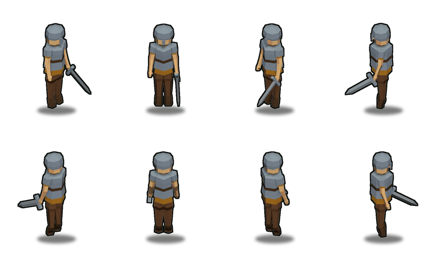

# Житель в броне (armored_villager) — воин деревни для mapgen2

Мужской житель в железной броне, со шлемом и мечом. Тот же рост, скелет, поза и
клетка атласа, что у [жителя](../villager/README.md): это **вариант** человека
(`person.build(variant='k')`), а не новая анатомия. Проект отдельный, чтобы
боевой атлас жителя не пересобирался.

| Что | Число |
|---|---|
| Рост (габарит по Z) | **1.005** юнита (канон человека 0.98..1.02) |
| Габарит X × Y | 0.504 × 0.332 (меч выходит за плечи — это оружие, не тело) |
| Полигонаж | **686 трис / 395 верт**, 26 деталей (бюджет `hero` 300..700 / 180..480) |
| Клетка атласа | 112 × 132, опора **(56, 106)**; 4x — 448 × 528, опора (224, 424) |
| Повороты | 0 / 45 / 90 / … / 315, анимации `idle`, `walk` и `work` |
| Кадры | `out/av_idle_0_<поворот>.png`, `out_kn/kn_idle_*`, `out_kn/kn_walk_*`, `out_kn/kn_work_*` |

## Что надето

| Деталь | Семейство | Трис | Зачем так |
|---|---|---|---|
| Кираса, 5 сечений (внизу — горжет) | `iron` | 56 | от бедра до ключиц; верхнее кольцо 0.053 вокруг шеи закрывает ворот |
| Пояс поверх кирасы | `leather` | 20 | тёмная лента поперёк железа: цвет читается и без рельефа |
| Наплечники (2) | `iron` | 40 | почти цилиндр: нижний край НЕ уже рукава, иначе ткань торчит кольцом |
| Шлем (4 сечения, 8 граней) | `iron` | 60 | радиусы сняты с головы (скула +6%, затылок +9%), зазор +0.007 |
| Наносник | `iron` | 12 | от отворота до кончика носа; 0.034 в ширину = 2.3 px |
| Меч: клинок / крестовина | `salt` / `iron` | 14 + 12 | клинок 0.34, крестовина 0.152 (10 px) — она и делает меч мечом |
| Рубаха, рукава | `leaf_autumn` | 32 + 32 | тёплая ткань под холодным железом; ворот рубахи срезан под горжет |
| Голова, шея, кисти | `skin` | 60 + 16 | единственное выведенное семейство атласа |

Волос и ушей под шлемом нет: шлем их заменяет. Рукояти меча в меше нет — кисть
это труба-кулак, рукоять целиком внутри неё.

## Как собрано

Геометрия — чистый Python (`tools/person.py`, без `bpy`), сборка — в **уже
запущенном** Blender через сокет аддона (правило заказчика 2026-10-12):

```bash
PY=/Users/hermmoment/.dsh/profiles/desktop/node_modules/dsh-blender/.venv/bin/python
PYX=/Users/hermmoment/.dsh/dsh-runtimes/dsh-primary-runtime/dependencies/python/bin/python3

$PYX tools/metrics.py --variant k          # форма: ИТОГ: ПРИНЯТО
$PYX tools/xray.py probe --variant k       # изнанки, зазоры, z-fighting
$PYX tools/contain.py --outer helmet --inner head --above 0.885   # голова в шлеме
$PY tools/blmcp.py run tools/build_live.py --config live_config.json   # 1x
$PY tools/blmcp.py run tools/build_live.py --config live_4x.json       # 4x
$PY tools/blmcp.py run tools/build_live.py --config live_chk.json      # 8 ракурсов
$PYX tools/compose.py --tag av  --anims idle --frames 0 --out out
$PYX tools/compose.py --tag av4 --ppu 384 --res 576,768 --anims idle --frames 0 --out out4
```

**`tools/contain.py` — главный прибор этой правки.** Он берёт точки внутренней
детали (вершины, середины рёбер, центры граней), пускает из каждой четыре
**косых** луча и считает, внутри ли замкнутой оболочки внешней детали. Осевые
лучи не годятся: у кольца есть вершина ровно на 0°, и луч проходит через неё —
пересечение то есть, то нет.

`build_live.py` после цикла кадров возвращает сцену в покой и поворот 0 — иначе
в сцене и в копии `.blend` остаётся последний поворот (270°, спиной к камере).
Если последним запускался 4x-конфиг (у него `save_blend: false`), сцену надо
вернуть 1x-прогоном. Копия файла — только `save_as_mainfile(copy=True)`.

Выгрузка: `out/armored_villager.glb` (Y вверх) и `.obj` (Z вверх), рост 1.005.
`.blend` — `armored_villager.blend`, открывается в покое лицом к камере.

## Приёмка (числа прогона 2026-10-20)

| Слой | Чем | Результат |
|---|---|---|
| Форма | `metrics.py --variant k` | **ИТОГ: ПРИНЯТО**: рост 1.005, голова 23%, плечи 30%, кисть 40%, низ на z=0, запас штанов +0.025, 0 мельче 2 px, 0 замечаний по нормалям |
| Дефекты | `xray.py probe --variant k` | **0 видимых изнанок**, 0 зазоров, 0 z-fighting, 0 деталей < 2 px |
| Вложения | `contain.py` | голова в шлеме — **0 из 73** точек снаружи выше 0.885; рубаха в кирасе — **0 из 73** (0.50..0.752); рукав в наплечнике — **0 из 29** (0.70..0.78) |
| Кадр 1x | `audit.py --kind hero --tris 686` | **4 из 4 поворотов: 0 FAIL, 0 WARN** (палитра 98.4..99.2%, фасеты 38..57%, контур 2.00 px, тень h/w 0.16..0.19) |
| Кадр 4x | он же, `--ppu 384` | **4 из 4 поворота: 0 FAIL, 0 WARN** |
| Восемь ракурсов | `live_chk.json` → `renders/turnaround8.png` | голова не выходит ни на 45°, ни на 135°/225°/315° |
| Выгрузка | импорт GLB | 686 полигонов, 17 материалов, размеры 0.504 × 0.332 × 1.005 |

Для игры кадры сняты заново — 8 поворотов, `idle` / `walk` / `work`
(`live_knight.json`, `out_kn/`); форма модели при этом не менялась.

## Что нашлось при взгляде в фас и по кругу (2026-10-20)

В изометрии дефект не виден; в ортографическом виде из Blender — виден сразу:
**голова протыкала шлем оранжевой полосой во весь лоб**. Первая правка (шлем
шестигранник → восьмигранник) убрала полосу спереди, но **не закрыла проблему до
конца**: заказчик повернул модель и увидел голову с других сторон.

Замер `contain.py` показал настоящую причину: у головы скула расширена на 6%
(`HEAD_JAW 1.12`), а затылок — ещё и яйцом (+9% на 180°). Её реальный максимум
на брови — **0.091 по Y**, а шлем был 0.090/0.084. Голова выходила с боков, на
висках и на темени: **19 точек снаружи** выше брови. Шлем увеличен до конверта
головы +0.007 (0.090/0.098 на брови, 0.094/0.102 выше, 0.086/0.094 у темени) —
стало 0.

Плечи: рубаха (плечо 0.745, 0.110) оставалась над кирасой, а верх рукава
торчал над наплечником. Сделано: кираса поднята до 0.752 и накрывает плечевое
кольцо рубахи, верх рукава убран под наплечник (-0.004), наплечник стал почти
цилиндром (0.050 на конце против рукава 0.045), а ворот рубахи заменён железным
**горжетом** (кольцо 0.053 вокруг шеи) — оранжевые клинья на плечах исчезли.



## Решения, которые стоили итераций

1. **Бюджет 700 — жёсткий.** После срезания ворота рубахи и добавления кольца
   горжета фигура весит 686. Борода (56 трис) в бюджет не влезла.
2. **Кольцо талии туники нельзя выбрасывать.** Средние кольца под кирасой не
   видны, но если срезать все, туника идёт от подола к груди прямой и на талии
   вылезает тёплой полосой. Оставлено кольцо 0.618.
3. **Верх кирасы отогнут наружу (0.017 против 0.014).** Кромка доспеха и защита
   от ложного z-fighting: фасет отворота наклонён в другую сторону, чем длинный
   фасет туники под ним.
4. **Клинок 0.34 и наклон 40°.** Длинный клинок на повороте 90° проецировался
   ниже подошв на 9 px, и гейт тени падал честно: пятно под ступнями оказывалось
   выше острия. Под 40° остриё выше подошв на 2.2 px.
5. **Шлем с наклонным низом.** Горизонтальный низ читался кепкой поперёк лба;
   спереди край выше брови, на затылке ниже.
6. **Шлем — восьмигранник, как голова, и по её конверту.** Шестигранник при том
   же радиусе стоит гранью на 13% ближе к оси; кроме того, шлем был уже
   раздатой скулы. Оба числа нашлись замером, а не глазом.
7. **Наносник — до носа, рукав — под наплечник.** Короткий наносник на брови
   читался усами; верхняя крышка рукава торчала оранжевым шипом над железом.

## Что осталось неидеальным

* **Шлем на 1x ближе к «каске», чем к рыцарскому шлему** — он широкий и низкий:
  высокий купол вылез бы за канон роста, а поля шляпы закрыли бы лицо при
  подъёме камеры 35°.
* **Затылок под шлемом — голая кожа.** Между краем шлема (0.87) и горжетом
  (0.77) видна шея сзади; назатыльник/койф стоил бы ещё 12–16 трис.
* **На повороте 270° меча не видно**: он в правой руке, а камера смотрит в
  спину — клинок за корпусом.
* **Сняты `idle`, `walk` и `work`**; `carry`/`walk_axe` не снимались: рыцарь
  не носит брёвен и не рубит топором. `work` — удар мечом, он и играется как
  короткая тренировка во дворе.
* **Атлас лежит отдельно** — `mapgen2/assets/armored_villager/`; упаковщик
  `tools/pack_armored.py` не трогает `mapgen2/assets/villager/`. Игра грузит
  его как `ARMORED_VILLAGER_ATLAS` и выбирает по занятости
  (`Renderer.villagerSet`).

## В игре

Атлас собран `tools/pack_armored.py` (см. `out_kn/`), лежит отдельно от жителя —
`mapgen2/assets/armored_villager/` — и грузится обеими оболочками как
`ARMORED_VILLAGER_ATLAS`. Рыцарь — это тот же житель с `v.employer` = казарма;
`Renderer.villagerSet` по этому полю берёт `knightSprites` вместо
`villagerSprites`. Второго поля «рыцарь» нет. Ходьба идёт кадром `walk`, стоянка во дворе — `idle`, а раз в несколько
секунд — один проход `work` (удар мечом). Бой, здоровье и урон не добавляются.

## Состав проекта

```
tools/          копия рабочего набора жителя (2026-10-20), отличие — variant 'k'
  person.py     анатомия + SPEC_K, build_cuirass (с горжетом) / armor_belt /
                pauldron / helmet (8 граней по конверту головы) / sword
  contain.py    НОВЫЙ: проверка «деталь внутри детали» по 360°, косые лучи
  metrics.py    добавлен 'helmet' в верх головы, --variant k
  xray.py       добавлен --variant
  scene.py      своя сцена armored_villager, префикс av_
  build.py      av_ / av_armored_villager, VARIANT = 'k'
  pack_armored.py  упаковщик: out_kn/*.png -> mapgen2/assets/armored_villager/
live_config.json / live_4x.json    кадры 1x и 4x, tag av / av4
live_chk.json                      8 ракурсов для проверки по кругу, tag avchk
live_knight.json                   кадры рыцаря для игры: idle + walk + work, 8 поворотов, tag kn
out_kn/                            кадры kn_*, kn_sprites.json — то, что упаковано в игру
renders/        сырые кадры, отчёты, live_view, turnaround.png / turnaround8.png
out/            спрайты 1x, av_sprites.json, .glb / .obj / .mtl
out4/           спрайты 4x, av4_sprites.json
out_chk/        спрайты 8 ракурсов
armored_villager.blend   копия сцены (не файл заказчика)
```

Инструменты — **копия** проекта жителя, а не импорт: проект остаётся рабочим,
даже если соседний переедет. При обновлении скилла копии обновляются
`scaffold.py --force` (см. `4tox-building-forge`).
