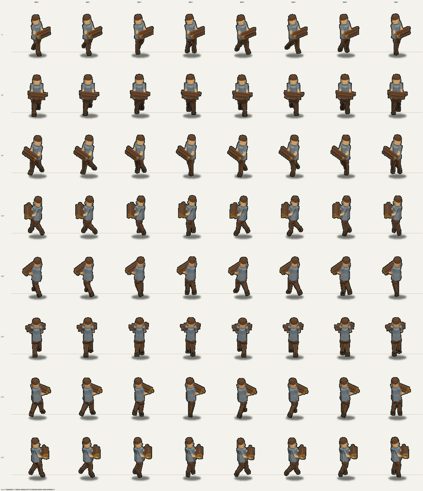
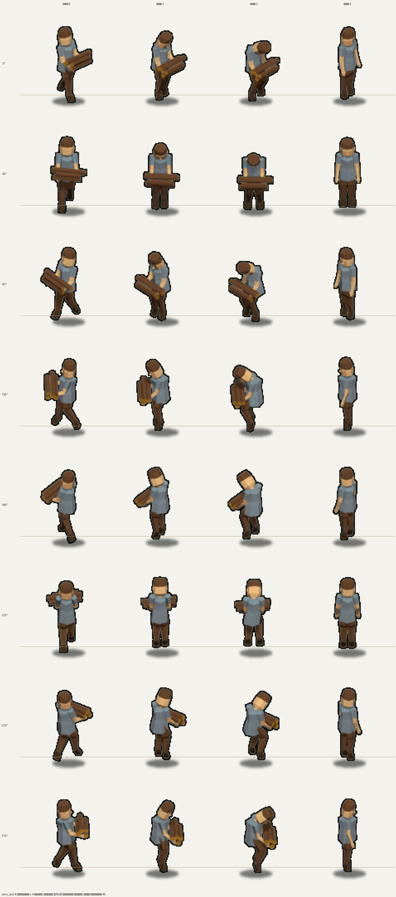
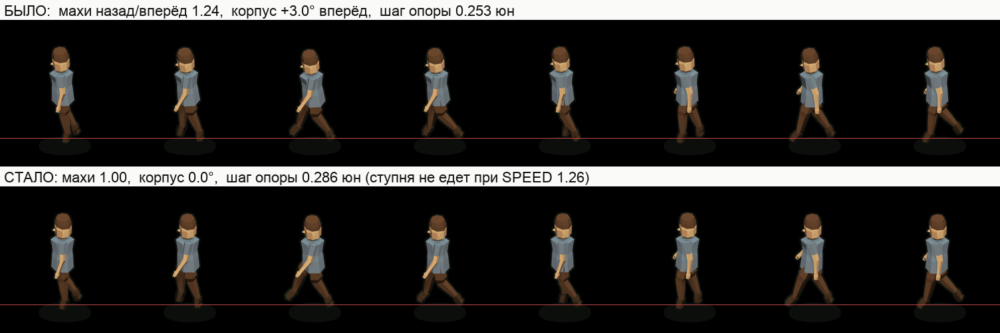
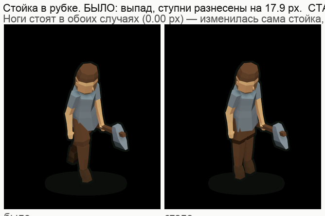
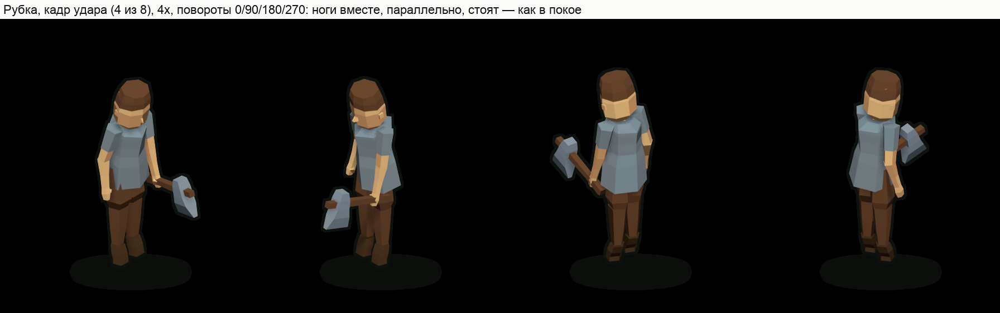

# Житель (villager) — мужской персонаж для mapgen2

Второй человек в игре — мужчина. Собран с нуля: параметрическая фигура на чистом
Python, сборка в **уже запущенном** Blender через MCP-сокет, приёмка числом —
стиль-гейт 672 кадра без единого FAIL и WARN.

**Итог:** `mapgen2/assets/villager/{atlas.png,atlas.json,atlas.js}` — 336 кадров
(idle 6, walk 8, work 8, **carry 8**, **walk_axe 8**, **carry_put 4**) x **8 поворотов** через 45°,
клетка и опора те же, что у героя (112 x 132, anchor 56,106). Третья анимация —
**рубка дерева топором** (2026-10-14): в кадрах `work` у жителя в правом кулаке
топор, отсюда 670 трис вместо 598. Четвёртая, пятая и шестая (2026-10-15) — **носка
брёвен** `carry` (охапка из четырёх брёвен в двух руках, 678 трис), **ходьба с
топором** `walk_axe` (тот же топор, что в рубке, но в шаге) и **сдача брёвен**
`carry_put` (4 кадра, не цикл: наклон, руки вниз, сдал, выпрямился). Плюс
`out/villager.glb` и `out/villager.obj` (выгружаются в позе покоя, без топора и
без охапки).


Сверху — герой-лесоруб (эталон игры), снизу — житель, повороты 0/90/180/270.
Один масштаб, одна линия земли, одна клетка атласа, увеличение x5 без сглаживания.

## Что именно сделано

| Что | Число |
|---|---|
| Рост | **0.993 юнита** (у героя 0.982..1.008); в кадрах носки 0.981 — корпус отклонён назад |
| Треугольников / вершин | 598 / 344 в покое и на шаге, **670 / 384 в рубке и с топором на ходу**, **678 / 440 с охапкой** (бюджет класса `hero` 300..700 / 180..480) |
| Крупных фасетов на кадр | 6..11, в них 33..64% площади (канон >=30%) |
| Палитра канона | 97.7..99.6% пикселей (порог 93%) |
| Контур | 2.00 px — как у героя |
| Тень | ширина/силуэт 0.94..1.08, h/w 0.14..0.20 (в рубке и с топором на ходу пятно шире — стойка и топор) |
| Стиль-гейт | **672 из 672 кадров: 0 FAIL, 0 WARN** (`tools/gate.py`, 336 на 1x и 336 на @4x) |
| Приёмка фигуры | `tools/metrics.py --variant m`: ИТОГ ПРИНЯТО (в том числе топор: 90°, кулак, клетка) |
| Приёмка шага | `tools/gait_probe.py`: ИТОГ ПРИНЯТО (симметрия **1.00**, наклон корпуса **0.00°**, клиренс 2.0 px, руки 0%, замер шага 0.573 кл/с × правило +10% = SPEED игры) |
| Приёмка стойки в рубке | `tools/gait_probe.py --anim work` (feet lock включается сам): ИТОГ ПРИНЯТО (подошвы **0.00 px** за все 8 кадров, ступни **вместе и параллельно** — как в покое) |
| Приёмка шага с ношей | `tools/gait_probe.py --anim carry`: ИТОГ ПРИНЯТО (симметрия 1.26, клиренс 2.2 px, руки 0% — охапка не даёт размаха) |
| Изнанки / зазоры / z-fighting | 1 px на «носе» при виде 45/5 — было и до правки; в канонных видах 0 / 0 / 0 |
| **Топор не добавил дефектов** | `tools/xray.py probe --anim work --frame 3 --axe` | 0 зазоров, 0 z-fighting с топором; рукоять 9.0 x 33.2 px, голова 17.3 x 16.0 px (порог 2 px) |
| **Охапка не добавила дефектов** | `tools/logs_probe.py --anim carry`, `tools/xray.py probe --anim carry --frame 0..7` | 0 изнанок и 0 зазоров на брёвнах; до рубахи 2.9 px, до подола и ног 8.3 px, лежит на предплечьях (−0.014 юнита) |

### Восемь поворотов вместо четырёх (2026-10-13)

Заказчик: «важно, чтобы он ходил не только по двум осям вправо и налево, а
вообще как хочет, — так как это 3D-модель, он так может, то есть он должен быть
повёрнут к этому дереву и идти к нему».

В игре (`js/villager.js`) курс жителя — свободный угол, а атлас до этого знал
четыре поворота: на диагональном ходу спрайт смотрел бы вбок от движения.
Добавлены 45/135/225/315 — те же 22 кадра на каждый, тем же пайплайном
(`live_8.json`, `live_8_4x.json`), атлас стал 912 x 3216. Кадры 0/90/180/270
при этом **побитово те же**, что были: старый и новый атласы сверены попиксельно
по всем 88 прежним кадрам, расхождение 0.

Гейт прогнан заново на обоих масштабах: **тогда 352 из 352 кадров, 0 FAIL, 0 WARN**
(сегодня, с ноской и ходьбой с топором, в атласе 304 кадра — и гейт даёт 608 из
608, см. таблицу выше). Новые углы ничего не сломали и в самой форме: полигонаж
598 трис, высота 0.995..0.997 юнита — те же числа, что на четырёх прежних поворотах.


Сверху вниз — 0/45/90/135/180/225/270/315°, слева восемь кадров ходьбы, справа
покой. Камера та же, что в игре (азимут 45°), поэтому 45° смотрит в камеру, а
225° — от неё.

### Чем мужчина читается на 96 ppu

Лица как лица в этом масштабе нет (замер эталона: внутри кожи ноль тёмных
пикселей), поэтому пол держится формой:

* **короткая стрижка** — широкая шапка волос по темени (верх 0.052, а не 0.036:
  конус на темени читался колпаком) с узким локоном-чёлкой;
* **борода** — тёмная оболочка по нижней части лица (подбородок -> усы), семья
  `trunk`: самая сильная мужская примета в этом размере;
* **квадратная челюсть** — скула x1.12, подбородок x1.18 к женским;
* **прямая рубаха до бедра** (`TUNIC_PROF`, семья `stone`) — без клеша, который
  превращал фигуру в колокол;
* **мешковатые штаны** (`trunk`, плотность 1.34) до голенища сапога;
* **плечи 31% роста** (шире таза), шея толще, кисти крупнее;
* **руки свободны** — ни корзины, ни сумки: лишний предмет в руке читался
  хозяйственным, а не рабочим;
* **детали, которые доехали до 1x**: уши (2..3 px), бакенбарды, сходящиеся с
  бородой, планка на груди (2 x 10 px), кисть с узким запястьем и широкой
  ладонью, широкая подошва под сапогом.

Обувь `leather`, кожа (лицо, шея, кисти) `skin`, волосы и борода `trunk` —
всё тона атласа игры.

### Топор в кулаке (2026-10-14)

Заказчик: «на время рубки дерева у жителя должен появиться топор в руке, причём
правильно расположенный, то есть **под 90 градусов относительно оси руки**, и
держать он его должен именно **в кулаке**, а не где-нибудь в локте». Заодно
третья анимация перестала быть «сбором» (наклониться и что-то поднять) и стала
**рубкой**: до этого жителю нечего было делать руками, и `work` в игре не
игралась вовсе.

Что сделано и чем это доказано:

| Что | Как | Число |
|---|---|---|
| Рукоять поперёк оси руки | `person.build_axe`: рукоять вдоль локального `+X` кисти, ось руки — локальный `+Z` | **90.0000°** в каждом из 8 кадров рубки |
| Черенок проходит через КУЛАК | середина кисти посажена на ось черенка, `AXE_GRIP` | расстояние до оси **0.0000**, хват на **22%** рукояти от комля |
| Топор только в рубке | `person.build(..., axe=True)` зовётся для `anim='work'` | в покое и на шаге 598 трис, в рубке **670** (бюджет 700) |
| Голова — железо, а не камень | канон `art/props/axe/README`: камень валунов; у жителя рубаха того же семейства `stone` | каменная голова сливалась с плечом на 4x |
| Голова меньше канонной | станции `axe.py` сжаты до 0.87 по лезвию и 0.80 по высоте | канонная (0.22 × 0.17) в кулаке читалась кувалдой |
| Замах «перед лицом», не через голову | `poses.WORK`: `sh+el = 86°` на замахе | верх кадра 97.0 px из 106; рука над головой даёт 105..110 px — обрез клетки |

Проверяется это **двумя** инструментами, и оба считают по геометрии, а не по
картинке: `tools/metrics.py` (угол, кулак, хват, габарит — в общей приёмке
фигуры) и `tools/axe_probe.py` (то же по всем восьми кадрам рубки плюс докудова
достаёт кромка — из этого числа игра берёт сдвиг `STAND_OFF`, с которого житель
рубит: 0.47 юнита против 0.88 до коры).


Кадры рубки, 4x: 0 — топор у пояса, 3 — замах, 4 — удар, 6 — отдача.

### Охапка брёвен и ходьба с топором (2026-10-15)

Заказчик дал жителю рабочий цикл в лагере лесоруба: подошёл, взял топор, пошёл к
дереву (`walk_axe`), рубит пять секунд (`work`, была), отнёс брёвна в лагерь
(`carry`), сдал. Движок зовёт анимации ПО ИМЕНАМ и деградирует мягко: нет
анимации — берётся запасная, поэтому у каждой из двух новых есть точный контракт
с `js/villager.js`, а не «красивая поза».

| Что | Как | Число |
|---|---|---|
| Брёвен ровно ЧЕТЫРЕ | `person.build_logs`, `LOG_LEN` — разные длины | **0.404 / 0.357 / 0.436 / 0.324** юнита = **31..42 px** (замер `tools/logs_probe.py` по крайним вершинам; номинальные длины в `LOG_LEN` — 0.400 / 0.352 / 0.432 / 0.318, то есть на 0.004..0.006 короче); игра начисляет +4 за ходку (`js/villager.js`: LOGS_PER_TRIP) |
| Бревно читается на 96 ppu | шестигранник радиусом 0.031 | 6.0 px в толщину, торцы 4.0..4.4 px (порог 2 px) |
| Кора тёмная, торцы светлые | боковина `trunk`, торцы `leaf_autumn` — ОТДЕЛЬНЫМИ деталями | тон верхней грани коры #523521 (82,53,33), торец #895B18 (137,91,24): разница 55 по сумме каналов |
| Охапка посажена в СИСТЕМУ ПРЕДПЛЕЧЬЯ | ось бревна — локальный +Y предплечья, поперёк руки | сдвиг к середине корпуса выведен формулой от `SHLD_X`, `UPARM_L`, `armout` (не подобран) |
| Нулевой кадр — стойка | фаза цикла 90°: обе подошвы на земле | расхождение подошв **0.0012 юнита = 0.09 px** (`logs_probe --phase`) |
| Цикл замкнут | все кривые ног периодические, кадр 8 = кадр 0 | шва нет по построению; мерцание соседних кадров 1.4..3.6 при пороге 45 |
| Вес читается | корпус назад, плечи подняты, шаг короче | lean −3.5° + chest −1.5° (в walk +3.0 и +1.0 — то есть в противоположную сторону), `shrug` +0.010 юнита, шаг опоры 16.3 px против 19.8 px у walk |
| Руки заняты — размаха нет | sh/el/armout обеих рук — константы | путь кистей 0.010 и 0.010 юнита, разница 0% (`gait_probe --anim carry`) |
| Охапка НЕ в корпусе и НЕ в ногах | зазор до шестиугольника рубахи и до подола | 2.9 px до рубахи (порог 2 px), 8.3 px до подола и ног, лежит на предплечьях (−0.014 юнита) |
| Кадр влезает в клетку | замер по восьми поворотам | верх 83.2 px из 106, вбок ±31.0 из 56, низ +8.8 из 26 |
| `walk_axe`: тот же топор и тот же хват | `person.build_axe` в правой руке, угол как у кадра 0 рубки | ⊥ оси руки **0.0000°**, черенок в кулаке **0.0000**, хват 22% рукояти; верх кадра 82.4 px из 106 |
| `walk_axe`: рука с топором не машет | sh_r/el_r/armout_r — константы, левая качается как в walk | иначе топор описывает дугу 0.27 юнита = 26 px и на повороте 315° уходит за клетку |
| Тень под охапкой | `tools/fit_shadow.py --anim carry` по 64 кадрам | ширина/силуэт **0.87..1.05** — ровно ядро канона 0.85..1.05; `b` 4.5 -> 5.0 (h/w 0.10..0.26) |
| Тень под ходьбой с топором | он же, `--anim walk_axe` | пятно покоя давало 0.61..1.42 и 17 WARN из 256; `a` 20 -> 26 даёт 0.79..1.67 без WARN. Подбор предлагал `a=24` (0.73..1.55) — взят 26: то же пятно, что у рубки (силуэт расширяет одна и та же голова топора), и запас до предела гейта 0.70 важнее близости к ядру |
| Тень под сдачей | он же, `--anim carry_put` | то же пятно, что у `carry`, и это не «на глаз»: нулевой кадр у них ОДИН, и с разными пятнами он перестал бы совпадать (0.88..1.79 против 0.83..1.05 у самой носки — оба внутри предела) |

Проверяется это тремя приборами, и все три считают по геометрии, а не по картинке:
`tools/logs_probe.py` (охапка: число, длины, зазоры до корпуса/рук/ног, габарит
кадра), `tools/metrics.py --anim carry` (то же в общей приёмке фигуры) и
`tools/gait_probe.py --anim carry` (шаг с ношей).



Контактный лист `carry`: строка — поворот, столбец — кадр, линия земли — общая
(её рисует `tools/sheet_anim.py` по опоре 56,106; «поехавшая» опора видна на
листе сразу). Числа мерцания и разбор — `out/show/carry_jumps.json`.

**ПОЧЕМУ ОХАПКА ВИСИТ НИЗКО, У ПОЯСА.** Первая сборка держала её на груди
(`sh+el = 90°`, предплечья горизонтально) — на повороте 180 охапка вставала
ровно на голову и закрывала лицо: в изометрии всё, что дальше от камеры,
проецируется ВЫШЕ, и охапка «уезжала» на плечо. Угол локтя уменьшен до
`sh+el = 70°` (предплечья вперёд-вниз), низ охапки опустился с 0.607 до 0.533
юнита — 5.8 px, и голова на 180 свободна.

**ПОЧЕМУ ФАЗА ЦИКЛА 90°, А НЕ 165°.** Игра ЗАМОРАЖИВАЕТ нулевой кадр `carry`,
когда житель сдаёт брёвна, поэтому кадр 0 обязан быть стойкой: обе подошвы на
земле. Замер нашёл две такие фазы — 165° и 90°. Из них взята 90°, и вот почему:
сетка кадров идёт через 45°, и на фазе 165° пик сгиба колена (315°) попадает
МЕЖДУ кадрами — прибор честно мерил соседний кадр, где бедро идёт назад, и
писал «отброс ступни за таз». На 90° сетка ложится на кривые, и все три проверки
шага (симметрия, фаза колена, клиренс) считаются по тем же фазам, что видит
игра. Цена: стойка нулевого кадра — с шагом 0.25 юнита между ступнями (16 px),
а не «ноги вместе». Мера этого выбора — расхождение подошв 0.09 px.

### Сдача брёвен: `carry_put` (2026-10-15)

Четвёртая анимация того же дня — 4 кадра, НЕ цикл: наклон вперёд, руки вниз,
сдал, выпрямился. Движок зовёт её по имени `carry_put`, а если её нет —
замораживает нулевой кадр `carry`.

| Что | Как | Число |
|---|---|---|
| Переход `carry -> carry_put` бесшовный | кадр 0 — это ВЫЗОВ `carry(0)`, а не копия чисел | `out/vg_carry_0_*.png` и `out/vg_carry_put_0_*.png` совпадают **побитово на всех 8 поворотах** |
| Охапка опускается к колену | замер по кадрам, низ охапки | 0.527 -> 0.436 -> 0.392 юнита (кадры 0/1/2) |
| Охапка не входит в корпус и в ноги | `tools/logs_probe.py --anim carry_put` | до рубахи 2.9 px (порог 2), до бедра/голени 4.0 px |
| Кадр влезает в клетку | замер по восьми поворотам | верх 82.7 px из 106, вбок ±30.9 из 56, низ 8.8 из 26 |
| Мерцание | `tools/sheet_anim.py --anim carry_put` | худший переход 39.3 при пороге 45 (это и есть «сброс»: кадр 2 -> 3 самый большой за анимацию) |
| Гейт | `tools/gate.py --anims carry_put` | 32 кадра, 0 FAIL, 0 WARN |



**ПОЧЕМУ В ПОСЛЕДНЕМ КАДРЕ РУКИ ПУСТЫ, А БРЁВЕН НА ЗЕМЛЕ НЕТ.** Это не
недоделка, а отказ по замеру, и он стоит того, чтобы его прочли:

1. **Руки до земли не достают.** Плечо в покое на 0.745, рука 0.357, а кости
   между тазом и плечом у модели НЕТ (грудь поворачивается вокруг точки в 0.015
   под плечом) — значит наклон корпуса плечо вниз не тянет, его опускает только
   присед. Предел, который удалось собрать без пересечений: низ охапки 0.392, то
   есть чуть выше колена. Глубже — и колени уходят ровно туда, где висит охапка:
   при бедре 58 и колене 88 замер даёт −0.037 (бревно СКВОЗЬ бедро).
2. **Лежащая охапка ломает замер тени.** Положив охапку перед ступнями, мы
   получаем в кадре предмет НИЖЕ опоры: в изометрии «впереди» проецируется вниз.
   Стиль-гейт мерит тень только НИЖЕ низа силуэта (`4tox-lowpoly-3d/references/
   pitfalls.md`, §1) и на таком кадре видит «ширина/силуэт 0.00» — то есть
   анимация перестаёт проходить приёмку не по форме, а по прибору.

Поэтому сдача собрана как «донёс, наклонился, отпустил, выпрямился»: в кадре 2
охапка ещё в руках у колена, а кадр 3 (пустые руки) — это и есть момент сдачи.
Первая версия клала её на землю и падала на гейте: 0.00 по тени.

**ПЛЕЧИ ПОДНЯТЫ — ЭТО СТЕПЕНЬ СВОБОДЫ, А НЕ УГОЛ.** В скелете появился `shrug`
(подъём гнезда плеча), потому что углами `sh` и `armout` плечо уходит вперёд и в
сторону, но не вверх. Ноль (значение по умолчанию) оставляет цепочку ровно
прежней: `translate((0,0,0))` — единичная матрица, поэтому покой, шаг и рубка не
сдвинулись ни на бит (проверено хешами геометрии всех 88 прежних кадров до и
после правки).

## Мужское и женское — одна модель, два параметра

Тело, скелет и позы общие, пол — это `variant`:

| Что меняется | `variant='m'` (мужчина) | `variant='f'` (женщина) |
|---|---|---|
| Плечи `SHLD_X` | 0.096 (31% роста) | 0.078 (26%) |
| Таз `HIP_X` | 0.038 | 0.034 |
| Шея `NECK_R` | 0.040 | 0.030 |
| Плотность рук / ног | 1.16 / 1.34 (штаны) | 1.00 / 1.00 |
| Одежда | рубаха до бедра + штаны | платье + фартук |
| Голова | короткая стрижка + борода | платок с узлом и косынками |
| В руке | топор в кадрах рубки и на ходу (`work`, `walk_axe`),
охапка брёвен в носке (`carry`) | корзина |
| Полигонаж | 550 трис | 658 трис |

Женская сборка осталась рабочей: `person.build(variant='f')` и `live_f.json`.

## Как это устроено

```
tools/geom3d.py      примитивы: кольцо, лофт, короб, зеркало, матрицы. Без Blender
tools/person.py      анатомия: SPEC + SPEC_M, скелет (FK), детали, ground_lock,
                     build_axe (топор в кулаке) и build_logs (охапка брёвен)
tools/poses.py       idle / walk / work / carry / walk_axe / carry_put — углы
                     суставов, не меши; PROPS — что надето в руки в кадрах какой
                     анимации (и logs_off — кадр, где охапку уже сдали)
tools/gait_probe.py  приёмка ШАГА и СТОЙКИ: ступня относительно таза, симметрия,
                     наклон корпуса, колено, клиренс, руки, feet lock (рубка) и
                     «скорость без проскальзывания» против SPEED из js/villager.js
tools/metrics.py     приёмка фигуры: пропорции, нормали, симметрия, бюджет
                     (--anim carry добавляет приёмку охапки)
tools/logs_probe.py  замер ОХАПКИ: брёвен, длины, зазоры до рубахи/рук/ног, клетка
tools/xray.py        софт-рендер и дефекты: изнанки, зазоры, z-fighting, «мельче 2 px»
tools/gate.py        стиль-гейт по всем 608 кадрам одной командой (было — руками)
tools/sheet_anim.py  контактный лист 8 поворотов x N кадров + мерцание соседних кадров
tools/scene.py       сцена `villager`, КАМЕРА КАНОНА ИГРЫ, свет и рендер
tools/build.py       меш, материалы, тона по нормалям, кадр, выгрузка
tools/build_live.py  точка входа: рендер всех кадров в живом Blender
tools/preview_live.py показать кадр во вьюпорте заказчика, НЕ рендеря в файлы
tools/compose.py     контур, тень, посадка в клетку 112x132
tools/fit_shadow.py  подбор тени ЗАМЕРОМ (сетка -> композит -> замер по ВСЕМ кадрам
                     анимации; выход за предел гейта штрафуется в 10000 раз, иначе
                     подбор советует набор, который гейт отвергает)
tools/axe_probe.py   замер топора в кулаке: угол 90°, кулак, габарит кадра
tools/pack_atlas.py  упаковка атласа в формат героя — сразу в mapgen2/assets/villager/
```

Пересобрать всё:

```bash
PY=/Users/hermmoment/.dsh/dsh-runtimes/dsh-primary-runtime/dependencies/python/bin/python3
$PY tools/metrics.py --variant m                      # приёмка формы и топора (без Blender)
$PY tools/metrics.py --variant m --anim carry         # приёмка фигуры С ОХАПКОЙ
$PY tools/gait_probe.py                               # приёмка шага (без Blender)
$PY tools/gait_probe.py --anim carry                  # приёмка шага С НОШЕЙ
$PY tools/gait_probe.py --anim work                   # приёмка стойки: ступни стоят (рубка)
$PY tools/gait_probe.py --anim idle --feet-lock       # ту же проверку — на любую позу
$PY tools/xray.py probe                               # дефекты (без Blender)
$PY tools/logs_probe.py --anim carry                  # замер охапки по 8 кадрам
$PY tools/logs_probe.py --phase --anim carry          # чем обоснована фаза нулевого кадра
$PY tools/axe_probe.py                                # замер топора по 8 кадрам рубки
$PY tools/blmcp.py run tools/preview_live.py --anim carry --frame 0   # взгляд во вьюпорт
$PY tools/blmcp.py run tools/build_live.py --config live_config.json   # кадры 1x, повороты 0/90/180/270
$PY tools/blmcp.py run tools/build_live.py --config live_8.json        # кадры 1x, добавка 45/135/225/315
$PY tools/blmcp.py run tools/build_live.py --config live_4x.json       # кадры 4x, повороты 0/90/180/270
$PY tools/blmcp.py run tools/build_live.py --config live_8_4x.json     # кадры 4x, добавка 45/135/225/315
# только рубка (топор в кулаке) — 64 кадра вместо 176, если правились одни они:
$PY tools/blmcp.py run tools/build_live.py --config live_walk.json      # walk 1x, все восемь
$PY tools/blmcp.py run tools/build_live.py --config live_walk_4x.json   # walk 4x, все восемь
$PY tools/blmcp.py run tools/build_live.py --config live_work.json      # 1x, 0/90/180/270
$PY tools/blmcp.py run tools/build_live.py --config live_work_8.json    # 1x, 45/135/225/315
$PY tools/blmcp.py run tools/build_live.py --config live_work_4x.json   # 4x, 0/90/180/270
$PY tools/blmcp.py run tools/build_live.py --config live_work_8_4x.json # 4x, 45/135/225/315
# только охапка и только топор на ходу (по 64 кадра, все восемь поворотов сразу):
$PY tools/blmcp.py run tools/build_live.py --config live_carry.json      # carry 1x
$PY tools/blmcp.py run tools/build_live.py --config live_carry_4x.json   # carry 4x
$PY tools/blmcp.py run tools/build_live.py --config live_walk_axe.json   # walk_axe 1x
$PY tools/blmcp.py run tools/build_live.py --config live_walk_axe_4x.json # walk_axe 4x
$PY tools/blmcp.py run tools/build_live.py --config live_carry_put.json      # carry_put 1x
$PY tools/blmcp.py run tools/build_live.py --config live_carry_put_4x.json   # carry_put 4x
$PY tools/compose.py --tag vg  --anims idle,walk,work,carry,walk_axe,carry_put --out out  --rotations 0,45,90,135,180,225,270,315
$PY tools/compose.py --tag vg4 --ppu 384 --res 576,768 --out out4 --anims idle,walk,work,carry,walk_axe,carry_put --rotations 0,45,90,135,180,225,270,315
$PY tools/gate.py                                     # 672 кадра стиль-гейтом
$PY tools/sheet_anim.py --anim carry                  # контактный лист в out/show/
$PY tools/sheet_anim.py --anim carry_put --frames 4
$PY tools/pack_atlas.py --src out --tag vg --name villager
# выгрузка для движка (мужская фигура в позе покоя, БЕЗ топора):
$PY tools/blmcp.py run tools/build_live.py --config live_export.json
```

**ГРАБЛИ, КОТОРЫЕ СТОИТ ЗНАТЬ ДО ПЕРВОГО ПРОГОНА.**

* `tools/compose.py` пишет манифест `out/<тег>_sprites.json` ТОЛЬКО по тем
  анимациям, что перечислены в `--anims`. Прогон `--anims carry` в одиночку
  оставит в манифесте одни брёвна, и `pack_atlas.py` соберёт атлас из одной
  анимации. Поэтому в обе команды compose перечислены ВСЕ шесть.
* Python кэширует байткод в `tools/__pycache__/`, а ключ кэша — (mtime, размер
  файла). Правка `LOG_ALONG = 0.132 -> 0.140` не меняет размер, и в ту же
  секунду кэш считается свежим: замер трижды показал одно и то же число при
  трёх разных значениях. Перед серией замеров — `rm -rf tools/__pycache__`.
  В живом Blender та же болезнь у `sys.modules` (её лечит `blmcp.py run`).

Профиль для глазами: поворот 135° ставит камеру ровно сбоку (лицо в профиль) —
на нём шаг видно честно, на 0/90/180/270 он читается в ракурсе:

```bash
$PY tools/blmcp.py run tools/build_live.py --config live_walk_side.json
$PY tools/compose.py --tag vgws --ppu 384 --res 576,768 --out out4 --anims walk --rotations 135
```

Blender должен быть УЖЕ ОТКРЫТ: сборка идёт в своей сцене `villager`, со своим
префиксом `vg_`, чужой файл не сбрасывается и не сохраняется (`.blend` — только
копией). Если сокет замолчал: `N` -> вкладка **Blender MCP** -> **Connect**.

## Три находки, которые меняют работу над персонажем в этом проекте

### 1. Рост человека — 1.0 юнита, а не 0.81

Вертикальная ось проекта сжата косинусом подъёма (`UP.z = 0.8165`), поэтому
1 юнит = **78.4 px**, а не 96. Силуэт героя 88 px — значит он 1.0 юнита, ровно
как записано в каноне домов («человек 1.0, дверь 0.72 — по плечо»). Замер
эталона (`references/hero-reference.md`) подтверждает: h = 0.982..1.008.

### 2. Камера: пайплайн проекта смотрит на 90° мимо игры

Игра считает ближе к камере того, у кого больше `x + y`
(`js/render.js`: `sx = (x−y)·tw/2`, `sy = (x+y)·tw/4`; `mapgen2/README`:
«по земле он честно ближе камеры (x + y больше)»). Значит камера стоит в
квадранте **+X +Y**, и модель, смотрящая в +X, видна спереди-слева.

Общий пайплайн (`art/buildings/townhall/tools/thpipe.py::setup_camera`) ставит камеру в
**−X +Y** — на 90° мимо. Атлас героя отрендерен именно так: доказано замером
топора (он висит у ПРАВОГО бедра: −0.158 по Y, +0.038 по X; при камере из +X+Y
тот же спрайт требовал бы, чтобы топор висел на 0.158 юнита ПЕРЕД телом).
Житель отрендерен по канону игры (`tools/scene.py::setup_camera`).

### 3. Кэш модулей живого Blender

`blmcp.py run` выкидывает из `sys.modules` СПИСОК ИМЁН. В клиенте из проекта
лопаты в нём не было `person`, `poses`, `geom3d`, `build` — правка анатомии не
подхватывалась, рендер молча шёл старым кодом (16 кадров падали в гейте).
Список обновлён — **при копии клиента в новый проект правьте его первым делом**.

И отдельно: **патч, который не применился, страшнее отсутствующего.** Правка
ног (штаны вместо голой кожи) один раз не сработала из-за несовпадения якоря —
и мужчина вышел с голыми ногами, то есть читался женщиной. Теперь все правки
геометрии идут с `assert` на якорь.

## Приёмка: что и чем доказано

| Проверка | Чем | Результат |
|---|---|---|
| Пропорции, симметрия, нормали, бюджет | `tools/metrics.py --variant m` | ИТОГ: ПРИНЯТО |
| Фигура В ПОЗЕ с охапкой | `tools/metrics.py --variant m --anim carry` | ИТОГ: ПРИНЯТО (678 трис / 440 вершин, 4 бревна, зазоры) |
| Штаны не вылезают из-под рубахи | он же, `cloth_cover` (круг ноги против шестиугольника одежды) | запас +0.025 (2.4 px) |
| **Шаг: симметрия, фаза колена, клиренс, обе руки** | `tools/gait_probe.py` | ИТОГ: ПРИНЯТО — **1.00** / пик 0° (середина переноса) / 2.0 px / 0% |
| **Корпус не наклонён вперёд** | он же, строка «наклон корпуса» (линия таз -> шея) | постоянная **−0.06°** при пороге 1.0° (было +3.06°) |
| **Скорость: шаг анимации × правило игры** | он же, «скорость без проскальзывания» против `SPEED_STEP` и `SPEED_BOOST` из `js/villager.js` | замер 1.143 юн/с = **0.573** кл/с, множитель **1.10**, игра идёт **0.630** — сходится 0.0%, ступня проезжает 9% (цена правила) |
| **Рубка: ступни стоят** | `tools/gait_probe.py --anim work` (feet lock) | смещение подошв **0.0000 юн = 0.00 px** за все 8 кадров; было 4.65 px по X и 1.67 px по Z |
| **Рубка: стойка = стойка покоя** | он же, центры подошв; `poses.WORK_STANCE` = четыре числа покоя (hip/knee/ankle 0, out 1.5) | ступни **вместе и параллельно**: разнесение вперёд-назад **0.00 px** (было 17.9 — выпад), вбок ±0.052 юн (это HIP_X, ширина таза); кромка топора 0.466 юн — `STAND_OFF` игры не меняется |
| **Рубка: пятно тени под новую стойку** | замер сеткой по 64 кадрам (a 18..24, b 4.5..6.0) | `SHADOW_WORK` a 26 -> **24**, b 5.0 -> **4.5**: ширина/силуэт 0.86..1.59, h/w 0.14..0.22 — ровно ядро канона |
| **Шаг С НОШЕЙ** | `tools/gait_probe.py --anim carry` | ИТОГ: ПРИНЯТО — 1.26 / пик 315° (бедро вперёд) / 2.2 px / 0% |
| Зеркальность конечностей | он же + разбор вершин (см. находку 5) | 0.00 px (было 4.87 px) |
| Видимые изнанки, зазоры, z-fighting, детали < 2 px | `tools/xray.py probe` | 0 зазоров, 0 z-fighting, 0 деталей < 2 px; 1 px изнанки на «носе» (был и до правки) |
| **Охапка: не в корпусе, не в ногах, в клетке** | `tools/xray.py probe --anim carry --frame 0..7`, `tools/logs_probe.py` | 0 изнанок и 0 зазоров на брёвнах во всех 8 кадрах; до рубахи 2.9 px, до подола и ног 8.3 px |
| **Топор: 90° к оси руки, черенок в кулаке** | `tools/metrics.py --variant m`, `tools/axe_probe.py` | отклонение 0.0000°, расстояние до оси кулака 0.0000, хват 22% рукояти от комля |
| **Топор: кадр рубки влезает в клетку** | он же, габарит по 8 поворотам | верх 97.0 px из 106 (замах держится на `sh+el = 86°`); в `walk_axe` 82.4 px |
| Палитра, детализация, контур, тень, полигонаж | `tools/gate.py` -> `4tox-lowpoly-3d/scripts/audit.py` | 672/672 кадра: 0 FAIL, 0 WARN |
| Тень против эталона | `tools/fit_shadow.py --anim carry / walk_axe / carry_put` | покой 0.94..1.08; носка 0.83..1.05; топор на ходу 0.79..1.67; сдача 0.88..1.79 (предел гейта 0.70..2.00) |
| Контактный лист и мерцание | `tools/sheet_anim.py --anim carry / walk_axe / carry_put` | одним PNG; худший переход между кадрами 13.9 / 18.0 / 39.3 при пороге 45 |
| Форма со всех ракурсов | листы `out/show/m4_*.png`, `m5_*.png`, `carry_8x8.png`, `walk_axe_8x8.png` | читается на 0/45/.../315 |
| Ходьба до и после | `out/show/walk_before_after_{0,90}.png`, профиль `walk_profile_135.png` | шаг симметричен, обе руки качаются |
| Выгрузка | `out/villager.glb`, `out/villager.obj`, `villager.blend` | GLB проверен импортом |

### 4. Штаны шире рубахи — это видно сразу

Заказчик увидел это раньше любых метрик: бугры по бокам туники. Причина —
мешковатость штанов (1.34) применялась на ВСЮ длину бедра, включая скрытую под
рубахой часть. Теперь штаны узкие в бёдрах и мешковатые ниже подола, рубаха
шире в бёдрах по Y (ноги разнесены по Y, а не по X), а проверка
`metrics.cloth_cover` считает запас честно: круг ноги против шестиугольника
одежды через опору эллипса. Ловушка: «на глаз» по bbox этого не поймать —
вершины шестиугольника и его грани стоят на разном расстоянии от оси
(`ry` против `ry·cos30`), и запас отличается на 13%.

### 5. Ходьба: две ошибки, которые видно только замером

Заказчик (2026-10-13): «ноги уходят назад, колени чуть сгибать, двигается одна
рука». Обе причины — в числах, и обе ловятся прибором, а не глазом.

**а) Колено гнулось не в той фазе.** Пик сгиба стоял на фазе 218°, а бедро
разгибалось до −21° на фазе 270°: колено складывалось ровно тогда, когда нога
шла назад, и отбрасывало ступню за таз. Замер (`tools/gait_probe.py`): ступня
уходила вперёд на +0.12 юнита и назад на −0.25 — **асимметрия 2.05x**, то есть
шаг читался ходьбой задом наперёд. Теперь сгиб живёт на ПЕРЕНОСЕ (пик 315°,
между отрывом 270° и выносом вперёд 45°), бедро сгибается вперёд больше, чем
разгибается назад (`sin + sin²`), и отношение стало **1.24** при шаге опоры
0.253 юнита = 19.8 px. Профиль для глаза: `--rotations 135` — камера ровно
сбоку, на 0/90/180/270 шаг читается в ракурсе и «на глаз» врёт.

**б) Качалась одна рука.** Левая качалась на 5° против 15° у правой: поза
«несу корзину» осталась от женской фигуры, а у мужчины в руках ничего нет.
Но одной правки амплитуды не хватило — под ней лежала ошибка скелета.

**в) Правая сторона не была зеркалом левой.** Геометрия правой руки и ноги
строится по тем же формулам с +Y и зеркалится через `G.mirror_y` — но
зеркалилась ТОЛЬКО геометрия, а родитель (таз, грудь) у правой кости оставался
незеркалённым. Поэтому `twist` и `side` уводили ОБЕ стороны в одну сторону по
X: замер — правое плечо уезжало вперёд на 0.013 юнита (1 px) относительно
своего гнезда в тунике, а правая рука качалась на 27% шире левой. Лечение:
`person._parent` даёт правой стороне зеркального родителя `S·M·S`. Проверка
«правая кость кадра f == зеркало левой кости кадра f+4»: **0.00 px** (было
4.87 px). При `twist = side = 0` зеркало совпадает с копией, поэтому **покой и
выгрузка в движок не изменились ни на бит** (проверено сравнением вершин), а
`work` сдвинулся на ≤4.3 px — это и есть та же ошибка, но в рубке.

### 6. Ходьба 2026-10-16: махи РАВНЫЕ, корпус прямой, ступня не едет

Заказчик: «во время ходьбы персонаж немного наклонён вперёд, и его ноги больше
делают мах назад, из-за чего кажется, что центр тяжести не посередине, а
где-то спереди. Нужно, чтобы их ноги равномерно делали махи вперёд и назад на
одинаковое расстояние и чтобы корпус не наклонялся вперёд».

| Что | Как | Число |
|---|---|---|
| Махи вперёд и назад равны | `poses.WALK_HIP_F` 14.0 -> **17.72**, `WALK_HIP_D` 9.0 -> **8.86**: пара решена ЧИСЛЕННО под замер, а не подобрана | назад/вперёд **1.000** (было 1.241); порог у ходьбы свой — `SIDE_TOL_WALK` **1.05** |
| Пик колена — на переносе, где бедро ИДЁТ ВПЕРЁД | `WALK_KNEE_PH` 225 -> **250**, `WALK_KNEE_SW` 24 -> **28** | пик на фазе **0°** (середина переноса), производная бедра там **+17.7**; было 315° при **−0.55** |
| Корпус не наклонён вперёд | `poses.walk`: `lean` 3.0 -> **0.0**, у `chest` убрана постоянная (было `1.0 − 0.8·cos2t`) | постоянная наклона **−0.06°** при пороге 1.0° (было +3.06°) |
| Походка осталась живой | клиренс и фаза колена — те же проверки, пороги не тронуты | клиренс **2.0 px** (порог 1.6), руки 0.143/0.143 = **0%**, противофаза — да |
| Ступня НЕ ЕДЕТ по земле | из замера шага посчитана скорость, при которой проскальзывания нет, и сверена с `SPEED` игры | **0.573** кл/с против 0.573 (0.0%); было 0.506 против 0.573 — игра шла на 13% быстрее рисунка |

**ЧТО ЗДЕСЬ ПРИШЛОСЬ ПОНЯТЬ, А НЕ ПОДОБРАТЬ.**

1. **Асимметрия — не в бедре, а в ступне.** Ступня — не конец бедра: на неё
   работают колено и стопа. Поэтому «синус + sin²» решается парой (F, D) под
   два условия сразу, а не одним числом. Первая проба (F = 14, D = 9 при
   `lean = 3`) давала 1.24; чистый синус — 2.05.
2. **Наклон корпуса — это ДВЕ постоянные, а не одна.** Постоянную давало и
   `lean = 3.0`, и `chest = 1.0 − 0.8·cos2t`. Убрать только `lean` — значит
   оставить +1° и «почти» попасть в требование. Прибор (`gait_probe`, строка
   «наклон корпуса») мерит угол линии **таз -> шея**: её не двигают ни
   `head_pitch`, ни `head_turn`, поэтому это наклон корпуса, а не поза головы.
3. **Порог симметрии у каждой анимации свой.** Общее ужесточение до 1.05
   уронило бы носку: у неё свои константы (`CARRY_*`) и своя приёмка, и её
   заказчик трогать запретил. Теперь `SIDE_TOL_WALK = 1.05` для ходьбы,
   `SIDE_TOL = 1.30` — для носки; обе строки приёмки раздельные.
4. **Фаза колена одолжена быть не может.** Пока `_knee_walk` брала фазу из
   `WALK_KNEE_PH`, правка шага молча переписывала кадры `carry` — а у носки
   заморожены и картинка, и приёмка. Теперь у неё СВОЯ `CARRY_KNEE_PH = 225°`,
   и кадры носки после правки шага **побитово те же**: замер даёт те же 1.26,
   2.2 px и 16.3 px шага опоры, что записаны в README от 2026-10-15.
5. **Шаг расширять пришлось — и вот почему.** Заказчик выбрал «расширить шаг
   анимации под 0.573», а не «замедлить игру». Замер показал, что шаг был
   короток на 13% (0.253 юнита за полуцикл против 0.286 нужных), поэтому шаг
   вырос до 0.286 юнита, а рисунок — на 21% по бедру. `SPEED_STEP` в игре при
   этом НЕ изменилось: 1.26 — теперь ИЗМЕРЕННОЕ число, а не допущение «шаг
   человека 0.42 роста». Связь «шаг <-> скорость» проверяет машина: `gait_probe`
   читает из `mapgen2/js/villager.js` ОБА множителя (`SPEED_STEP` и
   `SPEED_BOOST`) и падает, если замер и игра разошлись больше чем на 3%.
7. **Скорость +10% — правилом игры, а не правкой анимации** (2026-10-16,
   заказчик: «увеличь скорость ходьбы жителей на 10%, не ускоряя анимации»).
   В `js/villager.js` теперь два числа: `SPEED_STEP = 1.26` (замер шага) и
   `SPEED_BOOST = 1.1` (правило), а `SPEED = SPEED_STEP · SPEED_BOOST / SHRINK`
   = **0.630** кл/с вместо 0.573. Кадры, их число (8) и частоту (12 к/с) никто не
   трогал. Цена названа прямо и стоит в комментарии рядом с числом: ровно на эти
   10% ступня теперь проезжает по земле — это уже проскальзывание, а не рисунок
   шага. Если заказчик захочет быстрее ещё, расти будет `SPEED_BOOST`, и расти
   будет проскальзывание; чтобы вернуть «ступня не едет» — либо `SPEED_BOOST`
   назад в 1.0, либо шаг анимации шире.
6. **Пятно тени пришлось пересчитать — это следствие шага, а не вкус.** С
   широким шагом передняя ступня в изометрии проецируется НИЖЕ пятна покоя, и
   на кадрах 2 и 6 при повороте 45° под силуэтом оставалась полоска 1 px: гейт
   честно писал h/w 0.03 (предел 0.04) и пик α 0.21 (предел 0.25). Замер
   сеткой (a 18..24, b 4.5..6.0, все 64 кадра): **b = 4.5 не проходит ни при
   каком a** (толщину видимой полоски задаёт малая ось — она и лежит вдоль
   шага), b >= 5.0 проходит при всех. Взято `a = 20, b = 5.0` — то же пятно,
   что у носки; форма, цвет, размытие и сдвиг не тронуты.

Профиль для глаза — поворот 135° (камера ровно сбоку), «до» и «после» в одной
сетке:



### 7. Рубка 2026-10-16: ступни стоят, рубит корпус

Заказчик: «в момент удара топором одна нога улетает назад, так быть не должно.
Ноги должны стоять на месте, шевелиться должен только корпус и руки».

Диагноз был числом, а не ощущением: в таблице `WORK` углы ног шли ПО КАДРАМ
(на ударе «присед глубже»: `hip_l` 13 -> 16, `knee_l` 10 -> 15, `hip_r`
−11 -> −13, `knee_r` 16 -> 22). Замер низа подошвы в мире по кадрам:

| Нога | Было: dx | Было: dz | Было: размах середины подошвы | Стало |
|---|---|---|---|---|
| правая (та, что «улетала») | 0.0593 юн = **4.65 px** | 0.0213 юн = **1.67 px** | **7.21 px** | **0.00 px** |
| левая | 0.0180 юн = 1.41 px | 0.00 px | 1.35 px | **0.00 px** |

| Что | Как | Число |
|---|---|---|
| Ступни неподвижны весь цикл | углов ног в таблице `WORK` НЕТ ВООБЩЕ: `poses.WORK_STANCE` накладывается ПОСЛЕ интерполяции ключей (`work()`), поэтому интерполировать нечего | смещение подошвы **0.0000 юн = 0.00 px** во всех 8 кадрах |
| Повороты корпуса не тянут ноги | новая степень свободы `person.skeleton`: при `feet_lock` ноги строятся от НЕповёрнутого таза (`M['legs']`), а `lean/twist/side` остаются корпусу | при `twist` −2 -> +6 (8°) ступня уезжала бы на 0.015 юн = 1.2 px; теперь ровно 0 |
| Двигаются только корпус, голова, руки | `chest`, `lean`, `twist`, `side`, `head_*`, `sh/el/armout/foreout`, топор (он в системе кисти); подол — производная корпуса | корпус усилен: `chest` −4 -> **−6** (замах) и 17 -> **20** (удар), `lean` −2 -> −3 / 3 -> **4**, `twist` −11 -> −12 / 5 -> **6** |
| Удар читается без ног | амплитуда взята корпусом и руками, а не возвратом движения ног | замах -> удар: черенок 86° -> 40°, `chest` −6 -> +20, `twist` −12 -> +6 |
| Фаза удара не сдвинута | удар по-прежнему на фазе **0.50** (кадр 4 из 8), 8 кадров, 12 к/с | `CHOP_TIME`/`CHOP_HIT` в `js/villager.js` не тронуты; «рубит ровно 5 секунд» проходит |
| Топор не поехал | `tools/axe_probe.py` | угол **90.0000°**, кулак **0.0000**, кромка впереди **0.466** юн (было 0.47 — `STAND_OFF` в игре не меняется), верх кадра **97.6** px из 106 |

**ВТОРОЙ И ТРЕТИЙ ЗАХОД: СТОЙКА (2026-10-16).** После первой правки заказчик
сказал: «во время рубки он всё ещё отводит ногу назад». Замер показал, что
ступни при этом стоят пиксель в пиксель (см. таблицу выше) — значит читалась
САМА СТОЙКА. Я сузил её (17.9 px -> 11.2 px разнесения) и снова получил то же
возражение, уже точное: **«движения ноги нет, она вообще не должна назад
выставляться, ноги должны вместе стоять когда он рубит, параллельно друг другу,
как когда он просто стоит»**.

Значит стойка рубки обязана быть СТОЙКОЙ ПОКОЯ, а не рабочей позой: шага в этой
анимации нет вовсе, рубит корпус и руки. `WORK_STANCE` теперь — те же четыре
числа, что в `POSE_REST` (`hip 0`, `knee 0`, `ankle 0`, `out 1.5`), то есть ровно
то, как житель стоит в `idle`:

| | Было (до правок) | Стало |
|---|---|---|
| hip_l / hip_r | +13 / −11 (выпад) | **0 / 0** |
| ступни вперёд-назад | 17.9 px разнесены | **0.00 px — вместе** |
| ступни вбок | ±0.05 юн | **±0.052 юн** (это ширина таза, ноги параллельны) |
| колени | 10 / 16, на ударе 15 / 22 | **0 / 0** (как в покое) |
| подол рубахи на ударе | уезжал назад на 2.9 px | **1.5 px** (вдвое слабее) |

Стойка по-прежнему одна на весь цикл (углов ног в таблице `WORK` нет), ступни
по-прежнему 0.00 px, кромка топора 0.466 юн — `STAND_OFF` игры не тронут, верх
кадра 98.1 px из 106. Пятно тени пересчитано под новую стойку (a 26 -> 24,
b 5.0 -> 4.5) — замером, тем же прибором, что у гейта.



**МЕТОДИКА И ПОРОГ «FEET LOCK»** (то, чем это ловится машиной, а не глазом;
живёт в `tools/gait_probe.py`, у анимации `work` включается САМ — режим, который
надо не забыть включить, не приёмка):

* берётся НИЗ ПОДОШВЫ каждой ступни в МИРОВЫХ координатах (кадры уже прошли
  `ground_lock`) и сравнивается с кадром 0 по всем восьми кадрам;
* смещение мерится по X, Y **и** Z: в изометрии глубина читается движением так
  же, как ширина, и «ступня уехала в глубину» — тот же шаг;
* порог **0.005 юнита = 0.39 px** (предложение заказчика) — это меньше одного
  пикселя спрайта, то есть «на глаз не шевельнулась»; прежнее состояние
  превышало его в 12 раз по X и в 4 раза по Z. После правки замер равен ровно
  нулю по построению, поэтому порог — СТОРОЖ, а не цель подгонки;
* отдельно проверяется, что центр подошвы не «переступает»: размах по X
  не больше **1 px** (`FEET_SPREAD_TOL`). Было 7.21 px.



## Границы и что дальше

### Что осталось неидеальным в носке и в ходьбе с топором (2026-10-15)

Честный список. Ни один пункт не «потом поправим» — это места, где решение
принято сознательно, и следующий человек не должен принять их за новые дефекты.

* **Брёвна появляются в руках МГНОВЕННО.** Анимации «подобрать брёвна» нет: в
  игре последовательность `work -> walk -> carry`, и в тот кадр, когда движок
  переключает анимацию, охапка уже в руках. То есть между рубкой и ноской есть
  подмена, а не движение: житель не наклоняется за брёвнами и не берёт их.
  Отдельной анимации «взять» в атласе нет; если она понадобится, это новая
  анимация (`take`), а не правка `carry` — как когда-то `work` перестал быть
  сбором и стал рубкой.
* **`carry_put` оканчивается ПУСТЫМИ РУКАМИ, а не охапкой на земле.** Охапка
  уходит из рук между кадрами 2 и 3 — это и есть «сдал». Первая версия клала её
  перед ступнями и падала на гейте: лежащий предмет оказывается НИЖЕ опоры, а
  стиль-гейт мерит тень только ниже низа силуэта и видит «ширина/силуэт 0.00».
  Плюс руки до земли физически не достают (плечо 0.745, рука 0.357, костей между
  тазом и плечом у модели нет). Разбор с числами — в разделе «Сдача брёвен».
* **Сдачу игра проигрывает за 0.33 с (4 кадра по 12 к/с).** Настоящий человек
  кладёт ношу и выпрямляется за 0.5..0.7 с; четыре кадра — это быстро и читается
  как «сбросил», а не «положил». Удлинять нельзя: столько кадров у короткой
  анимации по заданию.
* **Нулевой кадр `carry` — стойка с шагом 0.25 юнита (16 px) между ступнями.**
  Обе подошвы на земле (расхождение 0.09 px) и вес распределён симметрично, но
  это «контакт шага», а не «ноги вместе». Фаза 165° давала ровно «ноги вместе» —
  и падала на приёмке шага: пик сгиба колена попадал между кадрами.
* **Охапка утоплена в предплечья на 0.014 юнита (1.4 px).** Это выбранное зло:
  зазор в те же 1.4 px читался бы висящей в воздухе охапкой, а пересечение
  бревна с рукой в спрайте не видно вовсе (рука за бревном).
* **Отдельные брёвна читаются не везде.** В длину (повороты 0/45/180/225) охапка
  видна боковиной, и четыре бревна сливаются в две полосы: различимы только два
  ряда. Отдельные брёвна видны на торцах (90/135/270/315) — там их два-три.
  Сдвинуть брёвна сильнее нельзя: разъехавшаяся «охапка» перестаёт быть охапкой.
* **На повороте 180 охапка подходит к подбородку.** В изометрии всё, что дальше
  от камеры, проецируется выше; после опускания к поясу (см. выше) она больше не
  закрывает лицо, но её дальний конец идёт на уровне шеи.
* **Правая рука в `walk_axe` не двигается вовсе.** Так требует заказчик («рука с
  топором не машет»), но цена — статичная рука на всей ходьбе. Промежуточный
  вариант (качать плечом на ±4°) не проверялся.
* **Угол топора в `walk_axe` взят у НУЛЕВОГО кадра рубки** («топор у пояса»),
  а не подобран для ходьбы: так он гарантированно проходит и по кулаку, и по
  клетке. В остальных кадрах рубки рука держит его иначе, и переход
  `walk_axe -> work` начинается с движения руки.
* **Бюджет почти выбран.** С охапкой 678 трис из 700 и 440 вершин из 480: запас
  22 трис. Следующий предмет в руки (или бревно пятого размера) в класс `hero`
  уже не влезет без чистки геометрии.
* **В игре это ещё не проверено.** `carry` и `walk_axe` лежат в атласе и объявлены
  в `atlas.json`, но звать их — задача движка (`mapgen2/js/villager.js`), и она
  делается отдельно. Здесь проверено только то, что кадры и метаданные готовы:
  304 кадра, `anims.carry {frames 8, fps 12, loop true}`.
* **Путь к `thpipe` в сборке был неверным** и починен 2026-10-15: стояло
  `art/characters/townhall/tools` вместо `art/buildings/townhall/tools`, и проект
  собирался только потому, что в ЖИВОЙ сессии Blender модуль уже лежал в
  `sys.modules` от чужого проекта. Свежий Blender дал «No module named thpipe».
  Урок общий: сборка, которая работает только в прогретой сессии, — не работает.

### Что осталось неидеальным в ходьбе и в рубке (2026-10-16)

Тот же честный список, что и выше: это не «потом поправим», а места, где
решение принято сознательно или где скелет просто не умеет лучше.

* **Опорная ступня едет под тазом НЕравномерно.** Замер по кадрам опоры:
  сразу после постановки ступня проходит 0.128 юнита за кадр, перед отрывом —
  0.045, то есть в 2.8 раза медленнее. Постоянная скорость игры может совпасть
  только со СРЕДНЕЙ (1.143 юн/с), поэтому внутри шага остаётся проскальзывание:
  ступня чуть «притормаживает» в начале опоры и чуть «подтаскивается» в конце.
  Лечится не числом `SPEED`, а формой кривой (нужна почти постоянная скорость
  ступни относительно таза) — это следующая правка шага, если заказчик увидит.
* **`carry` идёт тем же `SPEED`, а шаг у неё короче** — под ношей ступня
  проезжает **27%** (замер: 0.832 юн/с = 0.417 кл/с против 0.573 у игры, то
  есть игра идёт на 37% быстрее рисунка носки). Так вышло потому, что правку
  заказчик ограничил ходьбой («носку не трогать»), а `SPEED` у жителя одно на
  все походки; до правки ходьбы расхождение у носки было таким же — 0.51 кл/с
  против 0.573. Выбор был: трогать носку или оставить расхождение; оставлено
  расхождение, и оно печатается прибором СВЕДЕНИЕМ, а не вердиктом.
* **Руки машут как махали.** Шаг вырос на 21%, размах плеча (`WALK_ARM = 15`)
  не менялся: требование было про ноги и корпус, и трогать то, на что заказчик
  не жаловался, я не стал. Если походка покажется «руки по швам» — это
  следующая ручка, а не ошибка.
* **Ноги в рубке — статуя, и это буквально.** Требование заказчика («ноги
  должны стоять на месте») выполнено ровно: `WORK_STANCE` — константы, ноги не
  наследуют повороты корпуса. Веса в стойке от этого нет вовсе: перенос центра
  тяжести на удар выражается только корпусом. Скелет этого пайплайна не умеет
  «ступни стоят, а колени гасят удар» — для этого нужна IK-нога или
  контр-вращение таза, то есть новая степень свободы, а не правка углов.
* **Скорость ходьбы теперь на 10% быстрее рисунка шага** — это правило
  заказчика (`SPEED_BOOST = 1.1` в `js/villager.js`), и цена его названа там же:
  ступня проезжает 9%. Анимация при этом не тронута (8 кадров, 12 к/с). Вернуть
  «ступня не едет» можно двумя способами: `SPEED_BOOST` назад в 1.0 или шаг
  анимации ещё шире — оба числа рядом друг с другом, чтобы выбор был виден.
* **Переход «идёт -> рубит» остаётся скачком ног.** Пока житель подходит, играет
  `walk_axe` (ноги в шаге), а с первым кадром рубки встаёт стойка — и ноги
  перескакивают. Это не ошибка кадров (внутри `work` ступни стоят 0.00 px), а
  стык двух анимаций: у `work` нет входного кадра «шаг -> стойка». Сузить стойку
  помогло и здесь (скачок стал меньше), но совсем он уйдёт только отдельной
  анимацией подхода или кадром-переходом в движке.
* **Удар стал читаться корпусом — и это предел клетки.** Верх кадра в замахе
  97.6 px из 106: поднимать топор выше (`sh+el` > 86°) нельзя — обрез клетки.
  Поэтому сила удара набрана `chest`/`twist`, а не плечом.
* **Зеркально-симметричные махи — антианатомично, и это требование, а не
  находка.** У человека сгибание бедра больше разгибания; заказчик видит в
  этом «центр тяжести спереди» и просил равенства. Числа шага поэтому
  подобраны ПОД ЗАМЕР (1.00), а не под анатомию, и следующий человек не
  должен «чинить» их обратно, не перечитав этот абзац.
* **Замер шага — по 8 кадрам, а не по непрерывной кривой.** Игра играет ровно
  эти кадры, поэтому приёмка честна ровно в той мере, в какой честна сетка:
  между кадрами кривая может вести себя иначе (например, ступня успевает
  коснуться земли раньше кадра постановки). Порог `FEET_TOL = 0.005 юн`
  выбран меньше пикселя спрайта именно поэтому: он сторожит ВИДИМОЕ движение.
* **`uparm_r` и `sleeve_r` в кадре 3 рубки дают z-fighting** (area 0.00548).
  Это НЕ следствие правки: тот же дефект с той же площадью замерен на коде до
  неё (`xray.py probe --anim work --frame 3 --axe`). В кадре удара (4) его нет.

### Границы

* **Анимация собрана углами, без армтуры.** Форма живёт в чистом Python, её
  можно измерить и повторить; MCP — только способ запуска. Новые анимации —
  правка `poses.py`, а не меша. Числа шага (`WALK_*`, `CARRY_*` в `poses.py`)
  подобраны замером `tools/gait_probe.py`; менять их на глаз не стоит — фаза
  колена ошибается незаметно, а читается как «идёт задом наперёд».
* **Предмет в руках — часть меша, а не отдельный объект.** Топор и охапка
  строятся в системе кости (`person.build_axe`, `person.build_logs`) и попадают в
  тот же меш, поэтому «взять», «бросить» и «переложить из руки в руку» в этом
  пайплайне не выражаются: смена предмета — это смена кадра, а не движение
  предмета. Отсюда и мгновенное появление охапки.
* **`work` — это рубка** (с 2026-10-14): в кадрах у жителя в правом кулаке
  топор, игра играет их пять секунд на дерево (`js/villager.js`). Имя анимации
  осталось прежним, `work`: его читает `atlas.json`, и переименование потянуло
  бы за собой формат. Сбор (наклониться и поднять) из этих кадров убран —
  если понадобится, это новая анимация, а не правка этой.
* **Шаг расширен 2026-10-16 и теперь ШИРЕ, чем у героя.** Размах бедра 17.72°
  против прежних 14.0: это цена того, что ступня не едет по земле при
  `SPEED = 1.26` (замер шага — в разделе 6). Числа шага двигаются ТОЛЬКО
  втроём: `WALK_HIP_F`, `WALK_HIP_D` и `WALK_KNEE_PH`/`WALK_KNEE_SW`. Один
  `HIP_F` без `HIP_D` уводит ступню назад, а сдвиг пика колена без размахов
  роняет клиренс ниже 1.6 px — обе ошибки ловятся `gait_probe`, и обе уже
  случались в этой работе.
* **Героя не трогал.** Его атлас и его спрайты не изменены; атлас жителя лежит
  рядом, в новой папке. А вот в `mapgen2/js/*` правки есть, и они про рубку:
  `villager.js` (состояние `chop`, пять секунд, восемь ударов, падение дерева,
  подход к стволу), `render.js` (тряска дерева `treeShake`) и `app.js` (счётчик
  деревьев в панели обновляется, когда дерево срублено).
* **Выгрузка `.glb`/`.obj` — мужская фигура, без топора.** Топор живёт в кадрах
  рубки, а выгрузка — это фигура для движка в позе покоя. Заодно исправлено:
  `export_model` собирал вариант строкой `'a'`, которой в `pose_of` нет, и
  `pose_of` молча отдавал ЖЕНСКУЮ фигуру — «мужской» `villager.glb` был женским
  (442 вершины вместо 344). Теперь вариант берётся из `VARIANT` конфига.
* **В игре он рисуется в 2.2 раза мельче атласа — и это не правка модели.**
  Заказчик (2026-10-13): «персонаж в игре слишком большой, уменьшить его в
  масштабе в 2.2 раза». Решение живёт в игре, одним числом `SHRINK` в
  `mapgen2/js/villager.js`: им делится и масштаб кадра, и шаг (1.26 → 0.573
  клетки/с). Рост на экране: 1.18 клетки → 0.54. **Атлас, модель и приёмка
  этого проекта не переписаны**: `mul = 1.35` в нём по-прежнему крупность мира,
  общая с растительностью, а рост человечка — дело игры (см. `mapgen2/README.md`,
  «Житель»). Если когда-нибудь понадобится рисовать его «в натуральную
  величину», достаточно убрать это деление — атласный кадр к этому готов.
* **Светлый лён вместо серой ткани.** Рубаха в семье `salt` (светлый лён)
  выглядит контрастнее, но на ней метрика детализации @4x давала 26..29% при
  пороге 30% на одном-двух кадрах шага. Выбран вариант с 0 FAIL на всех 352
  кадрах, какие тогда были в атласе (сегодня их 608).

## Состав проекта

| Файл | Что |
|---|---|
| `mapgen2/assets/villager/atlas.{png,json,js}` | атлас для игры (336 кадров, 6 анимаций, 8 поворотов) |
| `out/villager/*` | тот же атлас в проекте |
| `out/villager.glb`, `out/villager.obj` | модель для движка (Y вверх / Z вверх) |
| `villager.blend` | исходник сцены (копия, не файл заказчика) |
| `out/show/carry_8x8.png`, `walk_axe_8x8.png`, `carry_put_8x4.png` | контактные листы новых анимаций |
| `out/show/*_jumps.json`, `*_contact_report.json` | мерцание соседних кадров (свой замер и лист скилла) |
| `out/show/m1..m6_*.png` | выставочные листы: покой, ходьба, работа, повороты, сверка с героем |
| `out/show/walk_before_after_{0,90}.png` | ходьба «было / стало» в одной сетке кадров |
| `out/show/walk_profile_135_before_after.png` | ходьба в профиле (135°, камера ровно сбоку): сверху «до» (махи 1.24, наклон +3.0°), снизу «после» (1.00, 0.0°) |
| `out/show/walk_8x8.png`, `walk_axe_8x8.png`, `work_8x8.png` | контактные листы правленых анимаций (2026-10-16) |
| `out/show/chop_4x_4_hit.png` | рубка, кадр удара (4 из 8), 4x, повороты 0/90/180/270 |
| `out/show/chop_profile_135_feet_lock.png` | рубка в профиле (135°, 4x), кадры 0..7 + полоса земли под ступнями без масштаба: подошвы стоят |
| `out/show/chop_stance_before_after.png` | рубка, кадр удара: стойка-выпад (ступни разнесены на 17.9 px) и стойка покоя (вместе, параллельно) рядом |
| `out/show/walk_profile_135.png` | ходьба в чистом профиле (камера ровно сбоку) |
| `references/hero-reference.md` | мерки эталона (342 строки) — то, по чему строилась фигура |
| `out/metrics*.json`, `out/gate.json`, `renders/vg*_report.json` | машинные отчёты приёмки, гейта и рендера |
| `out/xray/carry_*.txt` | просвет каждого кадра носки: изнанки, зазоры, z-fighting |
| `out/villager_f/` | женская сборка той же модели (запас) |
