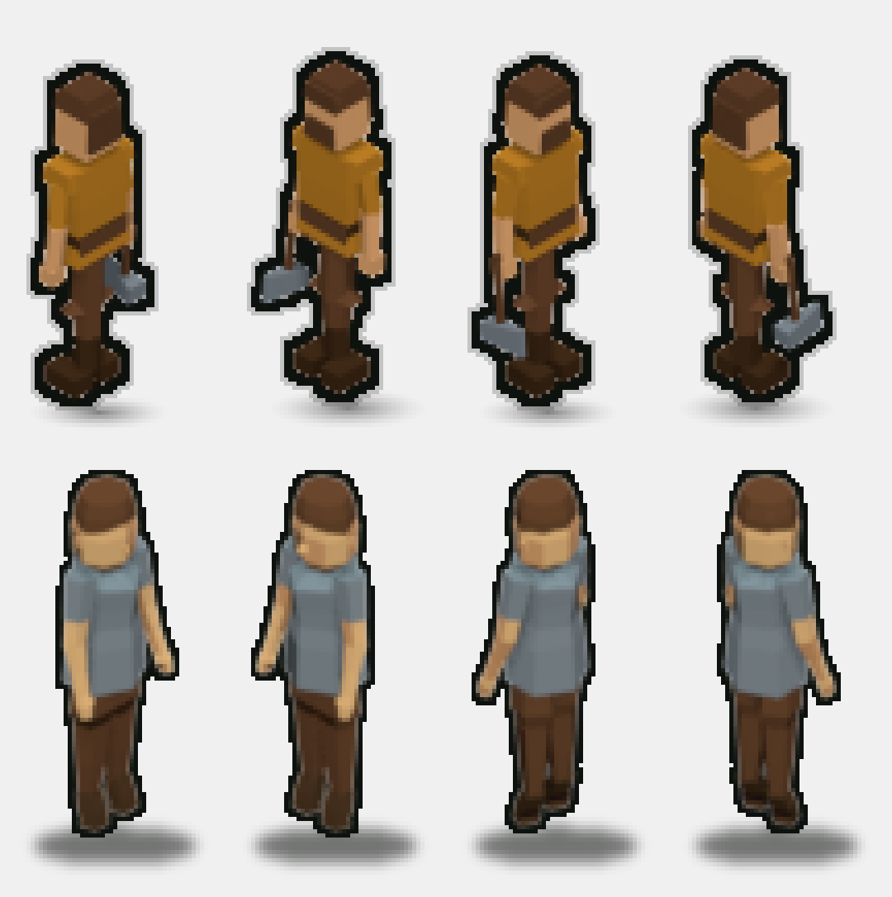
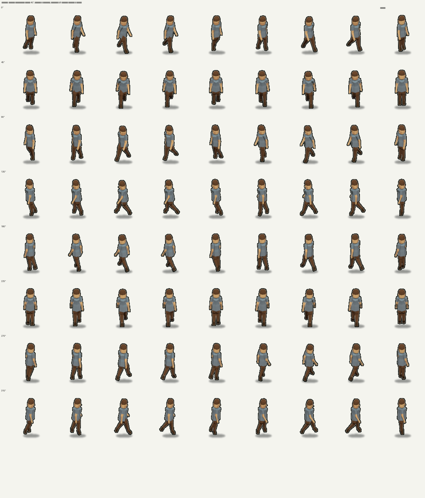
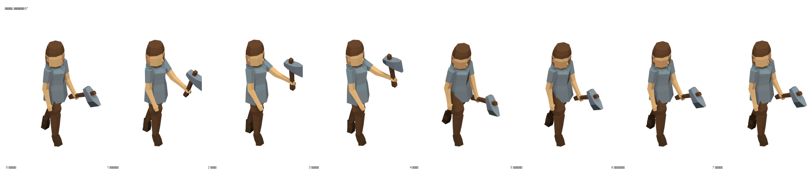

# Житель (villager) — мужской персонаж для mapgen2

Второй человек в игре — мужчина. Собран с нуля: параметрическая фигура на чистом
Python, сборка в **уже запущенном** Blender через MCP-сокет, приёмка числом —
стиль-гейт 352 кадра без единого FAIL и WARN.

**Итог:** `mapgen2/assets/villager/{atlas.png,atlas.json,atlas.js}` — 176 кадров
(idle 6, walk 8, work 8) x **8 поворотов** через 45°, клетка и опора те же, что у героя
(112 x 132, anchor 56,106). Третья анимация — **рубка дерева топором** (2026-10-14):
в кадрах `work` у жителя в правом кулаке топор, отсюда 670 трис вместо 598.
Плюс `out/villager.glb` и `out/villager.obj` (выгружаются в позе покоя, без топора).



Сверху — герой-лесоруб (эталон игры), снизу — житель, повороты 0/90/180/270.
Один масштаб, одна линия земли, одна клетка атласа, увеличение x5 без сглаживания.

## Что именно сделано

| Что | Число |
|---|---|
| Рост | **0.993 юнита** (у героя 0.982..1.008) |
| Треугольников / вершин | 598 / 344 в покое и на шаге, **670 / 384 в рубке** (топор; бюджет класса `hero` 300..700 / 180..480) |
| Крупных фасетов на кадр | 6..11, в них 33..64% площади (канон >=30%) |
| Палитра канона | 97.7..99.6% пикселей (порог 93%) |
| Контур | 2.00 px — как у героя |
| Тень | ширина/силуэт 0.94..1.08, h/w 0.14..0.20 (в рубке пятно шире — стойка) |
| Стиль-гейт | **352 из 352 кадров: 0 FAIL, 0 WARN** (`tools/gate.py`, 176 на 1x и 176 на @4x) |
| Приёмка фигуры | `tools/metrics.py --variant m`: ИТОГ ПРИНЯТО (в том числе топор: 90°, кулак, клетка) |
| Приёмка шага | `tools/gait_probe.py`: ИТОГ ПРИНЯТО (симметрия 1.24, клиренс 2.5 px, руки 0%) |
| Изнанки / зазоры / z-fighting | 1 px на «носе» при виде 45/5 — было и до правки; в канонных видах 0 / 0 / 0 |
| **Топор не добавил дефектов** | `tools/xray.py probe --anim work --frame 3 --axe` | 0 зазоров, 0 z-fighting с топором; рукоять 9.0 x 33.2 px, голова 17.3 x 16.0 px (порог 2 px) |

### Восемь поворотов вместо четырёх (2026-10-13)

Заказчик: «важно, чтобы он ходил не только по двум осям вправо и налево, а
вообще как хочет, — так как это 3D-модель, он так может, то есть он должен быть
повёрнут к этому дереву и идти к нему».

В игре (`js/villager.js`) курс жителя — свободный угол, а атлас до этого знал
четыре поворота: на диагональном ходу спрайт смотрел бы вбок от движения.
Добавлены 45/135/225/315 — те же 22 кадра на каждый, тем же пайплайном
(`live_8.json`, `live_8_4x.json`), атлас стал 912 x 3216. Кадры 0/90/180/270
при этом **побитово те же**, что были: старый и новый атласы сверены попиксельно
по всем 88 прежним кадрам, расхождение 0.

Гейт прогнан заново на обоих масштабах: **352 из 352 кадров, 0 FAIL, 0 WARN**.
Новые углы ничего не сломали и в самой форме: полигонаж 598 трис, высота
0.995..0.997 юнита — те же числа, что на четырёх прежних поворотах.



Сверху вниз — 0/45/90/135/180/225/270/315°, слева восемь кадров ходьбы, справа
покой. Камера та же, что в игре (азимут 45°), поэтому 45° смотрит в камеру, а
225° — от неё.

### Чем мужчина читается на 96 ppu

Лица как лица в этом масштабе нет (замер эталона: внутри кожи ноль тёмных
пикселей), поэтому пол держится формой:

* **короткая стрижка** — широкая шапка волос по темени (верх 0.052, а не 0.036:
  конус на темени читался колпаком) с узким локоном-чёлкой;
* **борода** — тёмная оболочка по нижней части лица (подбородок -> усы), семья
  `trunk`: самая сильная мужская примета в этом размере;
* **квадратная челюсть** — скула x1.12, подбородок x1.18 к женским;
* **прямая рубаха до бедра** (`TUNIC_PROF`, семья `stone`) — без клеша, который
  превращал фигуру в колокол;
* **мешковатые штаны** (`trunk`, плотность 1.34) до голенища сапога;
* **плечи 31% роста** (шире таза), шея толще, кисти крупнее;
* **руки свободны** — ни корзины, ни сумки: лишний предмет в руке читался
  хозяйственным, а не рабочим;
* **детали, которые доехали до 1x**: уши (2..3 px), бакенбарды, сходящиеся с
  бородой, планка на груди (2 x 10 px), кисть с узким запястьем и широкой
  ладонью, широкая подошва под сапогом.

Обувь `leather`, кожа (лицо, шея, кисти) `skin`, волосы и борода `trunk` —
всё тона атласа игры.

### Топор в кулаке (2026-10-14)

Заказчик: «на время рубки дерева у жителя должен появиться топор в руке, причём
правильно расположенный, то есть **под 90 градусов относительно оси руки**, и
держать он его должен именно **в кулаке**, а не где-нибудь в локте». Заодно
третья анимация перестала быть «сбором» (наклониться и что-то поднять) и стала
**рубкой**: до этого жителю нечего было делать руками, и `work` в игре не
игралась вовсе.

Что сделано и чем это доказано:

| Что | Как | Число |
|---|---|---|
| Рукоять поперёк оси руки | `person.build_axe`: рукоять вдоль локального `+X` кисти, ось руки — локальный `+Z` | **90.0000°** в каждом из 8 кадров рубки |
| Черенок проходит через КУЛАК | середина кисти посажена на ось черенка, `AXE_GRIP` | расстояние до оси **0.0000**, хват на **22%** рукояти от комля |
| Топор только в рубке | `person.build(..., axe=True)` зовётся для `anim='work'` | в покое и на шаге 598 трис, в рубке **670** (бюджет 700) |
| Голова — железо, а не камень | канон `art/props/axe/README`: камень валунов; у жителя рубаха того же семейства `stone` | каменная голова сливалась с плечом на 4x |
| Голова меньше канонной | станции `axe.py` сжаты до 0.87 по лезвию и 0.80 по высоте | канонная (0.22 × 0.17) в кулаке читалась кувалдой |
| Замах «перед лицом», не через голову | `poses.WORK`: `sh+el = 86°` на замахе | верх кадра 97.0 px из 106; рука над головой даёт 105..110 px — обрез клетки |

Проверяется это **двумя** инструментами, и оба считают по геометрии, а не по
картинке: `tools/metrics.py` (угол, кулак, хват, габарит — в общей приёмке
фигуры) и `tools/axe_probe.py` (то же по всем восьми кадрам рубки плюс докудова
достаёт кромка — из этого числа игра берёт сдвиг `STAND_OFF`, с которого житель
рубит: 0.47 юнита против 0.88 до коры).



Кадры рубки, 4x: 0 — топор у пояса, 3 — замах, 4 — удар, 6 — отдача.

## Мужское и женское — одна модель, два параметра

Тело, скелет и позы общие, пол — это `variant`:

| Что меняется | `variant='m'` (мужчина) | `variant='f'` (женщина) |
|---|---|---|
| Плечи `SHLD_X` | 0.096 (31% роста) | 0.078 (26%) |
| Таз `HIP_X` | 0.038 | 0.034 |
| Шея `NECK_R` | 0.040 | 0.030 |
| Плотность рук / ног | 1.16 / 1.34 (штаны) | 1.00 / 1.00 |
| Одежда | рубаха до бедра + штаны | платье + фартук |
| Голова | короткая стрижка + борода | платок с узлом и косынками |
| В руке | топор, и только в кадрах рубки | корзина |
| Полигонаж | 550 трис | 658 трис |

Женская сборка осталась рабочей: `person.build(variant='f')` и `live_f.json`.

## Как это устроено

```
tools/geom3d.py      примитивы: кольцо, лофт, короб, зеркало, матрицы. Без Blender
tools/person.py      анатомия: SPEC + SPEC_M, скелет (FK), детали, ground_lock
tools/poses.py       idle / walk / work — углы суставов, не новые меши
tools/gait_probe.py  приёмка ШАГА: ступня относительно таза, симметрия, колено, руки
tools/metrics.py     приёмка фигуры: пропорции, нормали, симметрия, бюджет
tools/xray.py        софт-рендер и дефекты: изнанки, зазоры, z-fighting, «мельче 2 px»
tools/gate.py        стиль-гейт по всем 352 кадрам одной командой (было — руками)
tools/scene.py       сцена `villager`, КАМЕРА КАНОНА ИГРЫ, свет и рендер
tools/build.py       меш, материалы, тона по нормалям, кадр, выгрузка
tools/build_live.py  точка входа: рендер всех кадров в живом Blender
tools/compose.py     контур, тень, посадка в клетку 112x132
tools/fit_shadow.py  подбор тени ЗАМЕРОМ (сетка -> композит -> гейт)
tools/axe_probe.py   замер топора в кулаке: угол 90°, кулак, габарит кадра
tools/pack_atlas.py  упаковка атласа в формат героя — сразу в mapgen2/assets/villager/
```

Пересобрать всё:

```bash
PY=/Users/hermmoment/.dsh/dsh-runtimes/dsh-primary-runtime/dependencies/python/bin/python3
$PY tools/metrics.py --variant m                      # приёмка формы и топора (без Blender)
$PY tools/gait_probe.py                               # приёмка шага (без Blender)
$PY tools/xray.py probe                               # дефекты (без Blender)
$PY tools/axe_probe.py                                # замер топора по 8 кадрам рубки
$PY tools/blmcp.py run tools/build_live.py --config live_config.json   # кадры 1x, повороты 0/90/180/270
$PY tools/blmcp.py run tools/build_live.py --config live_8.json        # кадры 1x, добавка 45/135/225/315
$PY tools/blmcp.py run tools/build_live.py --config live_4x.json       # кадры 4x, повороты 0/90/180/270
$PY tools/blmcp.py run tools/build_live.py --config live_8_4x.json     # кадры 4x, добавка 45/135/225/315
# только рубка (топор в кулаке) — 64 кадра вместо 176, если правились одни они:
$PY tools/blmcp.py run tools/build_live.py --config live_work.json      # 1x, 0/90/180/270
$PY tools/blmcp.py run tools/build_live.py --config live_work_8.json    # 1x, 45/135/225/315
$PY tools/blmcp.py run tools/build_live.py --config live_work_4x.json   # 4x, 0/90/180/270
$PY tools/blmcp.py run tools/build_live.py --config live_work_8_4x.json # 4x, 45/135/225/315
$PY tools/compose.py --tag vg  --anims idle,walk,work --out out  --rotations 0,45,90,135,180,225,270,315
$PY tools/compose.py --tag vg4 --ppu 384 --res 576,768 --out out4 --anims idle,walk,work --rotations 0,45,90,135,180,225,270,315
$PY tools/gate.py                                     # 352 кадра стиль-гейтом
$PY tools/pack_atlas.py --src out --tag vg --name villager
# выгрузка для движка (мужская фигура в позе покоя, БЕЗ топора):
$PY tools/blmcp.py run tools/build_live.py --config live_export.json
```

Профиль для глазами: поворот 135° ставит камеру ровно сбоку (лицо в профиль) —
на нём шаг видно честно, на 0/90/180/270 он читается в ракурсе:

```bash
$PY tools/blmcp.py run tools/build_live.py --config live_walk_side.json
$PY tools/compose.py --tag vgws --ppu 384 --res 576,768 --out out4 --anims walk --rotations 135
```

Blender должен быть УЖЕ ОТКРЫТ: сборка идёт в своей сцене `villager`, со своим
префиксом `vg_`, чужой файл не сбрасывается и не сохраняется (`.blend` — только
копией). Если сокет замолчал: `N` -> вкладка **Blender MCP** -> **Connect**.

## Три находки, которые меняют работу над персонажем в этом проекте

### 1. Рост человека — 1.0 юнита, а не 0.81

Вертикальная ось проекта сжата косинусом подъёма (`UP.z = 0.8165`), поэтому
1 юнит = **78.4 px**, а не 96. Силуэт героя 88 px — значит он 1.0 юнита, ровно
как записано в каноне домов («человек 1.0, дверь 0.72 — по плечо»). Замер
эталона (`references/hero-reference.md`) подтверждает: h = 0.982..1.008.

### 2. Камера: пайплайн проекта смотрит на 90° мимо игры

Игра считает ближе к камере того, у кого больше `x + y`
(`js/render.js`: `sx = (x−y)·tw/2`, `sy = (x+y)·tw/4`; `mapgen2/README`:
«по земле он честно ближе камеры (x + y больше)»). Значит камера стоит в
квадранте **+X +Y**, и модель, смотрящая в +X, видна спереди-слева.

Общий пайплайн (`art/buildings/townhall/tools/thpipe.py::setup_camera`) ставит камеру в
**−X +Y** — на 90° мимо. Атлас героя отрендерен именно так: доказано замером
топора (он висит у ПРАВОГО бедра: −0.158 по Y, +0.038 по X; при камере из +X+Y
тот же спрайт требовал бы, чтобы топор висел на 0.158 юнита ПЕРЕД телом).
Житель отрендерен по канону игры (`tools/scene.py::setup_camera`).

### 3. Кэш модулей живого Blender

`blmcp.py run` выкидывает из `sys.modules` СПИСОК ИМЁН. В клиенте из проекта
лопаты в нём не было `person`, `poses`, `geom3d`, `build` — правка анатомии не
подхватывалась, рендер молча шёл старым кодом (16 кадров падали в гейте).
Список обновлён — **при копии клиента в новый проект правьте его первым делом**.

И отдельно: **патч, который не применился, страшнее отсутствующего.** Правка
ног (штаны вместо голой кожи) один раз не сработала из-за несовпадения якоря —
и мужчина вышел с голыми ногами, то есть читался женщиной. Теперь все правки
геометрии идут с `assert` на якорь.

## Приёмка: что и чем доказано

| Проверка | Чем | Результат |
|---|---|---|
| Пропорции, симметрия, нормали, бюджет | `tools/metrics.py --variant m` | ИТОГ: ПРИНЯТО |
| Штаны не вылезают из-под рубахи | он же, `cloth_cover` (круг ноги против шестиугольника одежды) | запас +0.025 (2.4 px) |
| **Шаг: симметрия, фаза колена, клиренс, обе руки** | `tools/gait_probe.py` | ИТОГ: ПРИНЯТО — 1.24 / пик 315° / 2.5 px / 0% |
| Зеркальность конечностей | он же + разбор вершин (см. находку 5) | 0.00 px (было 4.87 px) |
| Видимые изнанки, зазоры, z-fighting, детали < 2 px | `tools/xray.py probe` | 0 зазоров, 0 z-fighting, 0 деталей < 2 px; 1 px изнанки на «носе» (был и до правки) |
| **Топор: 90° к оси руки, черенок в кулаке** | `tools/metrics.py --variant m`, `tools/axe_probe.py` | отклонение 0.0000°, расстояние до оси кулака 0.0000, хват 22% рукояти от комля |
| **Топор: кадр рубки влезает в клетку** | он же, габарит по 8 поворотам | верх 97.0 px из 106 (замах держится на `sh+el = 86°`) |
| Палитра, детализация, контур, тень, полигонаж | `tools/gate.py` -> `4tox-lowpoly-3d/scripts/audit.py` | 352/352 кадра: 0 FAIL, 0 WARN |
| Тень против эталона | `tools/fit_shadow.py` (сетка -> замер) | w/sil 0.94..1.08, h/w 0.14..0.20 (у героя 0.97 / 0.145) |
| Форма со всех ракурсов | листы `out/show/m4_*.png`, `m5_*.png` | читается на 0/90/180/270 |
| Ходьба до и после | `out/show/walk_before_after_{0,90}.png`, профиль `walk_profile_135.png` | шаг симметричен, обе руки качаются |
| Выгрузка | `out/villager.glb`, `out/villager.obj`, `villager.blend` | GLB проверен импортом |

### 4. Штаны шире рубахи — это видно сразу

Заказчик увидел это раньше любых метрик: бугры по бокам туники. Причина —
мешковатость штанов (1.34) применялась на ВСЮ длину бедра, включая скрытую под
рубахой часть. Теперь штаны узкие в бёдрах и мешковатые ниже подола, рубаха
шире в бёдрах по Y (ноги разнесены по Y, а не по X), а проверка
`metrics.cloth_cover` считает запас честно: круг ноги против шестиугольника
одежды через опору эллипса. Ловушка: «на глаз» по bbox этого не поймать —
вершины шестиугольника и его грани стоят на разном расстоянии от оси
(`ry` против `ry·cos30`), и запас отличается на 13%.

### 5. Ходьба: две ошибки, которые видно только замером

Заказчик (2026-10-13): «ноги уходят назад, колени чуть сгибать, двигается одна
рука». Обе причины — в числах, и обе ловятся прибором, а не глазом.

**а) Колено гнулось не в той фазе.** Пик сгиба стоял на фазе 218°, а бедро
разгибалось до −21° на фазе 270°: колено складывалось ровно тогда, когда нога
шла назад, и отбрасывало ступню за таз. Замер (`tools/gait_probe.py`): ступня
уходила вперёд на +0.12 юнита и назад на −0.25 — **асимметрия 2.05x**, то есть
шаг читался ходьбой задом наперёд. Теперь сгиб живёт на ПЕРЕНОСЕ (пик 315°,
между отрывом 270° и выносом вперёд 45°), бедро сгибается вперёд больше, чем
разгибается назад (`sin + sin²`), и отношение стало **1.24** при шаге опоры
0.253 юнита = 19.8 px. Профиль для глаза: `--rotations 135` — камера ровно
сбоку, на 0/90/180/270 шаг читается в ракурсе и «на глаз» врёт.

**б) Качалась одна рука.** Левая качалась на 5° против 15° у правой: поза
«несу корзину» осталась от женской фигуры, а у мужчины в руках ничего нет.
Но одной правки амплитуды не хватило — под ней лежала ошибка скелета.

**в) Правая сторона не была зеркалом левой.** Геометрия правой руки и ноги
строится по тем же формулам с +Y и зеркалится через `G.mirror_y` — но
зеркалилась ТОЛЬКО геометрия, а родитель (таз, грудь) у правой кости оставался
незеркалённым. Поэтому `twist` и `side` уводили ОБЕ стороны в одну сторону по
X: замер — правое плечо уезжало вперёд на 0.013 юнита (1 px) относительно
своего гнезда в тунике, а правая рука качалась на 27% шире левой. Лечение:
`person._parent` даёт правой стороне зеркального родителя `S·M·S`. Проверка
«правая кость кадра f == зеркало левой кости кадра f+4»: **0.00 px** (было
4.87 px). При `twist = side = 0` зеркало совпадает с копией, поэтому **покой и
выгрузка в движок не изменились ни на бит** (проверено сравнением вершин), а
`work` сдвинулся на ≤4.3 px — это и есть та же ошибка, но в рубке.

## Границы и что дальше

* **Анимация собрана углами, без армтуры.** Форма живёт в чистом Python, её
  можно измерить и повторить; MCP — только способ запуска. Новые анимации —
  правка `poses.py`, а не меша. Числа шага (`WALK_*` в `poses.py`) подобраны
  замером `tools/gait_probe.py`; менять их на глаз не стоит — фаза колена
  ошибается незаметно, а читается как «идёт задом наперёд».
* **`work` — это рубка** (с 2026-10-14): в кадрах у жителя в правом кулаке
  топор, игра играет их пять секунд на дерево (`js/villager.js`). Имя анимации
  осталось прежним, `work`: его читает `atlas.json`, и переименование потянуло
  бы за собой формат. Сбор (наклониться и поднять) из этих кадров убран —
  если понадобится, это новая анимация, а не правка этой.
* **Шаг не «бежит».** Размах выбран по герою: у эталона ходьба — спокойный шаг,
  а не спортивная. Если понадобится шире, `WALK_HIP_F`/`WALK_HIP_D` двигаются
  вместе: один `HIP_F` без `HIP_D` снова уводит ступню назад.
* **Героя не трогал.** Его атлас и его спрайты не изменены; атлас жителя лежит
  рядом, в новой папке. А вот в `mapgen2/js/*` правки есть, и они про рубку:
  `villager.js` (состояние `chop`, пять секунд, восемь ударов, падение дерева,
  подход к стволу), `render.js` (тряска дерева `treeShake`) и `app.js` (счётчик
  деревьев в панели обновляется, когда дерево срублено).
* **Выгрузка `.glb`/`.obj` — мужская фигура, без топора.** Топор живёт в кадрах
  рубки, а выгрузка — это фигура для движка в позе покоя. Заодно исправлено:
  `export_model` собирал вариант строкой `'a'`, которой в `pose_of` нет, и
  `pose_of` молча отдавал ЖЕНСКУЮ фигуру — «мужской» `villager.glb` был женским
  (442 вершины вместо 344). Теперь вариант берётся из `VARIANT` конфига.
* **В игре он рисуется в 2.2 раза мельче атласа — и это не правка модели.**
  Заказчик (2026-10-13): «персонаж в игре слишком большой, уменьшить его в
  масштабе в 2.2 раза». Решение живёт в игре, одним числом `SHRINK` в
  `mapgen2/js/villager.js`: им делится и масштаб кадра, и шаг (1.26 → 0.573
  клетки/с). Рост на экране: 1.18 клетки → 0.54. **Атлас, модель и приёмка
  этого проекта не переписаны**: `mul = 1.35` в нём по-прежнему крупность мира,
  общая с растительностью, а рост человечка — дело игры (см. `mapgen2/README.md`,
  «Житель»). Если когда-нибудь понадобится рисовать его «в натуральную
  величину», достаточно убрать это деление — атласный кадр к этому готов.
* **Светлый лён вместо серой ткани.** Рубаха в семье `salt` (светлый лён)
  выглядит контрастнее, но на ней метрика детализации @4x давала 26..29% при
  пороге 30% на одном-двух кадрах шага. Выбран вариант с 0 FAIL на всех 352.

## Состав проекта

| Файл | Что |
|---|---|
| `mapgen2/assets/villager/atlas.{png,json,js}` | атлас для игры (176 кадров, 8 поворотов) |
| `out/villager/*` | тот же атлас в проекте |
| `out/villager.glb`, `out/villager.obj` | модель для движка (Y вверх / Z вверх) |
| `villager.blend` | исходник сцены (копия, не файл заказчика) |
| `out/show/m1..m6_*.png` | выставочные листы: покой, ходьба, работа, повороты, сверка с героем |
| `out/show/walk_before_after_{0,90}.png` | ходьба «было / стало» в одной сетке кадров |
| `out/show/walk_profile_135.png` | ходьба в чистом профиле (камера ровно сбоку) |
| `references/hero-reference.md` | мерки эталона (342 строки) — то, по чему строилась фигура |
| `out/metrics.json`, `out/gate.json`, `renders/vg_report.json` | машинные отчёты приёмки, гейта и рендера |
| `out/villager_f/` | женская сборка той же модели (запас) |
