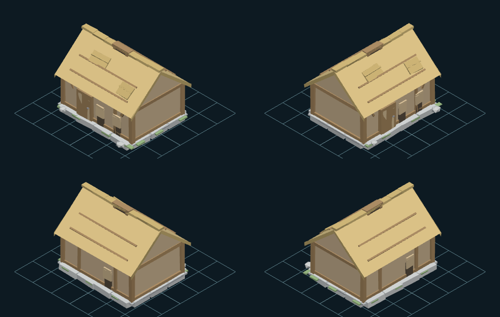

# Стенд моделей 4tox

Одна страница, на которой видно **все 3D-модели проекта** и то, что игра из них
рисует. Слева список, в середине 3D, справа числа и пути, снизу — кадры атласа.

Открывается двойным кликом: **`index.html`** (работает и по `file://`, и по
http — как `game/index.html` и `mapgen2/index.html`).



## Что он показывает

| | Что именно |
|---|---|
| **3D** | GLB из `out/` каждого проекта: орбита, каркас, габаритный ящик, сетка с клеткой 1 юнит = 1 клетка карты, вращение |
| **Повороты** | «4 поворота» — те же углы, что в именах кадров атласа (`_0/_90/_180/_270`), рядом с лентой кадров; у жителя ещё 8 поворотов через 45° |
| **Камера** | та, которой модель рисовал Blender: у ратуши, дома, лагеря и предметов −X +Y, у жителя +X +Y. Переключается кнопкой «камера» или клавишей `C` |
| **Числа** | треугольники, вершины, меши, материалы, габарит в юнитах, низ модели, размер файла, sha, палитра материалов |
| **Пути** | GLB, `.blend`, генератор формы, README проекта — ссылками |
| **Атлас** | кадры выбранной модели подсвечены рамкой, у персонажей — проигрыватель анимации с частотой из атласа |
| **Статус** | «в игре», «собран, не подключён» или «не в игре» — по тому, грузит ли атлас `game/index.html` или `mapgen2/index.html` |

Список отсортирован так, что **сначала идёт то, что игрок видит в игре**, и
стенд открывается на ратуше варианта C — той, которую ставит партия. Если
каталог и байты моделей разъехались (сборку прервали, браузер подхватил один
файл из двух), страница пишет об этом красной полосой сверху, а у таких моделей
в списке стоит пометка «нет байтов» — молча показывать пустое окно она не
должна.

Клавиши: `←` `→` — модель, `1…9` — по номеру, `I` — изометрия, `4` — четыре
поворота, `C` — камера, `F` — лист кадров во весь экран, `W` — каркас, `G` —
сетка, `B` — габарит, `пробел` — вращение, `R` — сброс камеры, `/` — поиск,
`?` — справка.

## Запуск и пересборка

Стенд ничего не грузит из сети: байты GLB лежат в `data/meshes.js` в base64
(приём тот же, что у `mapgen2/assets/*/atlas.js`), картинки атласов берутся
относительным путём. Поэтому он работает по `file://`.

```bash
python3 tools/build_catalog.py          # пересобрать каталог и байты моделей
python3 tools/build_catalog.py --check  # проверить, не устарел ли каталог
node tools/shot.js                      # приёмка в браузере + кадры в tools/out/
node tools/filecheck.js                 # то же, но БЕЗ флагов Chrome (двойной клик)
```

`filecheck.js` — отдельная проверка обещания «открывается двойным кликом»:
Chrome запускается без единого послабления (`shot.js` иначе берёт
`--allow-file-access-from-files`, чтобы прочитать пиксели кадра для сверки
цвета) и проверяется, что GLB разбирается из base64, картинка атласа грузится
относительным путём, кадры нарезаются, а в консоли пусто.

**После правки любой модели каталог надо пересобрать** — иначе стенд покажет
старое и не скажет об этом. `--check` возвращает 1, если `data/` разошлось с
репозиторием (время сборки в сравнении не участвует), так что это можно
повесить на проверку перед коммитом.

`shot.js` открывает стенд в headless Chrome и проверяет: каталог совпадает со
страницей; **каждая** модель открывается и число треугольников в three.js
совпадает с числом, которое `build_catalog.py` посчитал по самому GLB (два
независимых разбора одного файла); лента кадров нарезается; камера у каждой
модели та, что объявлена; средний цвет модели во вьюпорте не разъехался со
средним цветом её кадра атласа (Δ ≤ 45 из 255); в консоли нет ошибок.
Кадры складываются в `tools/out/` (в git не идут, как у приёмок игры). Несколько
отобранных лежат в `show/` — на них ссылается этот README:

| Кадр | Что видно |
|---|---|
| `show/townhall-iso.png` | с этого стенд открывается: ратуша варианта C, та же, что ставит игра |
| `show/townhall-quad.png` | ратуша: 4 поворота в 3D и те же кадры атласа под ними |
| `show/villager-walk.png` | житель: камера канона игры, лента ходьбы, проигрыватель |
| `show/lumbercamp.png` | лагерь лесоруба — модель, которую до этого нельзя было открыть |
| `show/atlas-without-3d.png` | атлас без 3D-исходника: что стенд говорит и что показывает |

## Что нашлось по дороге и почему стенд устроен именно так

Четыре вещи, которые в репозитории нигде не были записаны числами. Стенд их
показывает, потому что без них он показывал бы не то, что в игре.

**1. Камеры рендера разные, и их три.** Ратуша, дом, лагерь, топор и лопата
рендерились общим пайплайном (`thpipe.py`/`pview.py`) из квадранта **−X +Y**;
житель — камерой канона игры (`villager/tools/scene.py`) из **+X +Y**; дом из
разбора — своей из **+X −Y**. Разбор жителя — в
[art/characters/villager/README.md §2](../../characters/villager/README.md).
Стенд берёт камеру каждой модели из каталога и даёт переключить.

**2. У камеры жителя левый базис.** Определитель `det(right, up, eye)`: у
`thpipe.py` **+1** (обычная камера), у `scene.py` жителя **−1**. Значит кадр
атласа жителя зеркален обычному взгляду из той же точки. Проверено не на
глаз: геометрия жителя спроецирована на позу рубки (она резко несимметричная —
топор в правом кулаке) и сравнена с кадром `villager_work_4_0` — совпадение
силуэтов **IoU 0.69** против **0.47** у зеркального варианта. Стенд повторяет
отражение, иначе «4 поворота» показывали бы не тот бок.

**3. Хижина и ратуша выгружены развёрнутыми на 180°.** Их экспортёры
(`export_hut_rect.py`, `export_townhall.py`) разворачивают геометрию, чтобы
дверь смотрела в glTF +Z, а кадры атласа рисовались без этого. Проверено
замером: в спрайте `hutrect_b_0` труба стоит на **39.7 px левее** центра
силуэта, а в GLB при повороте 0 — на **39.4 px правее** (80 ppu). Стенд
разворачивает обратно, поэтому квадрант 0° = кадр `_0`.

**4. Трём атласам не хватало GLB** — ратуше, лагерю и волнам: их 3D-исходники
никогда не выгружались, и в стенде они были видны только спрайтами. Теперь
выгружены: `art/buildings/townhall/tools/export_townhall.py` (новый),
`art/buildings/lumbercamp` с конфигом `live_export.json` и
`art/fx/waves/tools/export_waves.py` (новый).

## Что осталось неидеальным

* **`sprites/` и `hero/` в 3D не показываются и не будут.** Это унаследованные
  атласы: исходных моделей в репозитории нет (docs/STRUCTURE.md §7.4). Стенд по
  ним честно пишет, что 3D-исходника нет и восстановить его не из чего, и
  показывает спрайты — 64 кадра деревьев и камней, 88 кадров лесоруба.
* **Стенд показывает модель, а не движок.** Свет и материалы подобраны так,
  чтобы средний цвет сходился со спрайтом (замер в приёмке), но это three.js,
  а не Blender: точного совпадения тона фасетов ждать не надо. Разница по
  среднему цвету — 17…34 из 255, у жителя больше всех (в его спрайте крупная
  тень).
* **Ленты кадров показывают не все кадры атласа сразу.** У моделей с
  вариантами — все четыре поворота каждой строки; у персонажей — все кадры
  выбранной анимации и поворота, а анимации переключаются кнопками. Полный
  лист жителя — 176 кадров, в панель высотой 292 px он не влезает; кнопка
  «во весь экран» (`F`) разворачивает ленту на всю высоту.
* **Каталог — снимок, а не живой индекс.** Модель перерисовали — надо
  пересобрать (`tools/build_catalog.py`). `--check` есть, автоматического
  хука на коммит нет.
* **Волны — пять почти одинаковых гребней.** Формы 0…4 отличаются длиной и
  профилем вала, в списке это пять строк. Так и есть в атласе: 5 форм × 2
  поворота.
* **`thpipe` ищется тремя уровнями вверх** — новый инструмент в `tools/`
  проекта считает корень сам (docs/STRUCTURE.md §6.1). В `build_waves.py` и ещё
  14 файлах остался путь времён, когда `townhall/` лежал в корне репозитория;
  у них импорт `thpipe` не находится. Стенда это не касается, но починить надо.

## Файлы

```
art/tools/model-stand/
├── index.html            страница стенда
├── css/stand.css         палитра взята из mapgen2/css/style.css
├── js/stand.js           список, карточка, вьюпорт, лента кадров
├── vendor/               three.js r147 (UMD), OrbitControls, GLTFLoader
├── data/                 собирается: catalog.{json,js}, meshes.js (GLB в base64)
├── show/                 кадры для этого README, отобранные руками
├── tools/
│   ├── build_catalog.py  обход репозитория → каталог
│   ├── shot.js           приёмка в браузере + кадры
│   └── out/              кадры приёмки, в git не идут
```

`vendor/` лежит в репозитории намеренно: стенд должен открываться без сети и
без `pnpm install`. three.js r147 — последняя версия с UMD-сборкой; на
ES-модулях страница по `file://` не работает (CORS), а `file://` для проекта
обязателен — на нём же держится `atlas.js` у игры.
